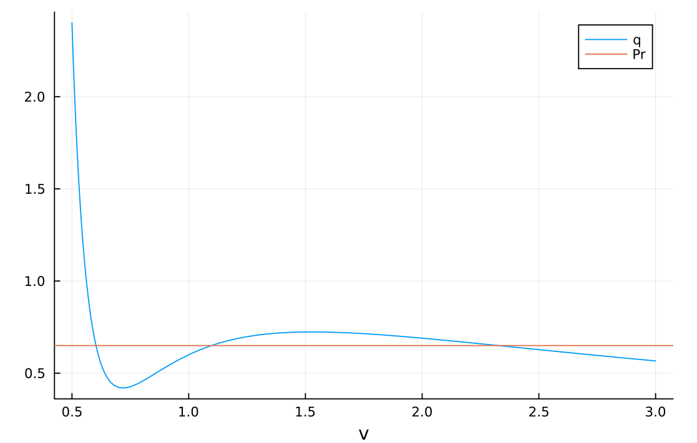
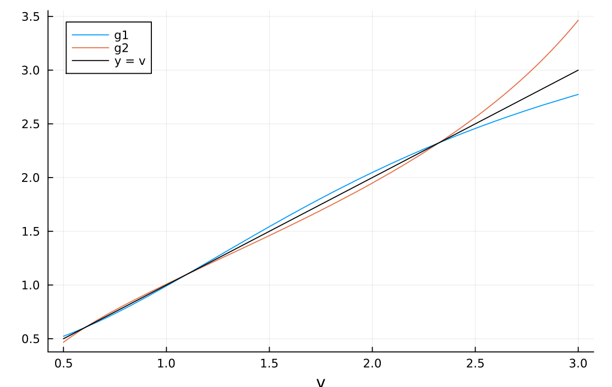

Si se conocen la temperatura $T$ y la presión $P$ de un gas, ¿qué volumen $V$ ocupa? Para un gas ideal la respuesta es inmediata: $V = RT/P$, donde $R$ es la constante de los gases y $V$ es el volumen de una cantidad fija de gas (un mol). Para un gas real como el CO₂, el modelo más sencillo es la ecuación de van der Waals,

$$\left(P + \frac{a}{V^2}\right)(V - b) = RT, \tag{1}$$

donde $a > 0$ mide la atracción entre las moléculas y $b > 0$ el espacio que ellas mismas ocupan; cada gas tiene sus propios $a$ y $b$. Con $T$ y $P$ dadas, $V$ es raíz de un polinomio cúbico. Con Cardano tendríamos una fórmula (inmanejable), pero aquí encontraremos $V$ con los métodos del curso.

Una cúbica puede tener hasta tres raíces reales (siempre al menos una), y aquí eso tiene sentido físico. A temperatura baja, una misma temperatura y presión pueden corresponder a dos estados del CO₂: líquido (volumen pequeño) y vapor (volumen grande). Es lo que pasa en una olla de agua hirviendo, donde conviven el agua y el vapor. La tercera raíz, entre esas dos, no se observa: en ella, al comprimir el gas su presión bajaría en vez de subir, y cualquier perturbación lo lleva al líquido o al vapor.

Al subir la temperatura, el líquido y el vapor se parecen cada vez más, hasta que en una temperatura llamada crítica, $T_c$, se vuelven indistinguibles. Por encima de $T_c$ no hay ebullición: al comprimir el CO₂ su densidad aumenta de forma continua sin que aparezca nunca un líquido separado, y se dice que es un fluido supercrítico. En la ecuación, el punto crítico es el único donde las tres raíces se juntan en una raíz triple. La temperatura, la presión y el volumen en ese punto se llaman $T_c$, $P_c$ y $V_c$; para van der Waals, $T_c = 8a/(27Rb)$, $P_c = a/(27b^2)$ y $V_c = 3b$.

Conviene medir todo en unidades del punto crítico. La temperatura, la presión y el volumen reducidos son $T_r = T/T_c$, $P_r = P/P_c$ y $v = V/V_c$; por ejemplo, $T_r = 0.9$ es el 90 % de la temperatura crítica. En esas variables desaparecen $a$, $b$ y $R$, y la ecuación es la misma para cualquier gas:

$$\left(P_r + \frac{3}{v^2}\right)(3v - 1) = 8T_r. \tag{2}$$

En papel, demuestren que a partir de la ecuación (2) se obtiene la cúbica

$$p(v) = 3P_r v^3 - (P_r + 8T_r)v^2 + 9v - 3 = 0. \tag{3}$$

Casi todo el taller estudia el CO₂ con $T_r = 0.9$ y $P_r = 0.65$, es decir, a 90 % de su temperatura crítica y a 65 % de su presión crítica, un poco por debajo del punto crítico. Confirmen, usando Julia como calculadora, que para ese caso la cúbica es

$$p(v) = 1.95v^3 - 7.85v^2 + 9v - 3. \tag{4}$$

Esta ecuación (4) tiene tres raíces: el líquido, el estado intermedio (inobservable e inestable) y el vapor. Calculen a mano su derivada $p'$. Usen `newton` del libro, con $p$ y $p'$, y la función `punto_fijo` del taller de estudio.

::: {.callout-tip title="Solución"}
Al multiplicar (2) por $v^2$ queda $(P_r v^2 + 3)(3v - 1) = 8T_r v^2$, es decir $3P_r v^3 - P_r v^2 + 9v - 3 - 8T_r v^2 = 0$, que es (3). Con $T_r = 0.9$ y $P_r = 0.65$: $3\cdot 0.65 = 1.95$ y $0.65 + 8\cdot 0.9 = 7.85$, lo que da (4).

La derivada, a mano, es $p'(v) = 9P_r v^2 - 2(P_r + 8T_r)v + 9$, que para este caso vale $p'(v) = 5.85v^2 - 15.7v + 9$.
:::

Comprueben primero a mano que con $T_r = P_r = 1$ la cúbica (3) se reduce a $3(v - 1)^3$: una raíz triple en $v = 1$, el punto crítico. Luego despejen a mano $P_r$ de la ecuación (2) en función de $v$ y $T_r$; llamen $q(v)$ al resultado, que es la presión que la ecuación asigna al volumen $v$. Entreguen en papel la verificación y el despeje. Ya en la computadora, grafiquen la $p$ del CO₂ con $T_r = 0.9$ y $P_r = 0.65$, es decir la ecuación (4), en $[0.5, 3]$ junto con el eje horizontal, y lean a ojo en qué intervalos de ancho 0.1 están sus tres raíces. Grafiquen también $q$ con $T_r = 0.9$ junto con la recta horizontal $P_r = 0.65$: las tres raíces son los cruces. Identifiquen cuál corresponde al líquido (volumen pequeño, mayor densidad) y cuál al vapor. Del estado intermedio no basta con decir que está en el medio: un fluido estable se resiste a ser comprimido, porque si se reduce un poco su volumen la presión sube y lo empuja de vuelta. Con eso expliquen por qué ese cruce corresponde a un volumen inestable que no puede observarse. *(10 pts)*

::: {.callout-tip title="Solución"}
```julia
p(v)  = 1.95v^3 - 7.85v^2 + 9v - 3
dp(v) = 5.85v^2 - 15.7v + 9
q(v, Tr) = 8Tr/(3v - 1) - 3/v^2

plot(p, 0.5, 3; label="p", xlabel="v")
hline!([0]; color=:black, label="")

plot(v -> q(v, 0.9), 0.5, 3; label="q", xlabel="v")
hline!([0.65]; label="Pr")
```

{#fig-q width=70%}

Con $T_r = P_r = 1$, $p(v) = 3v^3 - 9v^2 + 9v - 3 = 3(v - 1)^3$. Del despeje, $P_r + 3/v^2 = 8T_r/(3v - 1)$, así que $q(v) = 8T_r/(3v - 1) - 3/v^2$.

Las tres raíces están en $[0.6, 0.7]$, $[1.0, 1.1]$ y $[2.3, 2.4]$ (cerca de 0.60, 1.10 y 2.33). La menor es el líquido (volumen pequeño, mayor densidad) y la mayor es el vapor.

La curva $q$ baja hasta un mínimo local cerca de $v = 0.72$ (presión 0.42), sube hasta un máximo local cerca de $v = 1.53$ (presión 0.72) y vuelve a bajar. En los cruces cerca de 0.60 y 2.33 la presión baja al aumentar el volumen ($q'$ vale $-5.65$ y $-0.13$): si el fluido se comprime un poco, la presión sube y lo empuja de vuelta, así que son estables. En el cruce cerca de 1.10 la presión sube al aumentar el volumen ($q'$ vale $0.43$): si el fluido se comprime un poco, su presión queda por debajo de $P_r$ y la compresión continúa hasta el líquido; si se expande un poco, queda por encima de $P_r$ y la expansión continúa hasta el vapor. Por eso el estado intermedio no se observa.
:::

Ahora estudien cómo se comporta Newton según la semilla. Corran `newton` (`maxiter` $= 60$, `ftol` $=$ `xtol` $= 10^{-13}$) desde 1001 semillas igualmente espaciadas en $[0.3, 4]$, guarden el último iterado de cada una y grafiquen la raíz alcanzada contra la semilla. Lean en su gráfica qué intervalos de semillas llevan a cada raíz y señalen los resultados que no esperarían, es decir, semillas que terminan lejos de la raíz más cercana. *(10 pts)*

::: {.callout-tip title="Solución"}
```julia
semillas  = range(0.3, 4; length=1001)
alcanzada = [last(newton(p, dp, s; maxiter=60, ftol=1e-13, xtol=1e-13)) for s in semillas]

scatter(semillas, alcanzada; ms=2, legend=false,
        xlabel="semilla", ylabel="raíz alcanzada")
```

![Raíz alcanzada por `newton` contra la semilla, con 1001 semillas en $[0.3, 4]$.](newton-semillas.png){#fig-semillas width=70%}

Aproximadamente: de 0.3 a 0.83 llegan al líquido (0.603); de 0.87 a 1.65 a la raíz intermedia (1.097); y desde 1.85 en adelante al vapor (2.325). Lo inesperado está en dos franjas: las semillas entre 1.67 y 1.85 terminan en el líquido, a más de 1.0 de distancia, aunque están más cerca del vapor; y las semillas entre 0.83 y 0.86 saltan hasta el vapor. Hay además ventanas diminutas alternadas cerca de 0.86 y 1.66. Los cambios ocurren cerca de $v = 0.83$ y $v = 1.85$, que son los ceros de $p'$: la tangente es casi horizontal y el primer paso de Newton lanza el iterado muy lejos.
:::

Pasemos al punto fijo. La ecuación (2) se puede despejar de dos maneras para obtener una función $g$ cuyos puntos fijos son las raíces de $p$. Deduzcan las dos en papel: para $g_1$, dividan la ecuación (2) entre $P_r + 3/v^2$ y despejen $v$ del factor $3v - 1$; para $g_2$, dividan la ecuación (2) entre $3v - 1$, pasen $P_r$ al otro lado y despejen $v$ de $3/v^2$. Entreguen los despejes en papel. Grafiquen $g_1$ y $g_2$ junto con la identidad $y = v$ en $[0.5, 3]$: los cruces con la identidad son los puntos fijos y deben coincidir con las tres raíces de $p$ (si no coinciden, revisen el despeje). Antes de iterar, lean en la gráfica qué raíces atrapa cada despeje, recordando que un punto fijo atrae cuando $|g'| < 1$ en él. Programen una derivada numérica centrada, `derivada(h, x)` $= (h(x + \delta) - h(x - \delta))/(2\delta)$ con $\delta = 10^{-6}$, y calculen $g_1'$ y $g_2'$ en las tres raíces para confirmarlo. Compruébenlo con `punto_fijo` (`ftol` $= 10^{-8}$, `xtol` $= 0$): $g_1$ desde las semillas 0.5 y 2, y $g_2$ desde la semilla 1.2. Reporten redactando en el cuadernillo las iteraciones y raíz alcanzada. *(10 pts)*

::: {.callout-tip title="Solución"}
Para $g_1$, al dividir (2) entre $P_r + 3/v^2$ queda $3v - 1 = 8T_r/(P_r + 3/v^2)$, y despejando $v$:

$$g_1(v) = \frac{1}{3}\left(1 + \frac{8T_r}{P_r + 3/v^2}\right).$$

Para $g_2$, al dividir (2) entre $3v - 1$ queda $P_r + 3/v^2 = 8T_r/(3v - 1)$, luego $3/v^2 = 8T_r/(3v - 1) - P_r$ y

$$g_2(v) = \sqrt{\frac{3}{\dfrac{8T_r}{3v - 1} - P_r}}.$$

```julia
Tr, Pr = 0.9, 0.65
g1(v) = (1 + 8Tr/(Pr + 3/v^2)) / 3
g2(v) = sqrt(3 / (8Tr/(3v - 1) - Pr))

plot(g1, 0.5, 3; label="g1", xlabel="v")
plot!(g2, 0.5, 3; label="g2")
plot!(identity, 0.5, 3; label="y = v", color=:black)

derivada(h, x; δ=1e-6) = (h(x + δ) - h(x - δ)) / (2δ)

rs = [last(newton(p, dp, s; ftol=1e-14, xtol=0)) for s in (0.5, 1.0, 2.0)]
[derivada(g1, r) for r in rs], [derivada(g2, r) for r in rs]

punto_fijo(p, g1, 0.5; maxiter=3000, ftol=1e-8, xtol=0)
punto_fijo(p, g1, 2.0; maxiter=3000, ftol=1e-8, xtol=0)
punto_fijo(p, g2, 1.2; maxiter=3000, ftol=1e-8, xtol=0)
```

{#fig-g width=70%}

**(a)** Los cruces de $g_1$ y $g_2$ con la identidad están en 0.603, 1.097 y 2.325, las raíces de $p$.

**(b)** Para $g_1$: 0.829 en el líquido, 1.104 en la intermedia y 0.789 en el vapor. Para $g_2$: 1.206; 0.906 y 1.268. Un punto fijo atrae cuando $|g'| < 1$: $g_1$ atrapa el líquido y el vapor y repele la intermedia; $g_2$ atrapa solo la intermedia.

**(c)** $g_1$ desde 0.5: 88 iteraciones y 0.6029. $g_1$ desde 2: 81 iteraciones y 2.3253. $g_2$ desde 1.2: 164 iteraciones y 1.0974. Para hallar los tres volúmenes con punto fijo hacen falta los dos despejes.
:::

Con los iterados de $g_1$ desde 0.5 (que llegan al líquido) calculen el orden de convergencia del punto fijo. Tomen como $r$ la raíz que da `newton` con `ftol` $= 10^{-14}$, definan $\epsilon_k = |x_k - r|$ y calculen los cocientes $\epsilon_{k+1}/\epsilon_k$; mírenlos hacia el final de la lista y compárenlos con $|g_1'(r)|$. ¿Qué orden de convergencia tiene el punto fijo? Después programen `kappa(dp, r)` $= 1/|p'(r)|$ y calculen $\kappa$ en las tres raíces: ¿cuál es la más sensible a una perturbación de $p$? Por último, en la raíz del líquido, paren punto fijo ($g_1$) y Newton solo por residuo (`ftol` $= 10^{-8}$, `xtol` $= 0$) y calculen al final el cociente $\text{error}/(\kappa\cdot\text{residuo})$. ¿Qué dice ese número sobre el residuo como criterio de parada en este problema? *(10 pts)*

::: {.callout-tip title="Solución"}
```julia
r  = last(newton(p, dp, 0.5; ftol=1e-14, xtol=0))
xf = punto_fijo(p, g1, 0.5; maxiter=3000, ftol=1e-8, xtol=0)
ε  = abs.(xf .- r)
ε[2:end] ./ ε[1:end-1]        # mirar los últimos cocientes
```

**(a)** Los últimos cocientes valen 0.8289, igual que $|g_1'(r)| = 0.8289$: el error se multiplica por una constante en cada paso, es decir, convergencia lineal (orden 1).

```julia
kappa(dp, r) = 1 / abs(dp(r))

kappa.(dp, rs)   # rs: las tres raíces de la parte anterior
```

**(b)** $\kappa \approx 0.602$ en el líquido, 0.844 en la intermedia y 0.243 en el vapor. La intermedia es la más sensible: tiene la derivada más pequeña en valor absoluto, $|p'| \approx 1.18$.

```julia
κ = kappa(dp, r)
razon(x) = abs(x[end] - r) / (κ * abs(p(x[end])))

xn = newton(p, dp, 0.5; ftol=1e-8, xtol=0)
razon.((xf, xn))
```

**(c)** El cociente da aproximadamente 1 en los dos métodos: el error final es $\kappa$ veces el residuo final. Como aquí $\kappa \approx 0.6$ es menor que 1, el error siempre es menor que el residuo, y pedir `ftol` $= 10^{-8}$ ya garantiza error menor que $10^{-8}$ (es lo contrario de Kepler, donde $\kappa \approx 16.6$). Los errores finales son unos $5\times10^{-9}$ en punto fijo (88 pasos) y $10^{-11}$ en Newton (4 pasos): el método superlineal termina muy por debajo de la tolerancia porque el último paso corrige de golpe.
:::

Para cerrar, programen `raices(Tr, Pr, semillas; err)` con `newton`: escriban $p$ y su derivada $p'$, calculada a mano, para ese par $(T_r, P_r)$ y, desde cada semilla del vector `semillas`, corran `newton` con `ftol` $= 10^{-6}$ para estimar la raíz, calculen $\kappa$ y vuelvan a correr con `ftol` $= \text{err}/\kappa$. Devuelvan la lista de pares (raíz, $\kappa$). Pruébenla con $(T_r, P_r) = (0.85, 0.5)$, $(0.9, 0.65)$ y $(1.1, 1.0)$; para escoger las semillas grafiquen antes la $p$ de cada caso en $[0.5, 4]$. Digan cuántas raíces encuentra la función en cada caso.

Para entender por qué, grafiquen en una misma figura la función $q(v)$ de la primera parte en $[0.5, 3]$, para $T_r = 0.85$, $0.9$, $0.95$, $1$, $1.05$ y $1.1$ (con `ylims=(0, 1.5)`). Una presión fija es una recta horizontal en esa figura: ¿cuántas veces puede cortar cada curva? ¿A partir de qué temperatura reducida deja de haber tres volúmenes, y qué estado del CO₂ representa entonces el único volumen? *(10 pts)*

::: {.callout-tip title="Solución"}
```julia
function raices(Tr, Pr, semillas; err=1e-10)
    p(v)  = 3Pr*v^3 - (Pr + 8Tr)*v^2 + 9v - 3
    dp(v) = 9Pr*v^2 - 2(Pr + 8Tr)*v + 9
    res = Tuple{Float64,Float64}[]
    for x1 in semillas
        r0 = last(newton(p, dp, x1; ftol=1e-6, xtol=0))
        κ  = 1 / abs(dp(r0))
        r  = last(newton(p, dp, x1; ftol=err/κ, xtol=0))
        push!(res, (r, κ))
    end
    return res
end

raices(0.85, 0.5, (0.6, 1.1, 3.0)),
raices(0.9, 0.65, (0.6, 1.1, 2.3)),
raices(1.1, 1.0, (2.0,))

fig = plot(xlabel="v", ylabel="q", ylims=(0, 1.5))
for Tr in (0.85, 0.9, 0.95, 1.0, 1.05, 1.1)
    plot!(fig, v -> q(v, Tr), 0.5, 3; label="Tr = $Tr")
end
fig
```

Para $(0.85, 0.5)$: raíces 0.5538; 1.1373 y 3.1756, con $\kappa \approx 0.436$; 0.560 y 0.125. Para $(0.9, 0.65)$: 0.6029; 1.0974 y 2.3253, con $\kappa \approx 0.602$; 0.844 y 0.242. Para $(1.1, 1.0)$: una sola raíz, 2.0329, con $\kappa \approx 0.157$. En cada caso Newton converge a la raíz que está junto a su semilla.

En la figura de $q$, las curvas con $T_r < 1$ tienen un tramo creciente (forma de S): para $T_r = 0.85$ entre $v \approx 0.67$ y $1.72$, para $T_r = 0.9$ entre $0.72$ y $1.53$, y para $T_r = 0.95$ entre $0.79$ y $1.33$. Una horizontal a una altura comprendida en ese tramo corta la curva tres veces: líquido, estado intermedio y vapor. El estado intermedio está justo en el tramo creciente, donde comprimir el gas bajaría su presión. Desde $T_r = 1$ las curvas son decrecientes y una horizontal las corta una sola vez: por encima de la temperatura crítica el único volumen es el del fluido supercrítico, y por eso $(1.1, 1.0)$ da una sola raíz.

La frontera exacta se puede demostrar: la derivada de $q$ es $6/v^3 - 24T_r/(3v - 1)^2$, negativa exactamente cuando $T_r > (3v - 1)^2/(4v^3)$; el lado derecho tiene su máximo en $v = 1$, donde vale 1. Luego $q$ es decreciente para todo $v$ si y solo si $T_r \ge 1$.
:::
