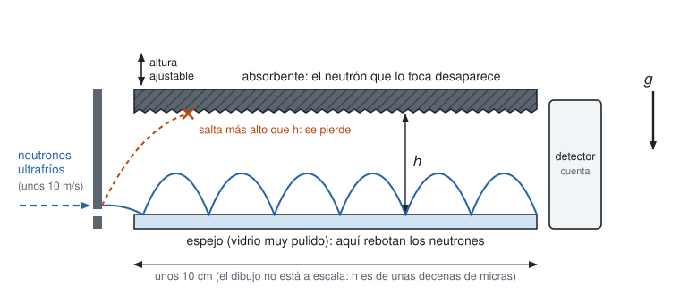
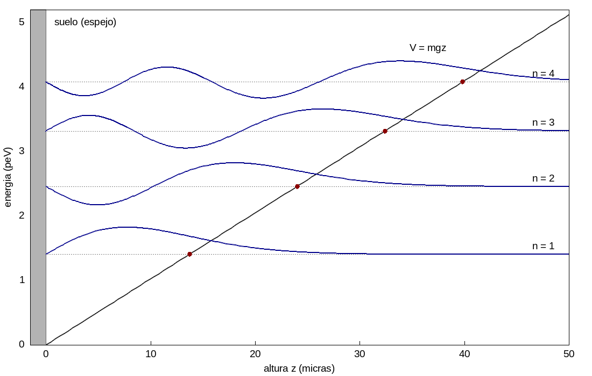

En el [oscilador armónico cuántico](../osciladorcuantico/index.qmd) la energía quedó cuantizada porque la función de onda tenía que ir a cero en $\pm\infty$. Aquí aparece otro mecanismo: una pared. El sistema es un neutrón que cae sobre un espejo, rebota y vuelve a caer, como un balón de básquetbol que se dribla sin perder energía. La ecuación que sale es la de Airy (Simmons, §28, problema 5), y la resolvemos por series de potencias.

## El experimento

En 2002, en el Instituto Laue-Langevin de Grenoble (Francia), el grupo de Valery Nesvizhevsky hizo pasar neutrones muy lentos, llamados *ultrafríos*, por un canal horizontal muy angosto ([artículo en *Nature*](https://doi.org/10.1038/415297a)). El piso del canal es un espejo de vidrio muy pulido y el techo es un absorbente: un neutrón que lo toca desaparece. Al final del canal hay un detector que solo cuenta cuántos neutrones salieron.

Se usan neutrones porque no tienen carga eléctrica: los campos eléctricos y magnéticos que hay en cualquier laboratorio no los desvían, y la gravedad es la única fuerza que actúa sobre ellos. Y se usan ultrafríos porque su movimiento vertical tiene tan poca energía que el espejo los refleja casi perfectamente, sin que pierdan energía en el rebote. Es una pelota ideal.

Dentro del canal el neutrón avanza horizontalmente con velocidad constante, porque no hay fuerza horizontal. Verticalmente hace lo mismo que una pelota: sube, la gravedad lo frena, cae, rebota en el espejo y vuelve a subir a la misma altura. Su trayectoria es una cadena de parábolas (@fig-experimento).

{#fig-experimento width=100%}

La única perilla del experimento es la altura $h$ del techo. Si un neutrón salta más alto que $h$, toca el absorbente y se pierde. Si salta menos, atraviesa el canal y se cuenta. Contar neutrones para distintos valores de $h$ es, entonces, averiguar qué alturas de salto tienen los neutrones.

Si los neutrones fueran pelotas clásicas habría saltos de todas las alturas, incluso muy pequeñas, y al subir $h$ pasarían cada vez más neutrones, de manera suave y desde $h=0$. Lo que se observó es que por debajo de unas 14 micras no pasa prácticamente ningún neutrón, y que por encima de eso el conteo sube. No existe un salto más bajo que ese: la energía del movimiento vertical tiene un valor mínimo distinto de cero. La cuenta que sigue predice ese valor.

Años después, en la misma institución, los experimentos qBounce midieron directamente las diferencias entre los niveles de energía haciendo vibrar el espejo: el neutrón solo cambia de nivel cuando la frecuencia de vibración corresponde a la diferencia entre dos energías permitidas, y esas frecuencias son de unos cientos de hertz.

## El caso ideal

Ahora vamos a considerar el caso ideal. Partimos de la ecuación de Schrödinger con el potencial

$$V(z)=Fz,$$

donde $z\ge0$ es la altura sobre el espejo y $F=mg$ es la fuerza de la gravedad. La fuerza es constante, $-dV/dz=-F$, y por eso el potencial es lineal. La masa del neutrón es $m=1.6749\times10^{-27}$ kg y $g=9.8$ m/s$^2$.

Recordemos que la ecuación de Schrödinger en una dimensión espacial viene dada por

$$i\hbar\frac{\partial\psi}{\partial t}=-\frac{\hbar^2}{2m}\frac{\partial^2\psi}{\partial z^2}+V(z)\,\psi.$$

Pero, como en el oscilador cuántico, buscamos soluciones de la forma

$$\psi(z,t)=\varphi(z)\,e^{-i\omega t},\qquad \omega=\frac{E}{\hbar},$$

y con $F=mg$ obtenemos

$$\hbar\,\frac{E}{\hbar}\,\varphi(z)=-\frac{\hbar^2}{2m}\varphi''(z)+mgz\,\varphi(z),$$

es decir,

$$\frac{\hbar^2}{2m}\varphi''(z)+(E-mgz)\,\varphi(z)=0.$$ {#eq-estac}

Esta ecuación vale para $z>0$. El espejo lo usaremos al final.

### Sin unidades

Nos deshacemos de las unidades con el cambio de variable

$$x=\frac{z-E/mg}{\ell}\quad\Longleftrightarrow\quad z=\ell x+\frac{E}{F},$$

donde $\ell$ es una longitud que escogemos enseguida. El punto $x=0$ es la altura $z=E/F$ donde $E=V(z)$, es decir, la altura máxima a la que llegaría una pelota clásica con energía $E$. Por la regla de la cadena,

$$\frac{d\varphi}{dz}=\frac{d\varphi}{dx}\,\frac1\ell,\qquad \frac{d^2\varphi}{dz^2}=\frac{d^2\varphi}{dx^2}\,\frac1{\ell^2}.$$

(Abusando de la notación, seguimos llamando $\varphi$ a la función de onda escrita en la variable $x$.) Como $E-Fz=-\ell Fx$, la ecuación @eq-estac queda

$$\frac{\hbar^2}{2m\ell^2}\,\varphi''(x)-\ell Fx\,\varphi(x)=0,$$

y multiplicando por $2m\ell^2/\hbar^2$,

$$\varphi''(x)-\frac{2\ell^3mF}{\hbar^2}\,x\,\varphi(x)=0.$$

Escogemos

$$\ell^3=\frac{\hbar^2}{2mF},$$ {#eq-ell}

y la ecuación se convierte en

$$\varphi''(x)-x\,\varphi(x)=0.$$ {#eq-airy}

Esta es la **ecuación de Airy**. Simmons la escribe como $y''+xy=0$ (§28, problema 5); se pasa de una a la otra cambiando $x$ por $-x$. Para el neutrón, @eq-ell da $\ell\approx5.87$ micras. Esa es la escala natural de longitud del problema, y la escala natural de energía es $F\ell\approx0.60$ peV (un peV es $10^{-12}$ eV).

Observe que la energía $E$ desapareció de la ecuación: solo quedó escondida en el cambio de variable.

### Solución por series

Por series,

$$\varphi(x)=\sum_{k=0}^{\infty}a_kx^k,\qquad \varphi'(x)=\sum_{k=1}^{\infty}k\,a_kx^{k-1},\qquad \varphi''(x)=\sum_{k=2}^{\infty}k(k-1)\,a_kx^{k-2}.$$

Pero

$$x\,\varphi(x)=\sum_{k=0}^{\infty}a_kx^{k+1}.$$

Para comparar potencias iguales cambiamos $k$ por $k+3$ en la serie de $\varphi''$, y entonces

$$\varphi''(x)=\sum_{k=-1}^{\infty}(k+3)(k+2)\,a_{k+3}\,x^{k+1}.$$

Así,

$$0=\varphi''(x)-x\,\varphi(x)=2\cdot1\,a_2+\sum_{k=0}^{\infty}\bigl[(k+3)(k+2)\,a_{k+3}-a_k\bigr]x^{k+1},$$

de modo que $a_2=0$ y $(k+3)(k+2)\,a_{k+3}=a_k$, de donde

$$a_{k+3}=\frac{a_k}{(k+2)(k+3)},\qquad a_2=0.$$ {#eq-rec}

La recurrencia salta de tres en tres. Los coeficientes $a_0$ y $a_1$ quedan libres (son las dos constantes de la solución general) y

$$a_3=\frac{a_0}{2\cdot3},\qquad a_4=\frac{a_1}{3\cdot4},\qquad a_5=0,$$

$$a_6=\frac{a_3}{5\cdot6}=\frac{a_0}{2\cdot3\cdot5\cdot6},\qquad a_7=\frac{a_4}{6\cdot7}=\frac{a_1}{3\cdot4\cdot6\cdot7},\qquad a_8=0,$$

$$a_9=\frac{a_0}{2\cdot3\cdot5\cdot6\cdot8\cdot9},\qquad a_{10}=\frac{a_1}{3\cdot4\cdot6\cdot7\cdot9\cdot10}.$$

En general,

$$a_{3m}=\frac{a_0}{(2\cdot3)(5\cdot6)\cdots\bigl((3m-1)(3m)\bigr)},\qquad a_{3m+1}=\frac{a_1}{(3\cdot4)(6\cdot7)\cdots\bigl(3m(3m+1)\bigr)},\qquad a_{3m+2}=0.$$

Entonces $\varphi(x)=a_0f(x)+a_1g(x)$, con

$$f(x)=1+\frac{x^3}{2\cdot3}+\frac{x^6}{2\cdot3\cdot5\cdot6}+\frac{x^9}{2\cdot3\cdot5\cdot6\cdot8\cdot9}+\cdots$$

$$g(x)=x+\frac{x^4}{3\cdot4}+\frac{x^7}{3\cdot4\cdot6\cdot7}+\frac{x^{10}}{3\cdot4\cdot6\cdot7\cdot9\cdot10}+\cdots$$

El radio de convergencia es infinito porque, por el criterio del cociente,

$$\left|\frac{a_{k+3}\,x^{k+3}}{a_k\,x^k}\right|=\frac{|x|^3}{(k+2)(k+3)}\longrightarrow0\qquad(k\to\infty)$$

para todo $x$. Las dos series convergen en toda la recta.

::: {.callout-note title="Fuera del curso: las funciones de Airy"}
Las combinaciones de $f$ y $g$ que se usan en la literatura son las funciones de Airy $\mathrm{Ai}$ y $\mathrm{Bi}$:

$$a_0f(x)+a_1g(x)=A\,\mathrm{Ai}(x)+B\,\mathrm{Bi}(x),$$

donde

$$\mathrm{Ai}(x)=\frac1\pi\int_0^\infty\cos\!\left(\frac{t^3}{3}+xt\right)dt,\qquad \mathrm{Bi}(x)=\frac1\pi\int_0^\infty\left[e^{-t^3/3+xt}+\sin\!\left(\frac{t^3}{3}+xt\right)\right]dt,$$

y en términos de las series,

$$\mathrm{Ai}=c_1f-c_2g,\qquad \mathrm{Bi}=\sqrt3\,\bigl(c_1f+c_2g\bigr),$$

con

$$c_1=\mathrm{Ai}(0)=\frac{1}{3^{2/3}\,\Gamma(2/3)}\approx0.35503,\qquad c_2=-\mathrm{Ai}'(0)=\frac{1}{3^{1/3}\,\Gamma(1/3)}\approx0.25882.$$

Pero esto se sale del dominio del curso.
:::

Hasta aquí iría un curso de ecuaciones normal.

## De vuelta al neutrón

Pero si queremos retomar el problema físico necesitamos que $\varphi(x)\to0$ cuando $x\to\infty$, para que la probabilidad total $\int|\varphi|^2$ sea finita. Hacia abajo no hay problema, porque el espejo corta la función en $z=0$.

Las dos funciones $f$ y $g$ crecen muy rápido cuando $x\to+\infty$ (todos sus coeficientes son positivos), así que la única esperanza es una combinación en la que ese crecimiento se cancele. Eso se consigue notando que

$$\frac{f(x)}{g(x)}\longrightarrow r=\frac{c_2}{c_1}=\frac{3^{1/3}\,\Gamma(2/3)}{\Gamma(1/3)}\approx0.72901.$$

Con las series se comprueba numéricamente: $f(2)/g(2)\approx0.7563$, $f(4)/g(4)\approx0.729040$ y $f(8)/g(8)\approx0.7290111329$. Así que la solución es

$$\varphi(x)=f(x)-r\,g(x),$$ {#eq-decae}

que es la que decae en infinito. (Que de verdad decae no se lee en la serie: es la función $\mathrm{Ai}(x)/c_1$ del recuadro anterior, que se va a cero como $e^{-\frac23x^{3/2}}$.)

Hasta aquí la energía es libre. Para cualquier valor de $E$, la función

$$\varphi(z)=f\!\left(\frac{z-E/F}{\ell}\right)-r\,g\!\left(\frac{z-E/F}{\ell}\right)$$

resuelve @eq-estac y decae hacia arriba. Cambiar $E$ solo traslada la curva a lo largo del eje $z$, sin deformarla.

### El suelo cuantiza la energía

Pero si usamos la condición del suelo, $\varphi=0$ en $z=0$, que equivale a $x=-\varepsilon$ con

$$\varepsilon=\frac{E}{F\ell}$$

(la energía medida en unidades de $F\ell$), queda

$$f(-\varepsilon)-r\,g(-\varepsilon)=0,$$ {#eq-suelo}

y esto ocurre solo para algunos valores de $\varepsilon$, espaciados:

$$\varepsilon_1\approx2.3381,\qquad \varepsilon_2\approx4.0879,\qquad \varepsilon_3\approx5.5206,\qquad \varepsilon_4\approx6.7867,\qquad\dots$$

Entonces $E$ solo puede tomar valores discretos. En términos de $m$, $\hbar$ y $F$,

$$E_n=\varepsilon_n\,F\ell=\varepsilon_n\left(\frac{\hbar^2F^2}{2m}\right)^{1/3},\qquad n=1,2,3,\dots$$ {#eq-niveles}

y

$$z_n=\frac{E_n}{F}=\varepsilon_n\,\ell$$

es la altura máxima: la altura a la que se detendría una pelota clásica con energía $E_n$. Para el neutrón, $E_1\approx1.41$ peV y $z_1\approx13.7$ micras, que es justamente el umbral que se vio en el experimento. Las siguientes alturas son $z_2\approx24.0$, $z_3\approx32.4$ y $z_4\approx39.8$ micras.

Entre el suelo y $z_n$ la función oscila y tiene $n-1$ ceros. Más arriba de $z_n$ decae muy rápido, pero no es cero: el neutrón se puede encontrar un poco por encima de la altura máxima clásica, con probabilidad pequeña (@fig-niveles).

{#fig-niveles width=95%}

Finalmente podemos recuperar la función de onda completa,

$$\psi_n(z,t)=N_n\left[f\!\left(\frac{z-z_n}{\ell}\right)-r\,g\!\left(\frac{z-z_n}{\ell}\right)\right]e^{-iE_nt/\hbar},$$

donde la constante $N_n$ se escoge para que $\int_0^\infty|\psi_n|^2\,dz=1$.

Vale la pena comparar con el oscilador armónico. Allá la condición en infinito bastó para cuantizar, porque obligaba a la serie a terminar. Aquí la condición en infinito solo escoge la combinación $f-rg$, y la que cuantiza es la condición en el suelo: dos condiciones de frontera para una sola constante libre, la energía.

::: {.callout-note title="Haciendo las cuentas con Maxima"}
```maxima
kill(all);

/* 1. Sin unidades: con z = l*x + E/F la ecuacion queda phi'' - x*phi = 0 */
depends(phi, x);
eq: hbar^2/(2*m)*diff(phi, x, 2)/l^2 + (E - F*(l*x + E/F))*phi;
eq2: expand(eq*2*m*l^2/hbar^2);
ratsimp(subst(l = (hbar^2/(2*m*F))^(1/3), eq2));   /* debe dar phi'' - x*phi */
remove(phi, dependency);

/* 2. La recurrencia a[k+3] = a[k]/((k+2)(k+3)) y el residuo de la serie truncada */
a[0]: a0$ a[1]: a1$ a[2]: 0$
for k:0 thru 37 do a[k+3]: a[k]/((k+2)*(k+3))$
makelist(a[k], k, 3, 10);
S: sum(a[k]*x^k, k, 0, 40)$
lopow(expand(diff(S, x, 2) - x*S), x);   /* solo sobreviven potencias altas */

/* 3. f, g y la razon r = c2/c1 */
f(x) := 1 + sum(x^(3*j)/prod((3*i-1)*(3*i), i, 1, j), j, 1, 60)$
g(x) := sum(x^(3*j+1)/prod((3*i)*(3*i+1), i, 1, j), j, 0, 60)$
fpprec: 40$
r: 3^(1/3)*gamma(2/3)/gamma(1/3)$
bfloat(r);
makelist(bfloat(f(bfloat(xx))/g(bfloat(xx))), xx, [2, 4, 6, 8]);

/* 4. El suelo: f(-e) - r g(-e) = 0 */
h(ee) := float(f(-ee) - float(r)*g(-ee))$
eps: [find_root(h, 2, 3), find_root(h, 3.5, 4.5), find_root(h, 5, 6), find_root(h, 6.5, 7.2)];

/* 5. Numeros para el neutron (g = 9.8) */
hb: 1.054571817e-34$ mn: 1.67492749804e-27$ gg: 9.8$ eV: 1.602176634e-19$
F: mn*gg$
l: (hb^2/(2*mn*F))^(1/3);                   /* metros */
En: eps*F*l/eV*1e12;                        /* peV */
zn: eps*l*1e6;                              /* micras */
```
:::

### Un electrón frente a una placa

Algo similar se puede hacer con un electrón y una placa de condensador. Entre las placas el campo eléctrico $\mathcal{E}$ es uniforme, y el electrón siente la fuerza constante $F=e\mathcal{E}$: basta cambiar $mg$ por $e\mathcal{E}$ en todo lo anterior. Si una barrera le impide al electrón atravesar la placa (en un transistor, la capa de óxido), el electrón queda atrapado en un pozo triangular con niveles

$$E_n=\varepsilon_n\left(\frac{\hbar^2e^2\mathcal{E}^2}{2m}\right)^{1/3}.$$

Con un campo de $10^7$ V/m, que es habitual en la interfaz de un semiconductor, salen $\ell\approx1.6$ nm y $E_1\approx37$ meV. Dentro de un semiconductor hay que usar la masa efectiva del electrón, que cambia los números pero no la ecuación. Este pozo es el origen del gas bidimensional de electrones que hay en los transistores.

## Simulador

::: {.callout-note title="Simulador: el neutrón que rebota"}
El tablero dibuja el potencial $V=mgz$, el suelo en $z=0$, los niveles $\varepsilon_n$ (las soluciones de @eq-suelo, calculadas por bisección con las series $f$ y $g$) y la función de onda sobre su nivel. En azul está la parte real de $\psi$, que gira con $e^{-iE_nt/\hbar}$, y en naranja $|\psi|^2$. La zona sombreada es la región que la pelota clásica no alcanza. El tiempo se mide en unidades de $\hbar/(mg\ell)$, que para el neutrón son unos $1.09$ ms, y con la casilla de unidades los ejes pasan a micras y peV.

Con **Superposición** se mezclan dos niveles y la nube de probabilidad empieza a moverse, con frecuencia $(E_n-E_m)/\hbar$. Con **Paquete que rebota** se suelta un paquete en reposo a la altura $z_0$, escrito como suma de los primeros 30 estados, y se compara con una pelota clásica soltada desde la misma altura.

```{=html}
<style>
  .air-caja{border:3px solid #ddd;border-radius:8px;padding:14px;max-width:780px;margin:1em auto;font-family:sans-serif;background:#fff;color:#222;}
  .air-caja canvas{display:block;width:100%;height:auto;background:#fff;border:1px solid #e3e3e3;border-radius:6px;margin-top:8px;}
  .air-caja button{padding:5px 11px;border:1px solid #bbb;border-radius:6px;background:#f5f5f5;color:#222;cursor:pointer;font-size:0.9em;}
  .air-caja button:hover{background:#e9e9e9;}
  .air-caja button.air-act{background:#2563a8;border-color:#2563a8;color:#fff;}
  .air-fila{display:flex;align-items:center;gap:8px;flex-wrap:wrap;}
  .air-ctrl{display:grid;grid-template-columns:repeat(auto-fit,minmax(210px,1fr));gap:8px 18px;margin-top:12px;}
  .air-ctrl label{font-size:0.92em;display:block;}
  .air-ctrl input[type=range]{width:100%;}
  .air-info{margin-top:10px;font-size:0.93em;line-height:1.5;}
</style>
<div class="air-caja" id="air">
  <div class="air-fila">
    <b>Estado:</b>
    <button data-m="est" class="air-act">Estacionario ψ<sub>n</sub></button>
    <button data-m="sup">Superposición de n y m</button>
    <button data-m="paq">Paquete que rebota</button>
    <button id="air-play">Pausa</button>
    <button id="air-reset">t = 0</button>
  </div>
  <div class="air-ctrl">
    <label id="air-ln">n = <b id="air-nv">1</b><input type="range" id="air-n" min="1" max="12" step="1" value="1"></label>
    <label id="air-lm" style="display:none">m = <b id="air-mv">2</b><input type="range" id="air-m" min="1" max="12" step="1" value="2"></label>
    <label id="air-lz" style="display:none">altura inicial z₀/ℓ = <b id="air-zv">10</b><input type="range" id="air-z" min="4" max="15" step="0.5" value="10"></label>
    <label>Velocidad = <b id="air-sv">1</b>×<input type="range" id="air-s" min="0.25" max="40" step="0.25" value="1"></label>
  </div>
  <div class="air-fila" style="margin-top:8px;">
    <label><input type="checkbox" id="air-re" checked> Re ψ (azul)</label>
    <label><input type="checkbox" id="air-d" checked> |ψ|² (naranja)</label>
    <label><input type="checkbox" id="air-niv" checked> todos los niveles</label>
    <label><input type="checkbox" id="air-cl" checked> pelota clásica (solo paquete)</label>
    <label><input type="checkbox" id="air-fis"> ejes en micras y peV (neutrón)</label>
  </div>
  <canvas id="air-c" width="760" height="520" role="img" aria-label="Potencial lineal con un suelo en z igual a cero, niveles de energía del neutrón y su función de onda"></canvas>
  <div class="air-info" id="air-info"></div>
</div>
<script>
(function(){
/*NUCLEO*/
// Unidades: x = (z - E/F)/l adimensional, z en unidades de l, E en unidades de F l = mgl, t en unidades de hbar/(mgl).
var R_AIRY = 0.7290111329472270;           // r = c2/c1 = 3^(1/3) Gamma(2/3)/Gamma(1/3)
var C1_AIRY = 0.3550280538878172;          // c1 = Ai(0)
// f(x) - r g(x) con las series de la recurrencia a_{k+3} = a_k/((k+2)(k+3))
function fMenosRg(x){
  var x3 = x*x*x, tf = 1, tg = x, f = 1, g = x;
  for (var m = 0; m < 200; m++){
    tf *= x3/((3*m+2)*(3*m+3)); tg *= x3/((3*m+3)*(3*m+4));
    f += tf; g += tg;
    if (Math.abs(tf) + Math.abs(tg) < 1e-17*(Math.abs(f) + Math.abs(g)) && m > 3) break;
  }
  return f - R_AIRY*g;
}
// Para |x| grande la serie pierde precision por cancelacion; ahi se usan los desarrollos asintoticos de Ai/c1
function phiAiry(x){
  if (x >= -7 && x <= 5) return fMenosRg(x);
  var ax = Math.abs(x), zeta = 2/3*Math.pow(ax, 1.5);
  var u = [1, 0.0694444444444444, 0.0371334876543210, 0.0379930591278464, 0.0576491904126697];
  var v = [1, -0.0972222222222222, -0.0438850308641975, -0.0424628307922328, -0.0626028008983441];
  if (x > 0){
    var s = 0, p = 1;
    for (var k = 0; k < 5; k++){ s += u[k]*p; p *= -1/zeta; }
    return Math.exp(-zeta)/(2*Math.sqrt(Math.PI)*Math.pow(x, 0.25))*s/C1_AIRY;
  }
  var P = 0, Q = 0, q = 1/zeta;
  P = 1 - u[2]*q*q + u[4]*q*q*q*q;
  Q = u[1]*q - u[3]*q*q*q;
  var th = zeta + Math.PI/4;
  return (Math.sin(th)*P - Math.cos(th)*Q)/(Math.sqrt(Math.PI)*Math.pow(ax, 0.25))/C1_AIRY;
}
// Los niveles: epsilon_n tal que f(-epsilon) - r g(-epsilon) = 0 (condicion del suelo), por biseccion
function nivel(n){
  var e0 = Math.pow(3*Math.PI*(4*n - 1)/8, 2/3), a = e0 - 0.25, b = e0 + 0.25;
  var fa = phiAiry(-a);
  for (var i = 0; i < 80; i++){
    var c = 0.5*(a + b), fc = phiAiry(-c);
    if (fa*fc <= 0) b = c; else { a = c; fa = fc; }
  }
  return 0.5*(a + b);
}
// phi_n(z) normalizada en z >= 0 (z en unidades de l)
function crearEstados(nmax, zmax, M){
  var dz = zmax/M, eps = [], fun = [];
  for (var n = 1; n <= nmax; n++){
    var e = nivel(n), v = new Float64Array(M + 1), s = 0;
    for (var i = 0; i <= M; i++){ v[i] = phiAiry(i*dz - e); }
    for (i = 0; i <= M; i++) s += (i === 0 || i === M ? 1 : (i % 2 ? 4 : 2))*v[i]*v[i];
    s = Math.sqrt(s*dz/3);
    for (i = 0; i <= M; i++) v[i] /= s;
    eps.push(e); fun.push(v);
  }
  return {eps:eps, fun:fun, dz:dz, M:M, zmax:zmax};
}
// coeficientes de un paquete gaussiano centrado en z0, ancho s, en reposo
function coefPaquete(est, z0, s){
  var M = est.M, dz = est.dz, g = new Float64Array(M + 1), i, n, nrm = 0;
  for (i = 0; i <= M; i++){ var z = i*dz; g[i] = Math.exp(-0.5*Math.pow((z - z0)/s, 2))*(1 - Math.exp(-z*z/(0.02))); }
  for (i = 0; i <= M; i++) nrm += (i === 0 || i === M ? 1 : (i % 2 ? 4 : 2))*g[i]*g[i];
  nrm = Math.sqrt(nrm*dz/3);
  var c = [], peso = 0;
  for (n = 0; n < est.fun.length; n++){
    var v = est.fun[n], p = 0;
    for (i = 0; i <= M; i++) p += (i === 0 || i === M ? 1 : (i % 2 ? 4 : 2))*v[i]*g[i];
    c.push(p*dz/3/nrm); peso += c[n]*c[n];
  }
  return {c:c, peso:peso};
}
function estadoTiempo(est, c, i, t){
  var re = 0, im = 0;
  for (var n = 0; n < c.length; n++){
    if (c[n] === 0) continue;
    var ph = -est.eps[n]*t, a = c[n]*est.fun[n][i];
    re += a*Math.cos(ph); im += a*Math.sin(ph);
  }
  return {re:re, im:im};
}
/*FIN NUCLEO*/

// Constantes del neutron con g = 9.8 m/s^2
var ELL_UM = 5.86995, FL_PEV = 0.601376, TAU_MS = 1.09451;

function $(id){ return document.getElementById(id); }
var cv = $('air-c'); if (!cv) return;
var ctx = cv.getContext('2d');
var EST = crearEstados(30, 40, 1600);
var S = {modo:'est', n:1, m:2, z0:10, vel:1, play:true, re:true, d:true, niv:true, cl:true, fis:false};
var t = 0, last = null, infoTs = -1, paq = null;
var ZMAX = 22, EMAX = 21, IMAX = Math.round(ZMAX/EST.dz);
function escala(){
  var tope;
  if (S.modo === 'est') tope = EST.eps[S.n - 1] + 3.2;
  else if (S.modo === 'sup') tope = EST.eps[Math.max(S.n, S.m) - 1] + 3.2;
  else tope = S.z0 + 5;
  EMAX = Math.max(7, tope); ZMAX = EMAX + 1.5; IMAX = Math.min(EST.M, Math.round(ZMAX/EST.dz));
}
function fmt(x, d){ return x.toFixed(d).replace('.', ','); }

function coefs(){
  var c = [], k;
  for (k = 0; k < EST.eps.length; k++) c.push(0);
  if (S.modo === 'est') c[S.n - 1] = 1;
  else if (S.modo === 'sup'){ if (S.n === S.m) c[S.n - 1] = 1; else { c[S.n - 1] = Math.SQRT1_2; c[S.m - 1] = Math.SQRT1_2; } }
  else { if (!paq || paq.z0 !== S.z0){ var P = coefPaquete(EST, S.z0, 1.0); paq = {z0:S.z0, c:P.c, peso:P.peso}; } c = paq.c; }
  return c;
}
function energiaMedia(c){ var s = 0, w = 0; for (var k = 0; k < c.length; k++){ s += c[k]*c[k]*EST.eps[k]; w += c[k]*c[k]; } return s/w; }
function autocorr(c){
  var re = 0, im = 0;
  for (var k = 0; k < c.length; k++){ var w = c[k]*c[k]; re += w*Math.cos(EST.eps[k]*t); im += w*Math.sin(EST.eps[k]*t); }
  return re*re + im*im;
}
function zClasica(){
  var a = Math.sqrt(S.z0), T = 2*a, s = ((t + a) % T + T) % T - a;
  return S.z0 - s*s;
}

function info(){
  var c = coefs(), txt = '', e;
  var tms = ' &nbsp;(para el neutrón, t = ' + fmt(t*TAU_MS, 1) + ' ms)';
  if (S.modo === 'est'){
    e = EST.eps[S.n - 1];
    txt = '<b>n = ' + S.n + '</b>: ε<sub>' + S.n + '</sub> = ' + fmt(e, 4) + ' es la solución número ' + S.n + ' de f(−ε) − r g(−ε) = 0. ' +
          'Para el neutrón: E<sub>' + S.n + '</sub> = ε<sub>' + S.n + '</sub>·mgℓ = ' + fmt(e*FL_PEV, 3) + ' peV y altura máxima z<sub>' + S.n + '</sub> = ε<sub>' + S.n + '</sub>·ℓ = ' + fmt(e*ELL_UM, 2) + ' micras. ' +
          'La función tiene ' + (S.n - 1) + (S.n === 2 ? ' cero' : ' ceros') + ' entre el suelo y z<sub>' + S.n + '</sub>, y más arriba decae (zona sombreada, prohibida para la pelota clásica). ' +
          'Re ψ gira con e<sup>−iE<sub>n</sub>t/ħ</sup>, pero |ψ|² no cambia: un estado estacionario no se mueve.';
  } else if (S.modo === 'sup'){
    if (S.n === S.m) txt = 'Con n = m es un estado estacionario: |ψ|² no se mueve.';
    else {
      var de = Math.abs(EST.eps[S.n - 1] - EST.eps[S.m - 1]), per = 2*Math.PI/de;
      txt = 'Superposición (ψ<sub>' + S.n + '</sub> + ψ<sub>' + S.m + '</sub>)/√2. |ψ|² oscila con frecuencia (E<sub>' + Math.max(S.n, S.m) + '</sub> − E<sub>' + Math.min(S.n, S.m) + '</sub>)/ħ, ' +
            'es decir, con periodo ' + fmt(per, 2) + ' en unidades de ħ/(mgℓ); para el neutrón son ' + fmt(per*TAU_MS, 2) + ' ms (' + fmt(1000/(per*TAU_MS), 0) + ' Hz). ' +
            'El movimiento aparece solo al mezclar niveles distintos.';
    }
  } else {
    var Tc = 2*Math.sqrt(S.z0);
    txt = 'Paquete gaussiano soltado en reposo a la altura z₀ = ' + fmt(S.z0, 1) + ' ℓ' + (S.fis ? ' = ' + fmt(S.z0*ELL_UM, 1) + ' micras' : '') + ', escrito como suma de los primeros 30 estados (recogen el ' + fmt(100*paq.peso, 2) + ' % del paquete). ' +
          'Energía media ' + fmt(energiaMedia(c), 2) + ' mgℓ. La pelota clásica (punto gris) rebota con periodo 2√(z₀/ℓ) = ' + fmt(Tc, 2) + ' en unidades de ħ/(mgℓ), unos ' + fmt(Tc*TAU_MS, 1) + ' ms para el neutrón. ' +
          'El paquete la sigue algunos rebotes y luego se deshace, porque los niveles no están igualmente espaciados; con la velocidad alta se ve que mucho después se vuelve a armar. ' +
          'Parecido con el paquete inicial |⟨ψ(0)|ψ(t)⟩|² = ' + fmt(autocorr(c), 3) + '.';
  }
  $('air-info').innerHTML = txt + '<br><span style="color:#555">t = ' + fmt(t, 2) + ' ħ/(mgℓ)' + tms + '</span>';
}

function dibujar(){
  escala();
  var W = 760, H = 520, L = 56, R = 18, T0 = 14, B0 = 40, c = coefs(), i, x, y, k;
  function X(z){ return L + z/ZMAX*(W - L - R); }
  function Y(e){ return H - B0 - e/EMAX*(H - B0 - T0); }
  ctx.fillStyle = '#fff'; ctx.fillRect(0, 0, W, H);
  // suelo (espejo)
  ctx.fillStyle = '#cfe3f3'; ctx.fillRect(L - 14, T0, 14, H - B0 - T0);
  ctx.strokeStyle = '#1e2327'; ctx.lineWidth = 1.5; ctx.beginPath(); ctx.moveTo(L, T0); ctx.lineTo(L, H - B0); ctx.stroke();
  // ejes y marcas
  ctx.strokeStyle = '#999'; ctx.lineWidth = 1; ctx.beginPath(); ctx.moveTo(L, H - B0); ctx.lineTo(W - R, H - B0); ctx.stroke();
  ctx.fillStyle = '#555'; ctx.font = '12px sans-serif'; ctx.textAlign = 'center';
  if (S.fis){
    var pz = ZMAX*ELL_UM > 90 ? 20 : 10;
    for (x = 0; x <= ZMAX*ELL_UM; x += pz) ctx.fillText(x, X(x/ELL_UM), H - B0 + 15);
    ctx.fillText('altura z (micras)', (L + W - R)/2, H - 8);
  } else {
    var pz2 = ZMAX > 16 ? 2 : 1;
    for (x = 0; x <= ZMAX; x += pz2) ctx.fillText(x, X(x), H - B0 + 15);
    ctx.fillText('altura z/ℓ', (L + W - R)/2, H - 8);
  }
  ctx.save(); ctx.translate(14, (T0 + H - B0)/2); ctx.rotate(-Math.PI/2); ctx.fillText(S.fis ? 'energía (peV)' : 'energía E/(mgℓ)', 0, 0); ctx.restore();
  ctx.textAlign = 'right';
  if (S.fis){ var pe = EMAX*FL_PEV > 8 ? 2 : 1; for (y = 0; y <= EMAX*FL_PEV + 1e-9; y += pe) ctx.fillText(y, L - 18, Y(y/FL_PEV) + 4); }
  else { var pe2 = EMAX > 14 ? 2 : 1; for (y = 0; y <= EMAX; y += pe2) ctx.fillText(y, L - 18, Y(y) + 4); }
  // zona prohibida (estacionario)
  if (S.modo === 'est'){
    var zn = EST.eps[S.n - 1];
    ctx.fillStyle = 'rgba(193,68,14,0.10)'; ctx.fillRect(X(zn), Y(EMAX), X(ZMAX) - X(zn), Y(0) - Y(EMAX));
    ctx.strokeStyle = 'rgba(193,68,14,0.6)'; ctx.setLineDash([5, 4]); ctx.beginPath(); ctx.moveTo(X(zn), Y(EMAX)); ctx.lineTo(X(zn), Y(0)); ctx.stroke(); ctx.setLineDash([]);
  }
  // niveles
  if (S.niv){
    ctx.strokeStyle = '#d4d9de'; ctx.lineWidth = 1;
    for (k = 0; k < EST.eps.length && EST.eps[k] < EMAX; k++){ ctx.beginPath(); ctx.moveTo(L, Y(EST.eps[k])); ctx.lineTo(W - R, Y(EST.eps[k])); ctx.stroke(); }
  }
  // potencial V = z (en unidades de mgl y l)
  ctx.strokeStyle = '#1e2327'; ctx.lineWidth = 2.5; ctx.beginPath(); ctx.moveTo(X(0), Y(0)); ctx.lineTo(X(Math.min(ZMAX, EMAX)), Y(Math.min(ZMAX, EMAX))); ctx.stroke();
  var zv = 0.85*Math.min(ZMAX, EMAX);
  ctx.fillStyle = '#1e2327'; ctx.textAlign = 'left'; ctx.fillText('V = mgz', X(zv) + 8, Y(zv) + 14);
  // energias de referencia
  var bases = [];
  if (S.modo === 'est') bases = [EST.eps[S.n - 1]];
  else if (S.modo === 'sup') bases = S.n === S.m ? [EST.eps[S.n - 1]] : [EST.eps[S.n - 1], EST.eps[S.m - 1]];
  else bases = [energiaMedia(c)];
  ctx.strokeStyle = '#2563a8'; ctx.lineWidth = 1.5; ctx.setLineDash(S.modo === 'paq' ? [6, 4] : []);
  for (k = 0; k < bases.length; k++){ ctx.beginPath(); ctx.moveTo(L, Y(bases[k])); ctx.lineTo(W - R, Y(bases[k])); ctx.stroke(); }
  ctx.setLineDash([]);
  var base = bases.length === 2 ? (bases[0] + bases[1])/2 : bases[0];
  var escPsi = EMAX/8, escD = EMAX/5.5, re = [], dens = [];
  for (i = 0; i <= IMAX; i++){ var e = estadoTiempo(EST, c, i, t); re.push(e.re); dens.push(e.re*e.re + e.im*e.im); }
  if (S.d){
    ctx.beginPath(); ctx.moveTo(X(0), Y(base));
    for (i = 0; i <= IMAX; i++) ctx.lineTo(X(i*EST.dz), Y(base + escD*dens[i]));
    ctx.lineTo(X(IMAX*EST.dz), Y(base)); ctx.closePath();
    ctx.fillStyle = 'rgba(232,121,30,0.35)'; ctx.fill();
    ctx.strokeStyle = '#c1440e'; ctx.lineWidth = 1.5; ctx.beginPath();
    for (i = 0; i <= IMAX; i++){ x = X(i*EST.dz); y = Y(base + escD*dens[i]); if (i === 0) ctx.moveTo(x, y); else ctx.lineTo(x, y); }
    ctx.stroke();
  }
  if (S.re){
    ctx.strokeStyle = '#2563a8'; ctx.lineWidth = 2.2; ctx.beginPath();
    for (i = 0; i <= IMAX; i++){ x = X(i*EST.dz); y = Y(base + escPsi*re[i]); if (i === 0) ctx.moveTo(x, y); else ctx.lineTo(x, y); }
    ctx.stroke();
  }
  if (S.modo === 'paq' && S.cl){
    var zc = zClasica();
    ctx.fillStyle = '#5a6570'; ctx.beginPath(); ctx.arc(X(zc), Y(base), 7, 0, 2*Math.PI); ctx.fill();
  }
  ctx.fillStyle = '#555'; ctx.textAlign = 'left'; ctx.font = '12px sans-serif';
  ctx.fillText('t = ' + fmt(t, 2) + ' ħ/(mgℓ)', L + 10, T0 + 14);
}

function loop(ts){
  if (last === null) last = ts;
  var dt = Math.min((ts - last)/1000, 0.05); last = ts;
  if (S.play) t += dt*S.vel;
  dibujar();
  if (ts - infoTs > 400){ info(); infoTs = ts; }
  requestAnimationFrame(loop);
}
function mostrar(){
  $('air-lm').style.display = S.modo === 'sup' ? 'block' : 'none';
  $('air-lz').style.display = S.modo === 'paq' ? 'block' : 'none';
  $('air-ln').style.display = S.modo === 'paq' ? 'none' : 'block';
  var bs = document.querySelectorAll('#air button[data-m]');
  for (var i = 0; i < bs.length; i++) bs[i].className = bs[i].getAttribute('data-m') === S.modo ? 'air-act' : '';
  info(); dibujar();
}
function ligar(id, clave, valId, dec){
  $(id).addEventListener('input', function(){
    var v = parseFloat(this.value); S[clave] = dec === 0 ? Math.round(v) : v;
    $(valId).textContent = fmt(S[clave], dec);
    if (clave === 'z0') t = 0;
    info();
  });
}
ligar('air-n', 'n', 'air-nv', 0);
ligar('air-m', 'm', 'air-mv', 0);
ligar('air-z', 'z0', 'air-zv', 1);
ligar('air-s', 'vel', 'air-sv', 2);
[['air-re', 're'], ['air-d', 'd'], ['air-niv', 'niv'], ['air-cl', 'cl'], ['air-fis', 'fis']].forEach(function(p){
  $(p[0]).addEventListener('change', function(){ S[p[1]] = this.checked; info(); });
});
var bs = document.querySelectorAll('#air button[data-m]');
for (var q = 0; q < bs.length; q++) bs[q].addEventListener('click', function(){ S.modo = this.getAttribute('data-m'); t = 0; mostrar(); });
$('air-play').addEventListener('click', function(){ S.play = !S.play; this.textContent = S.play ? 'Pausa' : 'Seguir'; });
$('air-reset').addEventListener('click', function(){ t = 0; info(); dibujar(); });
mostrar(); requestAnimationFrame(loop);
})();
</script>
```
:::

## Ejercicios de repaso

Ejercicios del capítulo de series de potencias hasta aquí (Simmons, §26 a §28) y de las dos secciones de mecánica cuántica.

### Repaso de series de potencias (Simmons, §26)

1. Problema 1: radios de convergencia $R=0$, $R=\infty$ y $R=1$ con el criterio del cociente.
2. Problema 2: la serie binomial converge para $|x|<1$ y diverge para $|x|>1$.
3. Problema 3: $R=\infty$ para las series de $\sin x$ y $\cos x$.
4. Problema 4: validez de las series de $e^x$, $\sin x$ y $\cos x$ con la fórmula de Taylor.
5. Problema 5: series de $\log(1+x)$ y $\arctan x$ a partir de la serie geométrica.
6. Problema 6: la serie de $1/(1-x)^2$ de dos maneras.
7. Problema 7: las series de $\cos x$ y de $J_0(x)$ como soluciones de sus ecuaciones.

### Series para ecuaciones de primer orden (Simmons, §27)

8. Problema 1: $y'=2xy$ y $y'+y=1$.
9. Problema 2: $xy'=y$ y $x^2y'=y$, y la discrepancia entre los dos métodos.
10. Problema 3: la serie de $\arcsin x$ y la fórmula para $\pi/6$.
11. Problema 4: la serie de $\tan x$ a partir de $y'=1+y^2$.
12. Problema 5: $y'=x-y$, $y(0)=0$.

### Puntos ordinarios y fórmulas de recurrencia (Simmons, §28)

13. Problema 1: $(1+x^2)y''+2xy'-2y=0$.
14. Problema 2: $y''+xy'+y=0$ y su relación con $e^{-x^2/2}$.
15. Problema 3: $y''+y'-xy=0$, una recurrencia de tres términos.
16. Problema 4: $y''+\bigl(p+\tfrac12-\tfrac14x^2\bigr)y=0$ y el cambio $y=w\,e^{-x^2/4}$.
17. Problema 6: la ecuación de Chebyshev y sus polinomios.
18. Problema 7: la ecuación de Hermite y sus polinomios.
19. La ecuación de Legendre del texto: fórmula de recurrencia y polinomios de Legendre.

### La ecuación de Airy

20. Simmons, §28, problema 5, partes (b) y (c).
21. Simmons, §28, problema 5, parte (a) (usa los teoremas de Sturm de la §24).
22. Escriba $f$ y $g$ hasta la potencia $x^{13}$ y compruebe que $\varphi''-x\varphi$ se anula hasta ese orden.
23. Calcule el wronskiano de $f$ y $g$ en $x=0$ y explique por qué no depende de $x$.
24. Muestre que si $y(x)$ resuelve $y''+xy=0$, entonces $u(x)=y(-x)$ resuelve $u''-xu=0$.
25. Con seis términos de cada serie, ubique por bisección el primer cero de $f(-\varepsilon)-r\,g(-\varepsilon)$ con tres cifras.

### Potencial lineal y cuantización

26. Repita el cambio de variable para $V(z)=Fz$ y compruebe que $\ell$ tiene unidades de longitud y $F\ell$ de energía.
27. Explique por qué cambiar $E$ solo traslada la solución $\varphi(z)$, sin deformarla.
28. Calcule $\ell$, $E_1$ y $z_1$ para un neutrón en la Luna ($g=1.62$ m/s$^2$) y en Júpiter ($g\approx24.8$ m/s$^2$).
29. Calcule $\ell$ y $E_1$ para un electrón frente a una placa con un campo de $10^6$ V/m.
30. Calcule la velocidad con la que una pelota clásica de energía $E_1$ golpearía el espejo.
31. Para la superposición de $\psi_1$ y $\psi_2$, muestre que $|\psi|^2$ oscila y calcule su periodo para el neutrón.
32. Use la aproximación $\varepsilon_n\approx\bigl[\tfrac{3\pi}{8}(4n-1)\bigr]^{2/3}$ para comparar el espaciamiento de los niveles del neutrón con el del oscilador armónico cuántico.
33. ¿Qué cambia en los niveles si el suelo está en $z=-d$ en lugar de $z=0$?
34. ¿Por qué no hay estados con $E\le0$?

### El oscilador armónico cuántico

35. Verifique que $e^{-\xi^2/2}$ resuelve $\varphi''+(\varepsilon-\xi^2)\varphi=0$ con $\varepsilon=1$.
36. Obtenga $H_5$ con la fórmula de recurrencia.
37. Normalice $\psi_1$.
38. Explique por qué la serie de la ecuación de Hermite tiene que terminar.
39. Compare cómo se cuantiza la energía en el oscilador armónico y en el neutrón que rebota.
