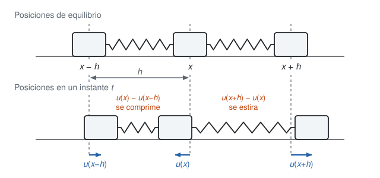
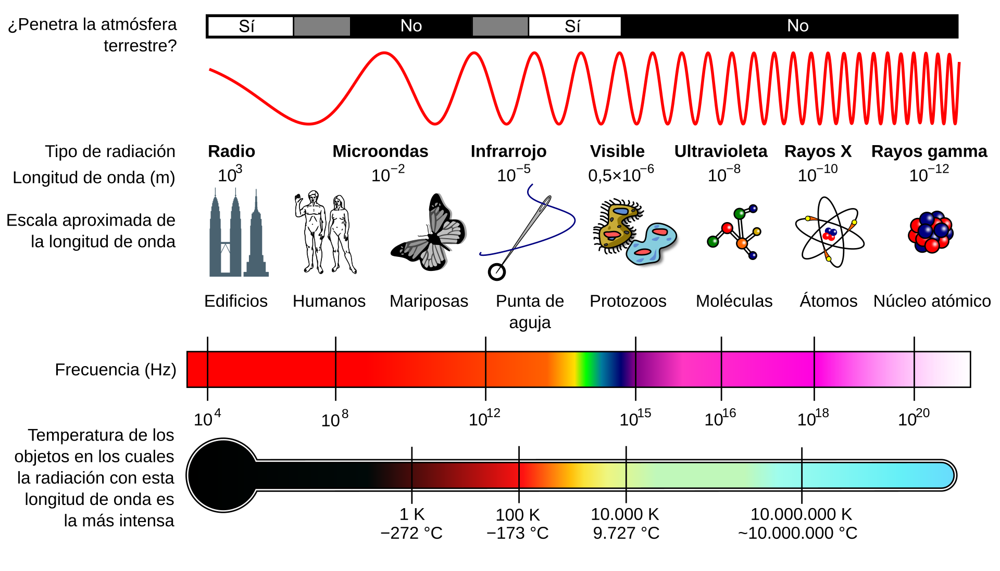

Esta sección usa la ecuación de Hermite como destino, pero el camino es largo y vale la pena recorrerlo. Empezamos con una fila de osciladores acoplados, de ahí sale la ecuación de onda, de las ondas sale la relación entre frecuencia, energía y momento, y con eso se llega a la ecuación de Schrödinger. Al final la aplicamos al potencial de un resorte y la resolvemos por series de potencias.

## Osciladores acoplados

Imaginemos un grupo de personas en fila, agarradas de la mano, jugando a la ola. Cuando el impulso llega de una persona a la otra, esta lo transmite a la vecina, pero cada persona se queda en su sitio. Lo que viaja es la perturbación, no las personas.

Esto es muy similar a acoplar osciladores armónicos con resortes: una fila de bloques de masa $m$, cada uno unido a sus vecinos por un resorte.

Consideremos entonces infinitos osciladores armónicos acoplados, con el mismo coeficiente de elasticidad $\kappa$ en todos los resortes y la misma masa $m$ en cada bloque. (Usamos $\kappa$ para la constante del resorte y reservamos $k$ para el número de onda, que aparece más abajo.) Sea $u_j$ el desplazamiento del bloque número $j$ respecto de su posición de equilibrio. La @fig-cadena muestra tres bloques consecutivos.

{#fig-cadena width=90%}

Si el bloque $j$ se desplaza $u_j$ y sus vecinos se desplazan $u_{j-1}$ y $u_{j+1}$, entonces el resorte de la derecha se estira en $u_{j+1}-u_j$ y el de la izquierda en $u_j-u_{j-1}$. El resorte derecho jala al bloque hacia la derecha con fuerza $\kappa(u_{j+1}-u_j)$, y el izquierdo lo jala hacia la izquierda con fuerza $\kappa(u_j-u_{j-1})$. Por la segunda ley de Newton,

$$m\,\ddot u_j=\kappa\,(u_{j+1}-2u_j+u_{j-1}).$$ {#eq-cadena}

La fuerza sobre un bloque depende solo de cómo está respecto de sus dos vecinos. Esa combinación $u_{j+1}-2u_j+u_{j-1}$ es una segunda diferencia, y es la que nos va a convertir la cadena en una ecuación diferencial parcial.

::: {.callout-note title="Simulador: la cadena de osciladores"}
El tablero integra @eq-cadena para $N$ bloques con los dos extremos fijos (método de Verlet, que conserva la energía). Con **Pulso** se ve cómo una perturbación local se parte en dos y viaja por la cadena. Con **Modo n** la cadena entera oscila con la forma de un seno, y la información de abajo compara la frecuencia exacta de la cadena con la que predice la ecuación de onda de la siguiente sección. Con **Un solo bloque** se ve que, si la perturbación es del tamaño del espaciado, el continuo no sirve.

```{=html}
<style>
  .oq-caja{border:3px solid #ddd;border-radius:8px;padding:14px;max-width:780px;margin:1em auto;font-family:sans-serif;background:#fff;color:#222;}
  .oq-caja canvas{display:block;width:100%;height:auto;background:#fff;border:1px solid #e3e3e3;border-radius:6px;margin-top:8px;}
  .oq-caja button{padding:5px 11px;border:1px solid #bbb;border-radius:6px;background:#f5f5f5;color:#222;cursor:pointer;font-size:0.9em;}
  .oq-caja button:hover{background:#e9e9e9;}
  .oq-caja button.oq-act{background:#2563a8;border-color:#2563a8;color:#fff;}
  .oq-fila{display:flex;align-items:center;gap:10px;flex-wrap:wrap;}
  .oq-insignia{padding:3px 12px;border-radius:12px;font-size:0.9em;background:#eee;color:#333;}
  .oq-ctrl{display:grid;grid-template-columns:repeat(auto-fit,minmax(210px,1fr));gap:8px 18px;margin-top:12px;}
  .oq-ctrl label{font-size:0.92em;display:block;}
  .oq-ctrl input[type=range]{width:100%;}
  .oq-info{margin-top:10px;font-size:0.93em;line-height:1.5;}
  .oq-tabla{border-collapse:collapse;width:100%;font-size:0.93em;margin-top:10px;}
  .oq-tabla td{padding:5px 8px;border-bottom:1px solid #e3e3e3;vertical-align:baseline;}
  .oq-tabla td:first-child{color:#555;width:46%;}
</style>
<div class="oq-caja" id="oqc">
  <div class="oq-fila">
    <b>Condición inicial:</b>
    <button data-i="pulso" class="oq-act">Pulso</button>
    <button data-i="modo">Modo n</button>
    <button data-i="bloque">Un solo bloque</button>
    <button id="oqc-play">Pausa</button>
    <button id="oqc-reset">Reiniciar</button>
  </div>
  <div class="oq-ctrl">
    <label>Bloques N = <b id="oqc-Nv">40</b><input type="range" id="oqc-N" min="8" max="80" step="1" value="40"></label>
    <label>Modo n = <b id="oqc-nv">3</b><input type="range" id="oqc-n" min="1" max="12" step="1" value="3"></label>
    <label>Constante del resorte κ = <b id="oqc-kv">20</b> N/m<input type="range" id="oqc-k" min="2" max="60" step="1" value="20"></label>
    <label>Masa de cada bloque m = <b id="oqc-mv">0,5</b> kg<input type="range" id="oqc-m" min="0.1" max="2" step="0.1" value="0.5"></label>
    <label>Espaciado h = <b id="oqc-hv">0,10</b> m<input type="range" id="oqc-h" min="0.05" max="0.5" step="0.01" value="0.10"></label>
    <label>Velocidad de reproducción = <b id="oqc-sv">1,0</b>×<input type="range" id="oqc-s" min="0.25" max="4" step="0.25" value="1"></label>
  </div>
  <div class="oq-fila" style="margin-top:8px;">
    <label><input type="checkbox" id="oqc-cont" checked> mostrar la solución de la ecuación de onda (curva naranja)</label>
  </div>
  <canvas id="oqc-c" width="760" height="250" role="img" aria-label="Cadena de bloques unidos por resortes con extremos fijos y la solución de la ecuación de onda"></canvas>
  <div class="oq-info" id="oqc-info"></div>
</div>
<script>
(function(){
/*NUCLEO*/
function omegaModo(N, kappa, m, n){ return 2*Math.sqrt(kappa/m)*Math.sin(n*Math.PI/(2*(N+1))); }
function velocidadOnda(h, kappa, m){ return h*Math.sqrt(kappa/m); }
function condicionInicial(N, tipo, n){
  var u = new Float64Array(N+2), j;
  if (tipo === 'modo'){ for (j = 1; j <= N; j++) u[j] = Math.sin(n*Math.PI*j/(N+1)); }
  else if (tipo === 'bloque'){ u[Math.round((N+1)/2)] = 1; }
  else { var s = (N+1)/14, c0 = (N+1)/2; for (j = 1; j <= N; j++) u[j] = Math.exp(-0.5*Math.pow((j-c0)/s, 2)); }
  return u;
}
function aceleraciones(ch){
  var k = ch.kappa/ch.m, u = ch.u, a = ch.a, N = ch.N;
  for (var j = 1; j <= N; j++) a[j] = k*(u[j+1] - 2*u[j] + u[j-1]);
}
function crearCadena(N, kappa, m, u0){
  var ch = {N:N, kappa:kappa, m:m, dt:0.04/Math.sqrt(kappa/m), t:0,
            u:Float64Array.from(u0), v:new Float64Array(N+2), a:new Float64Array(N+2), b:new Float64Array(N+2)};
  aceleraciones(ch);
  return ch;
}
function paso(ch){
  var N = ch.N, dt = ch.dt, j;
  for (j = 1; j <= N; j++){ ch.u[j] += ch.v[j]*dt + 0.5*ch.a[j]*dt*dt; ch.b[j] = ch.a[j]; }
  aceleraciones(ch);
  for (j = 1; j <= N; j++) ch.v[j] += 0.5*(ch.b[j] + ch.a[j])*dt;
  ch.t += dt;
}
function energia(ch){
  var E = 0, j;
  for (j = 1; j <= ch.N; j++) E += 0.5*ch.m*ch.v[j]*ch.v[j];
  for (j = 0; j <= ch.N; j++){ var d = ch.u[j+1] - ch.u[j]; E += 0.5*ch.kappa*d*d; }
  return E;
}
function continuoPulso(N, h, c, x, t){
  var L = (N+1)*h, s = (N+1)/14*h, c0 = L/2;
  function g(r){ return Math.exp(-0.5*Math.pow((r-c0)/s, 2)); }
  function F(r){ var q = ((r % (2*L)) + 2*L) % (2*L); return q <= L ? g(q) : -g(2*L - q); }
  return 0.5*(F(x - c*t) + F(x + c*t));
}
function continuoModo(N, h, c, n, x, t){
  var L = (N+1)*h;
  return Math.sin(n*Math.PI*x/L)*Math.cos(c*n*Math.PI/L*t);
}
/*FIN NUCLEO*/

function $(id){ return document.getElementById(id); }
var cv = $('oqc-c'); if (!cv) return;
var ctx = cv.getContext('2d');
var S = {tipo:'pulso', N:40, n:3, kappa:20, m:0.5, h:0.10, vel:1, cont:true, play:true};
var ch = null, simT = 0, last = null, E0 = 1, lastInfo = -1;
function fmt(x, d){ return x.toFixed(d).replace('.', ','); }
function nEfectivo(){ return Math.min(S.n, S.N); }

function reiniciar(){
  ch = crearCadena(S.N, S.kappa, S.m, condicionInicial(S.N, S.tipo, nEfectivo()));
  simT = 0; E0 = energia(ch) || 1;
  dibujar(); info();
}

function info(){
  var c = velocidadOnda(S.h, S.kappa, S.m), L = (S.N+1)*S.h;
  var t = '<b>Velocidad de la onda:</b> c = h·√(κ/m) = ' + fmt(c, 3) + ' m/s. ' +
          '<b>Largo de la cadena:</b> L = (N+1)·h = ' + fmt(L, 2) + ' m, y una onda tarda L/c = ' + fmt(L/c, 2) + ' s en cruzarla.';
  if (S.tipo === 'modo'){
    var n = nEfectivo(), wn = omegaModo(S.N, S.kappa, S.m, n), wc = c*n*Math.PI/L;
    t += '<br><b>Modo ' + n + ':</b> la cadena oscila con ω = 2√(κ/m)·sen(nπ/(2(N+1))) = ' + fmt(wn, 3) + ' rad/s (periodo ' + fmt(2*Math.PI/wn, 3) + ' s). ' +
         'La ecuación de onda predice ω = c·nπ/L = ' + fmt(wc, 3) + ' rad/s, es decir ' + fmt(100*(wc-wn)/wn, 2) + ' % más. ' +
         'La aproximación mejora cuando n es pequeño frente a N.';
  } else if (S.tipo === 'pulso'){
    t += '<br><b>Pulso:</b> se parte en dos pulsos de altura ½ que viajan en sentidos opuestos y rebotan en las paredes (extremos fijos). ' +
         'Con el tiempo aparece un rizado detrás de cada pulso: es la dispersión de la cadena, que la ecuación de onda no tiene.';
  } else {
    t += '<br><b>Un solo bloque:</b> su ancho es del tamaño del espaciado h, así que la aproximación continua no aplica y no se dibuja la curva naranja.';
  }
  t += '<br><b>Energía total:</b> E/E₀ = ' + fmt(energia(ch)/E0, 5) + ' (se conserva).';
  $('oqc-info').innerHTML = t;
}

function dibujar(){
  var W = 760, H = 250, x0 = 34, y0 = 125, A = 80, N = S.N, j, px, py;
  ctx.fillStyle = '#fff'; ctx.fillRect(0, 0, W, H);
  ctx.strokeStyle = '#ccc'; ctx.lineWidth = 1; ctx.setLineDash([4, 4]);
  ctx.beginPath(); ctx.moveTo(x0, y0); ctx.lineTo(W - x0, y0); ctx.stroke(); ctx.setLineDash([]);
  ctx.fillStyle = '#1e2327'; ctx.fillRect(x0 - 4, y0 - 62, 4, 124); ctx.fillRect(W - x0, y0 - 62, 4, 124);
  var sp = (W - 2*x0)/(N + 1);
  if (S.cont && S.tipo !== 'bloque'){
    var c = velocidadOnda(S.h, S.kappa, S.m), L = (N+1)*S.h, nn = nEfectivo();
    ctx.strokeStyle = '#c1440e'; ctx.lineWidth = 2; ctx.beginPath();
    for (var i = 0; i <= 400; i++){
      var x = L*i/400;
      var y = S.tipo === 'pulso' ? continuoPulso(N, S.h, c, x, ch.t) : continuoModo(N, S.h, c, nn, x, ch.t);
      px = x0 + (x/L)*(W - 2*x0); py = y0 - A*y;
      if (i === 0) ctx.moveTo(px, py); else ctx.lineTo(px, py);
    }
    ctx.stroke();
  }
  ctx.strokeStyle = '#8a949c'; ctx.lineWidth = 1.2; ctx.beginPath();
  for (j = 0; j <= N + 1; j++){
    px = x0 + j*sp; py = y0 - A*ch.u[j];
    if (j === 0) ctx.moveTo(px, py); else ctx.lineTo(px, py);
  }
  ctx.stroke();
  var s = Math.max(4, Math.min(14, 0.6*sp));
  ctx.fillStyle = '#2563a8';
  for (j = 1; j <= N; j++){ px = x0 + j*sp; py = y0 - A*ch.u[j]; ctx.fillRect(px - s/2, py - s/2, s, s); }
  ctx.fillStyle = '#555'; ctx.font = '13px sans-serif'; ctx.textAlign = 'left';
  ctx.fillText('t = ' + fmt(ch.t, 2) + ' s', 10, 18);
  ctx.fillStyle = '#2563a8'; ctx.fillRect(130, 9, 10, 10); ctx.fillStyle = '#555'; ctx.fillText('bloques', 146, 18);
  if (S.cont && S.tipo !== 'bloque'){ ctx.fillStyle = '#c1440e'; ctx.fillRect(220, 12, 18, 3); ctx.fillStyle = '#555'; ctx.fillText('ecuación de onda', 244, 18); }
}

function loop(ts){
  if (last === null) last = ts;
  var dt = Math.min((ts - last)/1000, 0.05); last = ts;
  if (S.play){
    simT += dt*S.vel;
    var guard = 4000;
    while (ch.t < simT && guard-- > 0) paso(ch);
    dibujar();
    if (ts - lastInfo > 250){ info(); lastInfo = ts; }
  }
  requestAnimationFrame(loop);
}

function marcarBotones(){
  var bs = document.querySelectorAll('#oqc button[data-i]');
  for (var i = 0; i < bs.length; i++) bs[i].className = bs[i].getAttribute('data-i') === S.tipo ? 'oq-act' : '';
}
function ligar(id, clave, valId, dec, esEntero){
  var el = $(id);
  el.addEventListener('input', function(){
    var v = parseFloat(el.value);
    S[clave] = esEntero ? Math.round(v) : v;
    $(valId).textContent = fmt(S[clave], dec);
    if (clave === 'N'){ var nmax = Math.min(12, S.N); $('oqc-n').max = nmax; if (S.n > nmax){ S.n = nmax; $('oqc-n').value = nmax; $('oqc-nv').textContent = nmax; } }
    if (clave === 'vel') return;
    reiniciar();
  });
}
ligar('oqc-N', 'N', 'oqc-Nv', 0, true);
ligar('oqc-n', 'n', 'oqc-nv', 0, true);
ligar('oqc-k', 'kappa', 'oqc-kv', 0, false);
ligar('oqc-m', 'm', 'oqc-mv', 1, false);
ligar('oqc-h', 'h', 'oqc-hv', 2, false);
ligar('oqc-s', 'vel', 'oqc-sv', 1, false);
$('oqc-cont').addEventListener('change', function(){ S.cont = this.checked; dibujar(); });
var bs = document.querySelectorAll('#oqc button[data-i]');
for (var q = 0; q < bs.length; q++) bs[q].addEventListener('click', function(){ S.tipo = this.getAttribute('data-i'); marcarBotones(); reiniciar(); });
$('oqc-play').addEventListener('click', function(){ S.play = !S.play; this.textContent = S.play ? 'Pausa' : 'Seguir'; });
$('oqc-reset').addEventListener('click', reiniciar);

reiniciar();
requestAnimationFrame(loop);
})();
</script>
```
:::

### Del salto discreto a la derivada

Pongamos cada bloque en $x=jh$, donde $h$ es la distancia entre bloques en equilibrio, y escribamos $u(x,t)$ para el desplazamiento del bloque que está en $x$. Entonces $u_{j\pm1}=u(x\pm h,t)$ y @eq-cadena queda

$$m\,u_{tt}(x,t)=\kappa\,\bigl(u(x+h)-2u(x)+u(x-h)\bigr).$$

Para entender el lado derecho cuando $h$ es pequeño, recordemos que, por el teorema fundamental del cálculo,

$$u(x+h)-u(x)=\int_0^h u'(x+s)\,ds.$$

Como $u'(x+s)\approx u'(x)+u''(x)\,s$ para $s$ pequeño (es la aproximación lineal de $u'$), obtenemos

$$u(x+h)-u(x)\approx\int_0^h\bigl(u'(x)+u''(x)\,s\bigr)\,ds=u'(x)\,h+\tfrac12u''(x)\,h^2.$$

Esto es el polinomio de Taylor de orden 2. Reemplazando $h$ por $-h$,

$$u(x-h)-u(x)\approx-u'(x)\,h+\tfrac12u''(x)\,h^2.$$

Al sumar las dos, el término con $u'$ se cancela (por eso la fila es simétrica: lo que jala un vecino lo compensa el otro) y queda

$$u(x+h)-2u(x)+u(x-h)\approx u''(x)\,h^2.$$

Entonces $m\,u_{tt}=\kappa h^2\,u_{xx}$, es decir,

$$u_{tt}(x,t)=c^2\,u_{xx}(x,t),\qquad c^2=\frac{\kappa h^2}{m}.$$ {#eq-onda}

Esta es la **ecuación de onda**, nuestra primera ecuación diferencial parcial.

::: {.callout-note title="¿Qué hacemos con el $h^2$?"}
Si dejamos que $h\to0$ con $\kappa$ y $m$ fijos, entonces $c\to0$ y no queda ninguna onda. Hay que hacer que la cadena se parezca a un material continuo: si el material tiene masa $\mu$ por unidad de longitud, cada bloque pesa $m=\mu h$, y un pedazo de resorte de longitud $h$ es tanto más blando cuanto más largo, de modo que $\kappa=Y/h$, donde $Y$ es la rigidez del material. Entonces $c^2=\kappa h^2/m=Y/\mu$ no depende de $h$, y el límite tiene sentido.
:::

La aproximación tiene un costo: la segunda diferencia es $h^2u''+\tfrac1{12}h^4u''''+\cdots$, de modo que la ecuación de onda solo es buena cuando $u$ varía despacio frente a $h$. En el simulador se ve como un rizado que se queda detrás del pulso, y es la dispersión propia de la cadena que la ecuación de onda no tiene.

## La ecuación de onda

Por ahora no vamos a ver cómo se resuelve en general.

::: {.callout-important title="Tarea"}
Demuestre que $f(x+ct)+g(x-ct)$ resuelve la ecuación de onda @eq-onda para cualesquiera funciones $f$ y $g$ dos veces derivables. Demuestre además que $\varphi(x)\,\psi(ct)$ la resuelve cuando $\varphi$ y $\psi$ son senos o cosenos (con el mismo argumento, por ejemplo $\sin x\cos ct$).
:::

La constante $c$ es la velocidad de la onda: $f(x-ct)$ es la forma $f$ desplazada hacia la derecha a velocidad $c$. Esta ecuación modela tanto ondas unidimensionales mecánicas (una cuerda, el sonido en un tubo) como electromagnéticas (en el vacío, cada componente del campo eléctrico y del magnético la satisface con $c\approx3\times10^8$ m/s).

::: {.callout-note title="Una nota histórica: por qué importa la ecuación de onda"}
Esta ecuación está en el origen de varias teorías de la matemática.

D'Alembert la obtuvo en 1747 para la cuerda vibrante y encontró la solución $f(x+ct)+g(x-ct)$, pero pensaba que la forma inicial de la cuerda tenía que venir dada por una sola expresión analítica. Euler (1748) sostuvo que la solución tenía sentido para cualquier curva que se pudiera trazar, aun con picos o formada por pedazos. Esa disputa sobre qué curvas son admisibles obligó a preguntarse qué es una función, y por eso está en el origen de la **teoría de funciones**.

Hacia 1753 Daniel Bernoulli propuso que la cuerda vibra como una suma de modos senoidales, y Euler y d'Alembert dudaron de que una suma de senos pudiera representar una curva cualquiera. Fourier (presentado en 1807, publicado en 1822) afirmó que sí, y de ahí nace el **análisis de Fourier**.

Dirichlet dio en 1829 las primeras condiciones rigurosas bajo las cuales la serie de Fourier converge, y Riemann (1854) estudió las series trigonométricas para funciones muy irregulares. Siguiendo un problema planteado por Heine, Cantor se preguntó entre 1870 y 1872 cuándo es única la representación de una función por una serie trigonométrica, y qué tan grande puede ser el conjunto de puntos excepcionales donde la serie falla. Para describir esos conjuntos de puntos introdujo los conjuntos derivados y, iterándolos, los ordinales transfinitos: una de las vías por las que nació la **teoría de conjuntos**.

Se puede leer más en [este artículo de arXiv](https://arxiv.org/pdf/1803.05287) y en [estas notas de Caltech sobre la unicidad de la serie trigonométrica](https://pma.caltech.edu/documents/5627/uniqueness.pdf).
:::

## Ondas planas: frecuencia, longitud de onda y energía

Una forma abstracta de describir una onda es la onda plana compleja

$$u(x,t)=A\,e^{i(kx-\omega t)},$$

donde $A$ es la amplitud. Esta función satisface la ecuación de onda @eq-onda: como $u_{tt}=-\omega^2u$ y $u_{xx}=-k^2u$, la ecuación se reduce a $\omega^2=c^2k^2$, es decir,

$$\omega=c\,k.$$

Los números $k$ y $\omega$ tienen un significado muy concreto. Si miramos la onda en un instante fijo, se repite cada vez que $kx$ avanza $2\pi$, es decir, cada

$$\lambda=\frac{2\pi}{k}$$

(la **longitud de onda**), de modo que $k$ es $2\pi$ veces el número de ciclos por unidad de distancia. Si nos paramos en un punto fijo, la onda se repite cada vez que $\omega t$ avanza $2\pi$, es decir, cada

$$T=\frac{2\pi}{\omega}$$

(el **periodo**), y $\omega=2\pi/T=2\pi f$ es la **frecuencia angular**, que es $2\pi$ veces el número de ciclos por unidad de tiempo. La relación $\omega=ck$ equivale a $c=\lambda f$.

Planck y Einstein se dieron cuenta de que la energía está cuantizada y viene en paquetes de tamaño

$$E=\hbar\omega,\qquad \hbar=\frac{h}{2\pi},$$

donde $h\approx6.626\times10^{-34}$ J s es la constante de Planck y $\hbar$ es la constante reducida de Planck. Cada color de luz (cada fotón y cada onda) en el espectro electromagnético tiene un paquete (cuanto) de energía asociado a su frecuencia de oscilación $\omega$. A mayor frecuencia, más grande es el cuanto de energía, y un cuanto es lo más pequeño que se puede dar. Por ejemplo, el azul tiene más energía por fotón que el rojo. Los rayos X tienen una frecuencia muy alta (cuantos grandes), por eso son tan peligrosos y tan útiles para los humanos.

Una onda que oscila más rápido en el espacio ($\lambda$ pequeña, $k$ grande) tiene también más momento. Técnicamente,

$$p=\hbar k$$

es el momento (que ya no necesariamente está cuantizado: depende de la onda).

La @tbl-espectro muestra un representante de cada banda del espectro electromagnético, con $c=299\,792\,458$ m/s, $\omega=2\pi f$, $k=2\pi/\lambda$ y $E=\hbar\omega=hf$ expresada en electronvoltios.

| Banda | $\lambda$ (m) | $f$ (Hz) | $k$ (rad/m) | $\omega$ (rad/s) | $E$ (eV) |
|:--|--:|--:|--:|--:|--:|
| Radio | $1.00\times10^{3}$ | $3.00\times10^{5}$ | $6.28\times10^{-3}$ | $1.88\times10^{6}$ | $1.24\times10^{-9}$ |
| Microondas | $1.00\times10^{-2}$ | $3.00\times10^{10}$ | $6.28\times10^{2}$ | $1.88\times10^{11}$ | $1.24\times10^{-4}$ |
| Infrarrojo | $1.00\times10^{-5}$ | $3.00\times10^{13}$ | $6.28\times10^{5}$ | $1.88\times10^{14}$ | $1.24\times10^{-1}$ |
| Visible | $5.00\times10^{-7}$ | $6.00\times10^{14}$ | $1.26\times10^{7}$ | $3.77\times10^{15}$ | $2.48\times10^{0}$ |
| Ultravioleta | $1.00\times10^{-8}$ | $3.00\times10^{16}$ | $6.28\times10^{8}$ | $1.88\times10^{17}$ | $1.24\times10^{2}$ |
| Rayos X | $1.00\times10^{-10}$ | $3.00\times10^{18}$ | $6.28\times10^{10}$ | $1.88\times10^{19}$ | $1.24\times10^{4}$ |
| Rayos gamma | $1.00\times10^{-12}$ | $3.00\times10^{20}$ | $6.28\times10^{12}$ | $1.88\times10^{21}$ | $1.24\times10^{6}$ |

: Una longitud de onda típica de cada banda y las cantidades que le corresponden. {#tbl-espectro}

La @fig-espectro es el dibujo habitual del espectro. Además de la frecuencia y la longitud de onda, el dibujo tiene un termómetro: la temperatura de un cuerpo negro cuya emisión es máxima en esa longitud de onda, dada por la ley de desplazamiento de Wien, $\lambda_{\max}T=b$ con $b\approx2.898\times10^{-3}$ m K. Por eso el Sol, a unos $5800$ K, es máximo en el visible.

{#fig-espectro width=100%}

::: {.callout-note title="Simulador: el tablero del espectro"}
Mueva la frecuencia $f$ (en escala logarítmica, de $10^4$ a $10^{21}$ Hz) o salte a una banda con los botones. El tablero calcula la longitud de onda, el periodo, $k$, $\omega$, la energía $E=\hbar\omega$, el momento $p=\hbar k$ y la temperatura de Wien. La onda dibujada abajo usa una escala logarítmica fija: cada década de $\lambda$ cambia en el mismo factor la longitud de onda dibujada, de modo que se ve cómo se estira hacia la radio y se comprime hacia los rayos gamma (no es proporcional a la $\lambda$ real, que abarca 17 órdenes de magnitud). Al cambiar el medio, la frecuencia $f$ se mantiene y cambian la velocidad $c=c_0/n$, la longitud de onda y $k$. La energía y el momento se calculan siempre con $E=\hbar\omega$ y $p=\hbar k$ (el momento de un fotón dentro de un medio es un tema delicado, aquí solo usamos esta definición).

```{=html}
<style>
  .oq-caja{border:3px solid #ddd;border-radius:8px;padding:14px;max-width:780px;margin:1em auto;font-family:sans-serif;background:#fff;color:#222;}
  .oq-caja canvas{display:block;width:100%;height:auto;background:#fff;border:1px solid #e3e3e3;border-radius:6px;margin-top:8px;}
  .oq-caja button{padding:5px 11px;border:1px solid #bbb;border-radius:6px;background:#f5f5f5;color:#222;cursor:pointer;font-size:0.9em;}
  .oq-caja button:hover{background:#e9e9e9;}
  .oq-caja button.oq-act{background:#2563a8;border-color:#2563a8;color:#fff;}
  .oq-fila{display:flex;align-items:center;gap:8px;flex-wrap:wrap;}
  .oq-insignia{padding:3px 12px;border-radius:12px;font-size:0.95em;background:#eee;color:#333;font-weight:bold;}
  .oq-ctrl{display:grid;grid-template-columns:repeat(auto-fit,minmax(230px,1fr));gap:8px 18px;margin-top:12px;}
  .oq-ctrl label{font-size:0.92em;display:block;}
  .oq-ctrl input[type=range]{width:100%;}
  .oq-info{margin-top:10px;font-size:0.93em;line-height:1.5;}
  .oq-tabla{border-collapse:collapse;width:100%;font-size:0.93em;margin-top:10px;}
  .oq-tabla td{padding:5px 8px;border-bottom:1px solid #e3e3e3;vertical-align:baseline;}
  .oq-tabla td:first-child{color:#555;width:46%;}
</style>
<div class="oq-caja" id="oqe">
  <div class="oq-fila" id="oqe-pre"></div>
  <div class="oq-ctrl">
    <label>Frecuencia f: <b id="oqe-fv"></b><input type="range" id="oqe-f" min="4" max="21" step="0.01" value="14.78"></label>
    <label>Medio:
      <select id="oqe-n">
        <option value="1">Vacío (n = 1)</option>
        <option value="1.0003">Aire (n = 1,0003)</option>
        <option value="1.333">Agua (n = 1,333)</option>
        <option value="1.5">Vidrio (n = 1,5)</option>
      </select>
    </label>
  </div>
  <canvas id="oqe-c" width="760" height="285" role="img" aria-label="Espectro electromagnético en escala logarítmica y onda con la longitud de onda elegida"></canvas>
  <table class="oq-tabla" id="oqe-t"></table>
  <div class="oq-info" id="oqe-info"></div>
</div>
<script>
(function(){
/*NUCLEO*/
var C0 = 299792458, H = 6.62607015e-34, QE = 1.602176634e-19, HBAR = 6.62607015e-34/(2*Math.PI), WIEN = 2.897771955e-3;
var BANDAS = [
  {nombre:'Rayos gamma', lamMax:1e-11, color:'#7b2d8e'},
  {nombre:'Rayos X', lamMax:5e-9, color:'#3b5bdb'},
  {nombre:'Ultravioleta', lamMax:380e-9, color:'#7048e8'},
  {nombre:'Visible', lamMax:700e-9, color:'#2f9e44'},
  {nombre:'Infrarrojo', lamMax:1e-3, color:'#e8590c'},
  {nombre:'Microondas', lamMax:1, color:'#c2255c'},
  {nombre:'Radio', lamMax:Infinity, color:'#5c6770'}
];
function bandaDe(lamVacio){
  for (var i = 0; i < BANDAS.length; i++) if (lamVacio < BANDAS[i].lamMax) return BANDAS[i].nombre;
  return 'Radio';
}
function propiedades(f, n){
  var c = C0/n, lam = c/f, k = 2*Math.PI/lam, w = 2*Math.PI*f;
  return {f:f, n:n, c:c, lam:lam, k:k, w:w, T:1/f,
          E_J:H*f, E_eV:H*f/QE, p:H*f/c, hbarw:HBAR*w, hbark:HBAR*k,
          lamVacio:C0/f, Twien:WIEN/(C0/f), banda:bandaDe(C0/f)};
}
function colorVisible(lamNm){
  var r = 0, g = 0, b = 0, f;
  if (lamNm >= 380 && lamNm < 440){ r = -(lamNm-440)/60; b = 1; }
  else if (lamNm < 490){ g = (lamNm-440)/50; b = 1; }
  else if (lamNm < 510){ g = 1; b = -(lamNm-510)/20; }
  else if (lamNm < 580){ r = (lamNm-510)/70; g = 1; }
  else if (lamNm < 645){ r = 1; g = -(lamNm-645)/65; }
  else if (lamNm <= 780){ r = 1; }
  else return null;
  if (lamNm < 380) return null;
  if (lamNm < 420) f = 0.3 + 0.7*(lamNm-380)/40;
  else if (lamNm <= 700) f = 1;
  else f = 0.3 + 0.7*(780-lamNm)/80;
  function q(x){ return Math.round(255*Math.pow(x*f, 0.8)); }
  return 'rgb(' + q(r) + ',' + q(g) + ',' + q(b) + ')';
}
/*FIN NUCLEO*/

function $(id){ return document.getElementById(id); }
var cv = $('oqe-c'); if (!cv) return;
var ctx = cv.getContext('2d');
var PRE = [['Radio', 3e5], ['Microondas', 3e10], ['Infrarrojo', 3e13], ['Visible', 5.996e14], ['Ultravioleta', 3e16], ['Rayos X', 3e18], ['Rayos gamma', 3e20]];
var logF = 14.78, nInd = 1, fase = 0, last = null;
var FMIN = 4, FMAX = 21;

function sci(x, d){
  if (x === 0) return '0';
  var e = Math.floor(Math.log10(Math.abs(x))), m = x/Math.pow(10, e);
  m = Number(m.toFixed(d));
  if (Math.abs(m) >= 10){ m /= 10; e += 1; }
  return m.toFixed(d).replace('.', ',') + ' × 10<sup>' + e + '</sup>';
}
function ejeF(lf){ return 34 + (lf - FMIN)/(FMAX - FMIN)*(760 - 68); }

function actualizar(){
  var f = Math.pow(10, logF), P = propiedades(f, nInd);
  $('oqe-fv').innerHTML = sci(f, 2) + ' Hz';
  var filas = [
    ['Banda (por λ en el vacío)', '<span class="oq-insignia" style="background:' + colorBanda(P.banda) + ';color:#fff">' + P.banda + '</span>'],
    ['Frecuencia f', sci(P.f, 3) + ' Hz'],
    ['Velocidad c = c₀/n', sci(P.c, 4) + ' m/s'],
    ['Longitud de onda λ = c/f', sci(P.lam, 3) + ' m'],
    ['Periodo T = 1/f', sci(P.T, 3) + ' s'],
    ['Número de onda k = 2π/λ', sci(P.k, 3) + ' rad/m'],
    ['Frecuencia angular ω = 2πf', sci(P.w, 3) + ' rad/s'],
    ['Energía E = ħω', sci(P.E_eV, 3) + ' eV &nbsp;(' + sci(P.E_J, 3) + ' J)'],
    ['Momento p = ħk', sci(P.p, 3) + ' kg·m/s'],
    ['Temperatura de Wien (pico en λ)', sci(P.Twien, 3) + ' K']
  ];
  var h = '';
  for (var i = 0; i < filas.length; i++) h += '<tr><td>' + filas[i][0] + '</td><td>' + filas[i][1] + '</td></tr>';
  $('oqe-t').innerHTML = h;
  var t = 'Se cumple ω = c·k (' + sci(P.w, 3) + ' = ' + sci(P.c*P.k, 3) + ') y E = ħω. ';
  if (nInd !== 1) t += 'Al cambiar de medio la frecuencia f no cambia, cambian c, λ y k. ';
  t += 'La temperatura de Wien es la de un cuerpo negro cuya emisión es máxima en esa longitud de onda (el Sol, a unos 5800 K, está en el visible).';
  $('oqe-info').innerHTML = t;
  var bs = $('oqe-pre').querySelectorAll('button');
  for (var j = 0; j < bs.length; j++) bs[j].className = bs[j].getAttribute('data-b') === P.banda ? 'oq-act' : '';
}
function colorBanda(n){ for (var i = 0; i < BANDAS.length; i++) if (BANDAS[i].nombre === n) return BANDAS[i].color; return '#555'; }

function dibujar(){
  var W = 760, i, x;
  ctx.fillStyle = '#fff'; ctx.fillRect(0, 0, W, 285);
  // barra del espectro en escala log de f
  var yb = 40, hb = 46;
  for (i = BANDAS.length - 1; i >= 0; i--){
    var b = BANDAS[i];
    var hiL = i === 0 ? Infinity : BANDAS[i-1].lamMax;
    var fLo = b.lamMax === Infinity ? Math.pow(10, FMIN) : C0/b.lamMax, fHi = hiL === Infinity ? Math.pow(10, FMAX) : C0/hiL;
    var xa = ejeF(Math.max(FMIN, Math.min(FMAX, Math.log10(fLo)))), xb = ejeF(Math.max(FMIN, Math.min(FMAX, Math.log10(fHi))));
    ctx.fillStyle = b.color; ctx.globalAlpha = 0.85; ctx.fillRect(xa, yb, xb - xa, hb); ctx.globalAlpha = 1;
    if (b.nombre === 'Visible'){
      for (x = Math.ceil(xa); x < xb; x++){
        var lf = FMIN + (x - 34)/(760 - 68)*(FMAX - FMIN);
        var col = colorVisible(C0/Math.pow(10, lf)*1e9);
        if (col){ ctx.fillStyle = col; ctx.fillRect(x, yb, 1.5, hb); }
      }
    }
    ctx.fillStyle = '#fff'; ctx.font = '11px sans-serif'; ctx.textAlign = 'center';
    if (b.nombre !== 'Visible'){ var tw = ctx.measureText(b.nombre).width; if (xb - xa > tw + 8) ctx.fillText(b.nombre, (xa + xb)/2, yb + hb/2 + 4); else if (b.nombre === 'Rayos gamma') ctx.fillText('γ', (xa + xb)/2, yb + hb/2 + 4); }
  }
  ctx.fillStyle = '#333'; ctx.font = '11px sans-serif'; ctx.textAlign = 'center';
  ctx.fillText('Visible', ejeF(Math.log10(C0/545e-9)), yb - 6);
  // eje log f
  ctx.strokeStyle = '#555'; ctx.fillStyle = '#555'; ctx.lineWidth = 1;
  for (var e = FMIN; e <= FMAX; e++){
    x = ejeF(e); ctx.beginPath(); ctx.moveTo(x, yb + hb); ctx.lineTo(x, yb + hb + 5); ctx.stroke();
    if ((e - FMIN) % 2 === 0) ctx.fillText('10^' + e, x, yb + hb + 18);
  }
  ctx.textAlign = 'left'; ctx.fillText('f (Hz), escala logarítmica', 34, yb + hb + 36);
  // marcador
  var xm = ejeF(logF);
  ctx.strokeStyle = '#1e2327'; ctx.lineWidth = 2; ctx.beginPath(); ctx.moveTo(xm, yb - 12); ctx.lineTo(xm, yb + hb + 6); ctx.stroke();
  ctx.fillStyle = '#1e2327'; ctx.beginPath(); ctx.moveTo(xm - 6, yb - 14); ctx.lineTo(xm + 6, yb - 14); ctx.lineTo(xm, yb - 5); ctx.fill();
  // onda: siempre 4 longitudes de onda
  var f = Math.pow(10, logF), P = propiedades(f, nInd);
  var x0 = 34, x1 = 726, yc = 208, A = 36;
  var tt = Math.max(0, Math.min(1, (Math.log10(P.lam) + 13.5)/18.1)), lamPx = 8*Math.pow(175, tt);
  var colV = P.lamVacio >= 380e-9 && P.lamVacio <= 780e-9 ? colorVisible(P.lamVacio*1e9) : null;
  ctx.strokeStyle = colV || colorBanda(P.banda); ctx.lineWidth = 3; ctx.beginPath();
  for (x = x0; x <= x1; x++){
    var y = yc - A*Math.cos(2*Math.PI*(x - x0)/lamPx - fase);
    if (x === x0) ctx.moveTo(x, y); else ctx.lineTo(x, y);
  }
  ctx.stroke();
  var lw = Math.min(lamPx, x1 - x0);
  ctx.strokeStyle = '#555'; ctx.lineWidth = 1;
  ctx.beginPath(); ctx.moveTo(x0, yc + A + 12); ctx.lineTo(x0 + lw, yc + A + 12);
  ctx.moveTo(x0, yc + A + 7); ctx.lineTo(x0, yc + A + 17); ctx.moveTo(x0 + lw, yc + A + 7); ctx.lineTo(x0 + lw, yc + A + 17); ctx.stroke();
  ctx.fillStyle = '#333'; ctx.textAlign = 'center'; ctx.font = '12px sans-serif';
  ctx.fillText('λ = ' + etiquetaLong(P.lam) + (lamPx > x1 - x0 ? ' (más larga que el dibujo)' : ''), x0 + lw/2, yc + A + 30);
  ctx.textAlign = 'left'; ctx.fillStyle = '#555';
  ctx.fillText('Dibujo con escala fija en logaritmo: cada década de λ cambia la λ dibujada por un factor ' + Math.pow(175, 1/18.1).toFixed(2).replace('.', ',') + '.', x0, 148);
}
function etiquetaLong(l){
  var u = [[1e3, 'km', 1e3], [1, 'm', 1], [1e-3, 'mm', 1e-3], [1e-6, 'μm', 1e-6], [1e-9, 'nm', 1e-9], [1e-12, 'pm', 1e-12]];
  for (var i = 0; i < u.length; i++) if (l >= u[i][0]*0.9999) return (l/u[i][2]).toPrecision(3).replace('.', ',') + ' ' + u[i][1];
  return (l/1e-15).toPrecision(3).replace('.', ',') + ' fm';
}

function loop(ts){
  if (last === null) last = ts;
  fase = (fase + (ts - last)/1000*3) % (2*Math.PI); last = ts;
  dibujar(); requestAnimationFrame(loop);
}
var cont = $('oqe-pre');
for (var i = 0; i < PRE.length; i++){
  var bt = document.createElement('button'); bt.textContent = PRE[i][0]; bt.setAttribute('data-b', PRE[i][0]);
  bt.addEventListener('click', (function(f){ return function(){ logF = Math.log10(f); $('oqe-f').value = logF; actualizar(); }; })(PRE[i][1]));
  cont.appendChild(bt);
}
$('oqe-f').addEventListener('input', function(){ logF = parseFloat(this.value); actualizar(); });
$('oqe-n').addEventListener('change', function(){ nInd = parseFloat(this.value); actualizar(); });
actualizar(); requestAnimationFrame(loop);
})();
</script>
```
:::

## La ecuación de Schrödinger

Volvamos a la onda plana, ahora como función de onda $\psi(x,t)=A\,e^{i(kx-\omega t)}$. El cuadrado del módulo $|\psi|^2=|A|^2$ es la amplitud al cuadrado, y lo vamos a interpretar como una densidad de probabilidad. Derivando,

$$\psi_x=ik\,\psi\quad\Longrightarrow\quad -i\hbar\,\psi_x=\hbar k\,\psi=p\,\psi,$$

$$\psi_t=-i\omega\,\psi\quad\Longrightarrow\quad i\hbar\,\psi_t=\hbar\omega\,\psi=E\,\psi.$$

Es decir, derivar respecto de $x$ equivale a multiplicar por el momento, y derivar respecto de $t$ equivale a multiplicar por la energía:

$$p\ \longleftrightarrow\ -i\hbar\,\frac{\partial}{\partial x},\qquad E\ \longleftrightarrow\ i\hbar\,\frac{\partial}{\partial t}.$$

Una partícula de masa $m$ en un potencial $V$ cumple

$$E=\frac{p^2}{2m}+V.$$

Si cambiamos $E$ y $p$ por sus operadores y aplicamos el resultado a $\psi$ (como $p^2$ es aplicar $p$ dos veces, aparece $-\hbar^2\partial_x^2$), obtenemos

$$i\hbar\,\frac{\partial\psi}{\partial t}=-\frac{\hbar^2}{2m}\frac{\partial^2\psi}{\partial x^2}+V(x)\,\psi.$$ {#eq-schro}

Esta es la **ecuación de Schrödinger**, nuestra segunda ecuación diferencial parcial. No es una deducción en sentido estricto: es una regla que reproduce el caso de la partícula libre ($V=0$, onda plana) y que se postula en general, y su validez la da el experimento.

Una observación de interpretación. Como $|\psi(x,t)|^2\,dx$ es la probabilidad de encontrar la partícula entre $x$ y $x+dx$, se requiere que

$$\int_{-\infty}^{\infty}|\psi(x,t)|^2\,dx=1,$$

lo que en física se llama **normalización**. La onda plana no cumple esto (su $|\psi|^2$ es constante en toda la recta), de modo que las partículas ligadas, que sí están localizadas, no son ondas planas.

### Estados estacionarios

Busquemos soluciones de la forma $\psi(x,t)=\varphi(x)\,e^{-iEt/\hbar}$, con la frecuencia $E/\hbar$ que le corresponde a la energía $E$. Entonces $\psi_{xx}=\varphi''(x)\,e^{-iEt/\hbar}$ y $\psi_t=-\tfrac{iE}{\hbar}\varphi(x)\,e^{-iEt/\hbar}$. Al reemplazar en @eq-schro y dividir por $e^{-iEt/\hbar}$ queda

$$-\frac{\hbar^2}{2m}\varphi''(x)+V(x)\,\varphi(x)=E\,\varphi(x).$$ {#eq-estac}

Esta ecuación es un problema de autovalores: $H\varphi=E\varphi$, con $H=-\tfrac{\hbar^2}{2m}\tfrac{d^2}{dx^2}+V$. Solo para algunos valores de $E$ hay una solución $\varphi$ que sea normalizable, es decir, que tienda a cero en $\pm\infty$ de modo que $\int|\varphi|^2dx=1$. Esa condición de frontera es la que escoge los valores permitidos, y esos valores son los **cuantos de energía**. Es un problema espectral.

## El oscilador armónico cuántico

Tomemos el potencial $V(x)=\tfrac12m\omega^2x^2$. La razón es que cualquier potencial suave tiene, cerca de un punto de equilibrio $x=0$ que es un mínimo, el desarrollo

$$V(x)\approx V(0)+V'(0)\,x+\tfrac12V''(0)\,x^2.$$

Podemos tomar $V(0)=0$ (solo cambia el origen de la energía), y $V'(0)=0$ porque es un mínimo. Escribiendo $V''(0)=m\omega^2>0$ queda $V(x)\approx\tfrac12m\omega^2x^2$, y la fuerza es $F=-dV/dx=-m\omega^2x$, que es la ley de Hooke. Por eso este potencial aparece por todas partes: describe pequeñas oscilaciones alrededor de cualquier equilibrio (las vibraciones de una molécula, los modos de un campo electromagnético, las de una red cristalina). Aquí $\omega$ es la frecuencia del oscilador clásico, no la de la onda de la sección anterior.

La ecuación estacionaria @eq-estac es entonces

$$-\frac{\hbar^2}{2m}\varphi''(x)+\tfrac12m\omega^2x^2\,\varphi(x)=E\,\varphi(x).$$ {#eq-oaq}

### Adimensionalizar

Hacemos el cambio de variable y de parámetro

$$\xi=x\sqrt{\frac{m\omega}{\hbar}},\qquad \varepsilon=\frac{2E}{\hbar\omega}.$$

Por la regla de la cadena, $\dfrac{d^2}{dx^2}=\dfrac{m\omega}{\hbar}\dfrac{d^2}{d\xi^2}$ y $x^2=\dfrac{\hbar}{m\omega}\xi^2$. Entonces @eq-oaq se convierte en

$$-\frac{\hbar\omega}{2}\varphi''+\frac{\hbar\omega}{2}\xi^2\varphi=E\varphi,$$

y dividiendo por $\hbar\omega/2$,

$$\varphi''(\xi)+(\varepsilon-\xi^2)\,\varphi(\xi)=0.$$ {#eq-adim}

No quedan constantes físicas: el único parámetro es $\varepsilon$, la energía medida en unidades de $\hbar\omega/2$.

### El comportamiento para $\xi$ grande

Para $\xi\gg1$, el término $\varepsilon$ es despreciable frente a $\xi^2$ y la ecuación queda $\varphi''\approx\xi^2\varphi$. Proponemos $\varphi=e^{S(\xi)}$. Entonces $\varphi'=e^SS'$ y $\varphi''=e^S\bigl(S''+S'^2\bigr)$, y la ecuación aproximada es

$$S''+(S')^2=\xi^2.$$

Busquemos $S\approx c\,\xi^p$. Entonces $(S')^2=c^2p^2\xi^{2p-2}$ y $S''=cp(p-1)\xi^{p-2}$. Para que $(S')^2$ pueda igualar a $\xi^2$ necesitamos $2p-2=2$, es decir, $p=2$ y $4c^2=1$, de modo que $c=\pm\tfrac12$. Con $p=2$, $S''=\pm1$ es de orden menor que $\xi^2$, lo que confirma que se puede despreciar. Es decir, $S\approx\pm\xi^2/2$, y por eso se postulan soluciones de la forma

$$\varphi(\xi)=h(\xi)\,e^{\pm\xi^2/2}.$$

La que lleva $e^{+\xi^2/2}$ crece sin cota y no cumple $\int|\varphi|^2d\xi=1$, así que nos quedamos con la otra:

$$\varphi(\xi)=h(\xi)\,e^{-\xi^2/2}.$$

(Estas son soluciones aproximadas para $\xi$ grande, y solo se usan para sugerir la forma. Lo que sigue es exacto.)

### La ecuación de Hermite

Reemplazamos $\varphi=h\,e^{-\xi^2/2}$ en @eq-adim. Como $\varphi'=(h'-\xi h)e^{-\xi^2/2}$ y $\varphi''=(h''-2\xi h'+(\xi^2-1)h)e^{-\xi^2/2}$, queda

$$h''-2\xi\,h'+(\varepsilon-1)\,h=0.$$

Escribimos $\varepsilon-1=2n$ y obtenemos la **ecuación de Hermite** de parámetro $n$,

$$h''-2\xi\,h'+2n\,h=0.$$ {#eq-hermite}

Por ahora $n$ es un número real cualquiera, y la ecuación es una vieja conocida.

### Solución por series de potencias

Buscamos soluciones $h(\xi)=\sum_{k=0}^{\infty}a_k\xi^k$. Entonces

$$h'=\sum_{k=1}^{\infty}k\,a_k\xi^{k-1},\qquad h''=\sum_{k=2}^{\infty}k(k-1)\,a_k\xi^{k-2}=\sum_{k=0}^{\infty}(k+2)(k+1)\,a_{k+2}\,\xi^{k}.$$

Al reemplazar en @eq-hermite, el coeficiente de $\xi^k$ es

$$(k+2)(k+1)\,a_{k+2}+(2n-2k)\,a_k=0,$$

de donde sale la fórmula de recurrencia

$$a_{k+2}=\frac{2k-2n}{(k+1)(k+2)}\,a_k=\frac{2k+1-\varepsilon}{(k+1)(k+2)}\,a_k.$$ {#eq-rec}

Una solución arranca con $a_0$ (solo potencias pares) y la otra con $a_1$ (solo potencias impares):

$$a_2=\frac{1-\varepsilon}{2}\,a_0,\quad a_4=\frac{5-\varepsilon}{12}\,a_2,\ \dots\qquad a_3=\frac{3-\varepsilon}{6}\,a_1,\quad a_5=\frac{7-\varepsilon}{20}\,a_3,\ \dots$$

Para $k$ grande, @eq-rec da $a_{k+2}/a_k\approx2/k$. Es el mismo cociente de los coeficientes de $e^{\xi^2}=\sum\xi^{2j}/j!$ (el coeficiente de $\xi^{2j}$ es $1/j!$, y el cociente entre $\xi^{2j+2}$ y $\xi^{2j}$ es $1/(j+1)\approx2/k$ con $k=2j$). Es decir, la serie crece como $e^{\xi^2}$ y entonces $\varphi=h\,e^{-\xi^2/2}$ crece como $e^{\xi^2/2}$, que no es normalizable. Una serie así diverge para nuestros fines, y entonces **debe terminar en algún punto**: hay un $n$ con $a_{n+2}=0$, es decir,

$$2n+1-\varepsilon=0\quad\Longleftrightarrow\quad \varepsilon=2n+1,\qquad n=0,1,2,\dots$$

(Si $n$ es par termina la serie par y hay que anular la impar con $a_1=0$; si $n$ es impar, al revés, con $a_0=0$.) Así la serie es un polinomio de grado $n$, que es el **polinomio de Hermite** $H_n(\xi)$ salvo una constante:

$$H_0=1,\quad H_1=2\xi,\quad H_2=4\xi^2-2,\quad H_3=8\xi^3-12\xi,\quad H_4=16\xi^4-48\xi^2+12.$$

Como $\varepsilon=2E/\hbar\omega$, la condición $\varepsilon=2n+1$ dice que la energía solo puede tomar los valores

$$E_n=\hbar\omega\left(n+\tfrac12\right),\qquad n=0,1,2,\dots$$

y las soluciones normalizadas son

$$\psi_n(x)=N_n\,H_n(\xi)\,e^{-\xi^2/2},\qquad N_n=\left(\frac{m\omega}{\pi\hbar}\right)^{1/4}\frac1{\sqrt{2^n\,n!}}.$$

La cuantización de la energía no se pone a mano. Sale de exigir que la solución sea normalizable, es decir, de la condición de frontera en infinito.

Algunas observaciones:

- El estado $n=0$ es $\psi_0\propto e^{-\xi^2/2}$ (una gaussiana), no la solución trivial $\psi=0$. Es el estado de menor energía, con cero cuantos de excitación: el **vacío cuántico**. Su energía $E_0=\tfrac12\hbar\omega$ no es cero: la partícula no puede quedarse quieta en el fondo del potencial porque eso exigiría posición y momento exactos a la vez.
- El estado $n$ tiene $n$ nodos (ceros de $H_n$).
- Los niveles están igualmente espaciados, con separación $\hbar\omega$. Es el cuanto de energía del oscilador, y es lo que hace que la luz de frecuencia $\omega$ se absorba o se emita en paquetes $\hbar\omega$.
- La partícula tiene probabilidad positiva de estar donde clásicamente no podría estar, es decir, donde $E<V$ (para $|\xi|>\sqrt{2n+1}$). Para $n=0$ es cerca del $15.7\%$, y baja lentamente al crecer $n$.

::: {.callout-note title="Simulador: el oscilador armónico cuántico"}
El tablero dibuja el potencial $V=\tfrac12\xi^2$ (energía en unidades de $\hbar\omega$), los niveles $E_n=n+\tfrac12$ como líneas horizontales y la función de onda $\psi_n$ sobre su nivel. En azul está la parte real de $\psi$ (que gira en el tiempo con $e^{-iE_nt/\hbar}$) y en naranja $|\psi|^2$. Las zonas sombreadas son la región clásicamente prohibida, y con la casilla "densidad clásica" se compara con la probabilidad de un péndulo clásico de la misma energía, que pasa más tiempo cerca de los extremos. Por defecto la escala es fija (ξ entre −7.2 y 7.2, E entre 0 y 22), de modo que los distintos $n$ se comparan directamente: el potencial no cambia y se ve cómo la función sube de nivel y se ensancha. Desmarcando "escala fija" el dibujo se reescala para llenar la pantalla. Con **Superposición** se mezclan dos niveles y la nube de probabilidad empieza a moverse, con frecuencia $|n-m|\,\omega$. Con **Estado coherente** se ve cómo el oscilador cuántico "se ve" como el clásico: un paquete gaussiano que oscila de lado a lado sin deformarse.

```{=html}
<style>
  .oq-caja{border:3px solid #ddd;border-radius:8px;padding:14px;max-width:780px;margin:1em auto;font-family:sans-serif;background:#fff;color:#222;}
  .oq-caja canvas{display:block;width:100%;height:auto;background:#fff;border:1px solid #e3e3e3;border-radius:6px;margin-top:8px;}
  .oq-caja button{padding:5px 11px;border:1px solid #bbb;border-radius:6px;background:#f5f5f5;color:#222;cursor:pointer;font-size:0.9em;}
  .oq-caja button:hover{background:#e9e9e9;}
  .oq-caja button.oq-act{background:#2563a8;border-color:#2563a8;color:#fff;}
  .oq-fila{display:flex;align-items:center;gap:8px;flex-wrap:wrap;}
  .oq-ctrl{display:grid;grid-template-columns:repeat(auto-fit,minmax(210px,1fr));gap:8px 18px;margin-top:12px;}
  .oq-ctrl label{font-size:0.92em;display:block;}
  .oq-ctrl input[type=range]{width:100%;}
  .oq-info{margin-top:10px;font-size:0.93em;line-height:1.5;}
</style>
<div class="oq-caja" id="oqo">
  <div class="oq-fila">
    <b>Estado:</b>
    <button data-m="est" class="oq-act">Estacionario ψ<sub>n</sub></button>
    <button data-m="sup">Superposición de n y m</button>
    <button data-m="coh">Estado coherente</button>
    <button id="oqo-play">Pausa</button>
  </div>
  <div class="oq-ctrl">
    <label id="oqo-ln">n = <b id="oqo-nv">3</b><input type="range" id="oqo-n" min="0" max="20" step="1" value="3"></label>
    <label id="oqo-lm" style="display:none">m = <b id="oqo-mv">4</b><input type="range" id="oqo-m" min="0" max="20" step="1" value="4"></label>
    <label id="oqo-la" style="display:none">α = <b id="oqo-av">2,0</b><input type="range" id="oqo-a" min="0" max="4" step="0.1" value="2"></label>
    <label>Velocidad = <b id="oqo-sv">1,0</b>×<input type="range" id="oqo-s" min="0.1" max="3" step="0.1" value="1"></label>
  </div>
  <div class="oq-fila" style="margin-top:8px;">
    <label><input type="checkbox" id="oqo-re" checked> Re ψ (azul)</label>
    <label><input type="checkbox" id="oqo-d" checked> |ψ|² (naranja)</label>
    <label><input type="checkbox" id="oqo-cl"> densidad clásica (gris, solo estacionario)</label>
    <label><input type="checkbox" id="oqo-niv" checked> todos los niveles</label>
    <label><input type="checkbox" id="oqo-fija" checked> escala fija</label>
  </div>
  <canvas id="oqo-c" width="760" height="520" role="img" aria-label="Potencial parabólico, niveles de energía y función de onda del oscilador armónico cuántico"></canvas>
  <div class="oq-info" id="oqo-info"></div>
</div>
<script>
(function(){
/*NUCLEO*/
// Unidades: xi = x*sqrt(m w / hbar), energía en unidades de hbar*w, tiempo en unidades de 1/w
function psiTodos(nmax, xi){
  var p = new Float64Array(nmax + 1);
  p[0] = Math.pow(Math.PI, -0.25)*Math.exp(-xi*xi/2);
  if (nmax >= 1) p[1] = Math.sqrt(2)*xi*p[0];
  for (var n = 1; n < nmax; n++) p[n+1] = Math.sqrt(2/(n+1))*xi*p[n] - Math.sqrt(n/(n+1))*p[n-1];
  return p;
}
function psiN(n, xi){ return psiTodos(n, xi)[n]; }
function densidadClasica(n, xi){
  var r2 = 2*n + 1 - xi*xi;
  return r2 > 0 ? 1/(Math.PI*Math.sqrt(r2)) : 0;
}
function probProhibida(n){
  var a = Math.sqrt(2*n + 1), b = a + 12, N = 40000, hh = (b - a)/N, s = 0, i, x, p;
  for (i = 0; i <= N; i++){
    x = a + i*hh; p = psiN(n, x);
    s += (i === 0 || i === N ? 1 : (i % 2 ? 4 : 2))*p*p;
  }
  return 2*s*hh/3;
}
function coefCoherente(alpha, nmax){
  var c = new Float64Array(nmax + 1);
  c[0] = Math.exp(-alpha*alpha/2);
  for (var n = 0; n < nmax; n++) c[n+1] = c[n]*alpha/Math.sqrt(n + 1);
  return c;
}
function coefSuperposicion(n, m){
  var c = new Float64Array(Math.max(n, m) + 1);
  if (n === m) c[n] = 1; else { c[n] = Math.SQRT1_2; c[m] = Math.SQRT1_2; }
  return c;
}
function estadoTiempo(c, xi, t){
  var p = psiTodos(c.length - 1, xi), re = 0, im = 0;
  for (var n = 0; n < c.length; n++){
    if (c[n] === 0) continue;
    var ph = -(n + 0.5)*t;
    re += c[n]*p[n]*Math.cos(ph); im += c[n]*p[n]*Math.sin(ph);
  }
  return {re:re, im:im};
}
function energiaMedia(c){
  var s = 0;
  for (var n = 0; n < c.length; n++) s += (n + 0.5)*c[n]*c[n];
  return s;
}
/*FIN NUCLEO*/

function $(id){ return document.getElementById(id); }
var cv = $('oqo-c'); if (!cv) return;
var ctx = cv.getContext('2d');
var S = {modo:'est', n:3, m:4, alpha:2, vel:1, play:true, re:true, d:true, cl:false, niv:true, fija:true};
var t = 0, last = null;
function fmt(x, d){ return x.toFixed(d).replace('.', ','); }
function coefs(){
  if (S.modo === 'est') { var c = new Float64Array(S.n + 1); c[S.n] = 1; return c; }
  if (S.modo === 'sup') return coefSuperposicion(S.n, S.m);
  return coefCoherente(S.alpha, Math.ceil(S.alpha*S.alpha + 6*S.alpha + 12));
}

function info(c){
  var Em = energiaMedia(c), txt = '';
  if (S.modo === 'est'){
    var pf = probProhibida(S.n);
    txt = '<b>n = ' + S.n + '</b>: E = ħω(n + ½) = ' + fmt(S.n + 0.5, 1) + ' ħω, con ' + S.n + ' nodos. ' +
          'Punto de retorno clásico: ξ = ±√(2n+1) = ±' + fmt(Math.sqrt(2*S.n + 1), 3) + '. ' +
          '<b>Probabilidad de encontrar la partícula en la zona clásicamente prohibida:</b> ' + fmt(100*pf, 1) + ' %. ' +
          'Re ψ oscila con fase cos(Et/ħ), pero |ψ|² no cambia: un estado estacionario no se mueve.';
  } else if (S.modo === 'sup'){
    txt = 'Superposición (ψ<sub>' + S.n + '</sub> + ψ<sub>' + S.m + '</sub>)/√2 con energía media ' + fmt(Em, 2) + ' ħω. ' +
          (S.n === S.m ? 'Con n = m es un estado estacionario. ' : '|ψ|² oscila con frecuencia |n − m|·ω: la nube de probabilidad "chapotea" de lado a lado. ') +
          'El movimiento aparece solo al mezclar niveles distintos.';
  } else {
    txt = 'Estado coherente |α⟩: energía media ' + fmt(Em, 2) + ' ħω (α² + ½). El paquete conserva la forma gaussiana del estado n = 0 y su centro oscila como el péndulo clásico: ⟨ξ⟩ = √2·α·cos t. ' +
          'Es lo más parecido a una masa en un resorte que permite la mecánica cuántica.';
  }
  $('oqo-info').innerHTML = txt;
}

function dibujar(){
  var W = 760, H = 520, L = 40, R = 20, T0 = 14, B0 = 36, c = coefs(), Em = energiaMedia(c), i, x, y;
  var top = S.fija ? 22 : S.modo === 'coh' ? Math.max(8.5, Em + 3*S.alpha + 2.5) : Math.max(8.5, Math.max(S.n, S.modo === 'sup' ? S.m : 0) + 2.5);
  var xr = S.fija ? 7.2 : Math.sqrt(2*top) + 0.6;
  function X(xi){ return L + (xi + xr)/(2*xr)*(W - L - R); }
  function Y(e){ return H - B0 - e/top*(H - B0 - T0); }
  ctx.fillStyle = '#fff'; ctx.fillRect(0, 0, W, H);
  // eje
  ctx.strokeStyle = '#999'; ctx.lineWidth = 1; ctx.beginPath(); ctx.moveTo(L, T0); ctx.lineTo(L, H - B0); ctx.lineTo(W - R, H - B0); ctx.stroke();
  ctx.fillStyle = '#555'; ctx.font = '12px sans-serif'; ctx.textAlign = 'center';
  for (x = -Math.floor(xr); x <= Math.floor(xr); x++){ ctx.fillText(x, X(x), H - B0 + 15); }
  ctx.fillText('ξ = x·√(mω/ħ)', (L + W - R)/2, H - 6);
  ctx.save(); ctx.translate(12, (T0 + H - B0)/2); ctx.rotate(-Math.PI/2); ctx.fillText('E / ħω', 0, 0); ctx.restore();
  ctx.textAlign = 'right'; var paso = top > 16 ? 5 : (top > 10 ? 2 : 1);
  for (i = 0; i <= top; i += paso) ctx.fillText(i, L - 5, Y(i) + 4);
  // zona prohibida (solo estacionario)
  if (S.modo === 'est'){
    var a = Math.sqrt(2*S.n + 1);
    ctx.fillStyle = 'rgba(193,68,14,0.10)';
    ctx.fillRect(X(-xr), Y(top), X(-a) - X(-xr), Y(0) - Y(top));
    ctx.fillRect(X(a), Y(top), X(xr) - X(a), Y(0) - Y(top));
    ctx.strokeStyle = 'rgba(193,68,14,0.6)'; ctx.setLineDash([5, 4]);
    ctx.beginPath(); ctx.moveTo(X(-a), Y(top)); ctx.lineTo(X(-a), Y(0)); ctx.moveTo(X(a), Y(top)); ctx.lineTo(X(a), Y(0)); ctx.stroke(); ctx.setLineDash([]);
  }
  // niveles
  if (S.niv){
    ctx.strokeStyle = '#d4d9de'; ctx.lineWidth = 1;
    for (i = 0; i + 0.5 < top; i++){ ctx.beginPath(); ctx.moveTo(L, Y(i + 0.5)); ctx.lineTo(W - R, Y(i + 0.5)); ctx.stroke(); }
  }
  // potencial
  ctx.strokeStyle = '#1e2327'; ctx.lineWidth = 2.5; ctx.beginPath();
  for (i = 0; i <= 300; i++){
    var xi = -xr + 2*xr*i/300, v = xi*xi/2;
    if (v > top) continue;
    if (i === 0 || (xi - 2*xr/300)*(xi - 2*xr/300)/2 > top) ctx.moveTo(X(xi), Y(v)); else ctx.lineTo(X(xi), Y(v));
  }
  ctx.stroke();
  ctx.fillStyle = '#1e2327'; ctx.textAlign = 'left'; ctx.fillText('V = ½ξ²', X(xr*0.8), Y(xr*xr*0.8*0.8/2) - 8);
  // energías de los estados
  var bases = [];
  if (S.modo === 'est') bases = [S.n + 0.5];
  else if (S.modo === 'sup') bases = S.n === S.m ? [S.n + 0.5] : [S.n + 0.5, S.m + 0.5];
  else bases = [Em];
  ctx.strokeStyle = '#2563a8'; ctx.lineWidth = 1.5; ctx.setLineDash(S.modo === 'coh' ? [6, 4] : []);
  for (i = 0; i < bases.length; i++){ ctx.beginPath(); ctx.moveTo(L, Y(bases[i])); ctx.lineTo(W - R, Y(bases[i])); ctx.stroke(); }
  ctx.setLineDash([]);
  // función de onda sobre la energía media
  var base = S.modo === 'sup' && bases.length === 2 ? (bases[0] + bases[1])/2 : bases[0];
  var escPsi = S.fija ? 1.4 : top/9, escD = S.fija ? 1.8 : top/9*1.3, N = 400, re = [], dens = [];
  for (i = 0; i <= N; i++){
    var xx = -xr + 2*xr*i/N, e = estadoTiempo(c, xx, t);
    re.push(e.re); dens.push(e.re*e.re + e.im*e.im);
  }
  if (S.d){
    ctx.beginPath(); ctx.moveTo(X(-xr), Y(base));
    for (i = 0; i <= N; i++) ctx.lineTo(X(-xr + 2*xr*i/N), Y(base + escD*dens[i]));
    ctx.lineTo(X(xr), Y(base)); ctx.closePath();
    ctx.fillStyle = 'rgba(232,121,30,0.35)'; ctx.fill();
    ctx.strokeStyle = '#c1440e'; ctx.lineWidth = 1.5; ctx.beginPath();
    for (i = 0; i <= N; i++){ x = X(-xr + 2*xr*i/N); y = Y(base + escD*dens[i]); if (i === 0) ctx.moveTo(x, y); else ctx.lineTo(x, y); }
    ctx.stroke();
  }
  if (S.cl && S.modo === 'est'){
    ctx.strokeStyle = '#7a848c'; ctx.lineWidth = 1.5; ctx.setLineDash([5, 4]); ctx.beginPath();
    var started = false;
    for (i = 0; i <= N; i++){
      var xc = -xr + 2*xr*i/N, dc = densidadClasica(S.n, xc);
      if (dc === 0){ started = false; continue; }
      var yy = Y(base + Math.min(escD*dc, S.fija ? 1.6 : top/9*1.95));
      if (!started){ ctx.moveTo(X(xc), yy); started = true; } else ctx.lineTo(X(xc), yy);
    }
    ctx.stroke(); ctx.setLineDash([]);
  }
  if (S.re){
    ctx.strokeStyle = '#2563a8'; ctx.lineWidth = 2.2; ctx.beginPath();
    for (i = 0; i <= N; i++){ x = X(-xr + 2*xr*i/N); y = Y(base + escPsi*re[i]); if (i === 0) ctx.moveTo(x, y); else ctx.lineTo(x, y); }
    ctx.stroke();
  }
  ctx.fillStyle = '#555'; ctx.textAlign = 'left'; ctx.font = '12px sans-serif';
  ctx.fillText('t = ' + fmt(t, 2) + ' / ω', L + 8, T0 + 12);
}

var infoTs = -1;
function loop(ts){
  if (last === null) last = ts;
  var dt = Math.min((ts - last)/1000, 0.05); last = ts;
  if (S.play) t += dt*S.vel;
  dibujar();
  if (ts - infoTs > 500){ info(coefs()); infoTs = ts; }
  requestAnimationFrame(loop);
}
function mostrar(){
  $('oqo-lm').style.display = S.modo === 'sup' ? 'block' : 'none';
  $('oqo-la').style.display = S.modo === 'coh' ? 'block' : 'none';
  $('oqo-ln').style.display = S.modo === 'coh' ? 'none' : 'block';
  var bs = document.querySelectorAll('#oqo button[data-m]');
  for (var i = 0; i < bs.length; i++) bs[i].className = bs[i].getAttribute('data-m') === S.modo ? 'oq-act' : '';
  info(coefs()); dibujar();
}
function ligar(id, clave, valId, dec, entero){
  $(id).addEventListener('input', function(){
    var v = parseFloat(this.value); S[clave] = entero ? Math.round(v) : v;
    $(valId).textContent = fmt(S[clave], dec);
    if (clave !== 'vel'){ if (clave === 'alpha') t = t; info(coefs()); }
  });
}
ligar('oqo-n', 'n', 'oqo-nv', 0, true);
ligar('oqo-m', 'm', 'oqo-mv', 0, true);
ligar('oqo-a', 'alpha', 'oqo-av', 1, false);
ligar('oqo-s', 'vel', 'oqo-sv', 1, false);
var chk = [['oqo-re', 're'], ['oqo-d', 'd'], ['oqo-cl', 'cl'], ['oqo-niv', 'niv'], ['oqo-fija', 'fija']];
chk.forEach(function(p){ $(p[0]).addEventListener('change', function(){ S[p[1]] = this.checked; }); });
var bs = document.querySelectorAll('#oqo button[data-m]');
for (var q = 0; q < bs.length; q++) bs[q].addEventListener('click', function(){ S.modo = this.getAttribute('data-m'); t = 0; mostrar(); });
$('oqo-play').addEventListener('click', function(){ S.play = !S.play; this.textContent = S.play ? 'Pausa' : 'Seguir'; });
mostrar(); requestAnimationFrame(loop);
})();
</script>
```
:::

::: {.callout-important title="Tarea"}
Resuelva por series de potencias las ecuaciones de Legendre, de Airy y de Chebyshev. Para cada una, encuentre la fórmula de recurrencia y diga qué condición hace que la serie termine en un polinomio, si es que alguna lo hace.
:::
