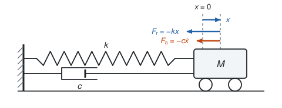
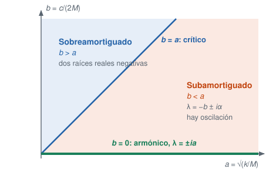
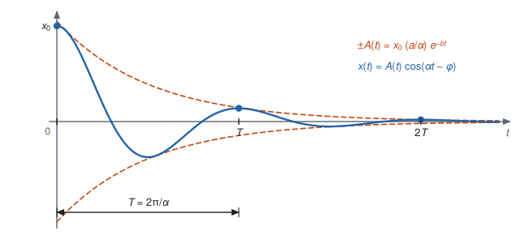
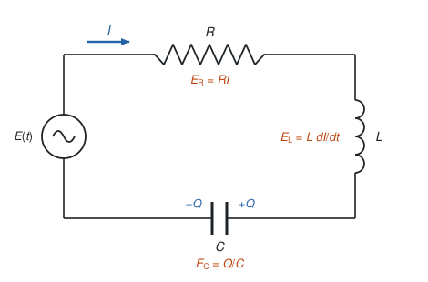
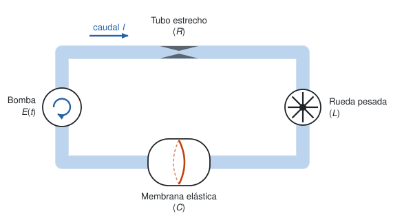

Esta sección sigue el §20 del Simmons (vibraciones en sistemas mecánicos y eléctricos), con el §13 para los circuitos. Empezamos con un resorte y al final vemos que el mismo modelo describe un circuito eléctrico, de modo que todo lo que aprendamos del uno vale para el otro.

Convención: un punto sobre una variable indica derivada respecto al tiempo, $\dot x=dx/dt$, y dos puntos indican la segunda derivada.

## Un resorte con rozamiento

Suponga que tenemos un resorte con un extremo fijo y el otro atado a una masa $M$, como en la @fig-resorte. La fuerza restauradora del resorte es

$$F_r=-kx,$$

donde $x$ es el desplazamiento desde la posición de equilibrio y $k>0$ es la constante de Hooke. Si además suponemos que no hay rozamiento con el suelo pero el medio es viscoso, aparece una fuerza de amortiguamiento proporcional a la velocidad,

$$F_a=-c\dot x,\qquad c\geq0.$$

{#fig-resorte width=75%}

Por la segunda ley de Newton,

$$M\ddot x=-c\dot x-kx\qquad\Longrightarrow\qquad M\ddot x+c\dot x+kx=0.$$

Dividimos por $M$ y escribimos

$$b=\frac{c}{2M},\qquad a=\sqrt{\frac kM},$$

de modo que la ecuación queda

$$\ddot x+2b\dot x+a^2x=0.$$

El polinomio característico es $\lambda^2+2b\lambda+a^2=0$, con raíces

$$\lambda=-b\pm\sqrt{b^2-a^2},\qquad \Delta=b^2-a^2.$$

El signo de $\Delta$ decide el comportamiento. Como $a$ y $b$ son positivos o nulos, todo se resume en el plano $(a,b)$ de la @fig-plano: la recta $b=a$ separa los dos regímenes oscilatorio y no oscilatorio, y el eje $b=0$ es el caso sin rozamiento.

{#fig-plano width=70%}

**Caso $b=0$ (armónico).** Sin rozamiento las raíces son imaginarias puras, $\lambda=\pm ia$, y $x=c_1\cos at+c_2\sin at$. Es un movimiento periódico de periodo $2\pi/a$ y amplitud constante.

**Caso $0<b<a$ (subamortiguado).** El discriminante es negativo y las raíces son complejas conjugadas, $\lambda=-b\pm i\sqrt{a^2-b^2}$. Hay oscilación, pero con una amplitud que decae.

**Caso $b=a$ (críticamente amortiguado).** Hay una raíz doble, $\lambda=-b$, y $x=(c_1+c_2t)e^{-bt}$. No hay oscilación, y el carrito vuelve al equilibrio lo más rápido posible.

**Caso $b>a$ (sobreamortiguado).** Hay dos raíces reales distintas y las dos son negativas, porque $\sqrt{b^2-a^2}<b$ ya que $a^2>0$. La solución $c_1e^{\lambda_1t}+c_2e^{\lambda_2t}$ decae sin oscilar.

## La oscilación subamortiguada

Quedémonos en el caso subamortiguado, que incluye al armónico cuando $b=0$. Pongamos las condiciones iniciales $x(0)=x_0$ y $\dot x(0)=0$: soltamos el carrito en reposo desde la posición $x_0$. Con

$$\alpha=\sqrt{a^2-b^2}$$

la solución general es $e^{-bt}(c_1\cos\alpha t+c_2\sin\alpha t)$. La condición $x(0)=x_0$ da $c_1=x_0$, y como

$$\dot x=e^{-bt}\left[(-bc_1+\alpha c_2)\cos\alpha t-(bc_2+\alpha c_1)\sin\alpha t\right],$$

la condición $\dot x(0)=0$ da $c_2=bx_0/\alpha$. Entonces

$$x(t)=\frac{x_0}{\alpha}\,e^{-bt}\left(\alpha\cos\alpha t+b\sin\alpha t\right).$$

Si hacemos $\varphi=\arctan(b/\alpha)$, como $\sqrt{\alpha^2+b^2}=a$ podemos escribirla en la forma de amplitud y fase,

$$x(t)=x_0\,\frac{\sqrt{\alpha^2+b^2}}{\alpha}\,e^{-bt}\cos(\alpha t-\varphi).$$

::: {.callout-important title="Tarea"}
Verifique que las dos expresiones de $x(t)$ coinciden, y encuentre la forma de amplitud y fase cuando la velocidad inicial es $v_0\neq0$.
:::

La amplitud

$$A(t)=x_0\,\frac{\sqrt{\alpha^2+b^2}}{\alpha}\,e^{-bt}$$

decrece con el tiempo a menos que $b=0$, que es la oscilación armónica. El siguiente tablero resuelve la ecuación con el carrito y la gráfica de la solución. Mueva $a$, $b$ y $x_0$, o recorra los cuatro regímenes con los botones, incluido $b=0$. Cuando $b<a$, la curva punteada naranja es la envolvente $\pm A(t)$ y las líneas verticales punteadas marcan los múltiplos del periodo.

::: {.callout-note title="Simulador: el resorte libre"}
```{=html}
<style>
  .osc-caja{border:3px solid #ddd;border-radius:8px;padding:14px;max-width:780px;margin:1em auto;font-family:sans-serif;background:#fff;color:#222;transition:border-color .2s,box-shadow .2s;}
  .osc-caja canvas{display:block;width:100%;height:auto;background:#fff;border:1px solid #e3e3e3;border-radius:6px;margin-top:8px;}
  .osc-caja button{padding:5px 11px;border:1px solid #bbb;border-radius:6px;background:#f5f5f5;color:#222;cursor:pointer;font-size:0.9em;}
  .osc-caja button:hover{background:#e9e9e9;}
  .osc-fila{display:flex;align-items:center;gap:10px;flex-wrap:wrap;}
  .osc-insignia{padding:3px 12px;border-radius:12px;font-size:0.9em;background:#eee;color:#333;}
  .osc-ctrl{display:grid;grid-template-columns:repeat(auto-fit,minmax(210px,1fr));gap:8px 18px;margin-top:12px;}
  .osc-ctrl label{font-size:0.92em;display:block;}
  .osc-ctrl input[type=range]{width:100%;}
  .osc-dos{display:grid;grid-template-columns:1fr 1fr;gap:8px;}
  @media (max-width:640px){.osc-dos{grid-template-columns:1fr;}}
  .osc-botones{display:flex;gap:6px;flex-wrap:wrap;margin-top:10px;}
  .osc-info{margin-top:10px;font-size:0.93em;line-height:1.5;}
</style>
<div id="osc-libre"></div>
<script>
/*NUCLEO*/
function armarOsc(p){
  var a = p.a, b = p.b, w = p.w, F0 = p.F0, x0 = p.x0, v0 = 0;
  var TOL = 1e-9;
  var resPura = (F0 > 0 && b < TOL && Math.abs(w - a) < TOL);
  var C = 0, del = 0, xp0 = 0, vp0 = 0;
  var xpf = function(t){ return 0; }, vpf = function(t){ return 0; };
  if (F0 > 0) {
    if (resPura) {
      C = Infinity;
      xpf = function(t){ return F0 * t * Math.sin(a * t) / (2 * a); };
      vpf = function(t){ return F0 / (2 * a) * (Math.sin(a * t) + a * t * Math.cos(a * t)); };
    } else {
      var D = Math.sqrt(Math.pow(a * a - w * w, 2) + 4 * b * b * w * w);
      C = F0 / D;
      del = Math.atan2(2 * b * w, a * a - w * w);
      xpf = function(t){ return C * Math.cos(w * t - del); };
      vpf = function(t){ return -C * w * Math.sin(w * t - del); };
    }
    xp0 = xpf(0); vp0 = vpf(0);
  }
  var xh0 = x0 - xp0, vh0 = v0 - vp0;
  var disc = b * b - a * a, tipo, alpha = 0, r1 = 0, r2 = 0, hom, hv, c1, c2, A, B;
  if (Math.abs(disc) < TOL) {
    tipo = 'critico';
    c1 = xh0; c2 = vh0 + b * xh0;
    hom = function(t){ return (c1 + c2 * t) * Math.exp(-b * t); };
    hv = function(t){ return (c2 - b * (c1 + c2 * t)) * Math.exp(-b * t); };
  } else if (disc > 0) {
    tipo = 'sobre';
    var s = Math.sqrt(disc); r1 = -b + s; r2 = -b - s;
    c2 = (vh0 - r1 * xh0) / (r2 - r1); c1 = xh0 - c2;
    hom = function(t){ return c1 * Math.exp(r1 * t) + c2 * Math.exp(r2 * t); };
    hv = function(t){ return c1 * r1 * Math.exp(r1 * t) + c2 * r2 * Math.exp(r2 * t); };
  } else {
    alpha = Math.sqrt(-disc);
    tipo = (b < TOL) ? 'armonico' : 'sub';
    A = xh0; B = (vh0 + b * xh0) / alpha;
    hom = function(t){ return Math.exp(-b * t) * (A * Math.cos(alpha * t) + B * Math.sin(alpha * t)); };
    hv = function(t){ return Math.exp(-b * t) * ((-b * A + alpha * B) * Math.cos(alpha * t) + (-b * B - alpha * A) * Math.sin(alpha * t)); };
  }
  return {
    tipo: tipo, alpha: alpha, r1: r1, r2: r2, resPura: resPura, C: C, del: del,
    T: alpha > 0 ? 2 * Math.PI / alpha : Infinity,
    f: alpha > 0 ? alpha / (2 * Math.PI) : 0,
    K: alpha > 0 ? x0 * a / alpha : 0,
    fase: alpha > 0 ? Math.atan(b / alpha) : 0,
    estado: function(t){ return [hom(t) + xpf(t), hv(t) + vpf(t)]; },
    energia: function(t){ var e = [hom(t) + xpf(t), hv(t) + vpf(t)]; return 0.5 * (e[1] * e[1] + a * a * e[0] * e[0]); }
  };
}
function amplitudResp(a, b, F0, w){
  var D = Math.sqrt(Math.pow(a * a - w * w, 2) + 4 * b * b * w * w);
  return D === 0 ? Infinity : F0 / D;
}
/*FIN NUCLEO*/

window.crearTableroOsc = function(idRaiz, opc){
  var raiz = document.getElementById(idRaiz);
  if (!raiz) return;
  var forzado = !!opc.forzado;
  var TMAX = 40, NPTS = 800;
  var AZUL = '#1f5fa8', ROJO = '#c1440e', GRIS = '#777', VERDE = '#1a7f5a';
  var p = {a: 2, b: 0.3, w: 1.5, F0: 0, x0: 1};
  Object.keys(opc.inicial).forEach(function(k){ p[k] = opc.inicial[k]; });

  var defs = forzado
    ? [['a', 'a, frecuencia natural', 0.5, 4], ['b', 'b, amortiguamiento', 0, 3], ['w', 'ω, frecuencia del forzamiento', 0.1, 6], ['F0', 'F₀, amplitud del forzamiento', 0, 2], ['x0', 'x₀, posición inicial', -2, 2]]
    : [['a', 'a, frecuencia natural', 0.5, 4], ['b', 'b, amortiguamiento', 0, 3], ['x0', 'x₀, posición inicial', -2, 2]];

  var html = '<div class="osc-fila"><div class="osc-insignia" data-r="insignia"></div><div style="font-size:0.9em;color:#555;" data-r="reloj"></div></div>' +
    '<canvas data-r="cart" width="760" height="150" role="img" aria-label="Carrito unido a un resorte"></canvas>' +
    '<canvas data-r="x" width="760" height="230" role="img" aria-label="Gráfica de la posición x(t)"></canvas>';
  if (forzado) {
    html += '<div class="osc-dos"><canvas data-r="resp" width="380" height="220" role="img" aria-label="Amplitud estacionaria en función de la frecuencia"></canvas>' +
      '<canvas data-r="en" width="380" height="220" role="img" aria-label="Energía en función del tiempo"></canvas></div>';
  }
  html += '<div class="osc-ctrl">';
  defs.forEach(function(d){
    html += '<label>' + d[1] + ' = <strong data-v="' + d[0] + '"></strong><input type="range" data-s="' + d[0] + '" min="' + d[2] + '" max="' + d[3] + '" step="0.05" aria-label="' + d[1] + '"></label>';
  });
  html += '</div><div class="osc-botones"><button type="button" data-r="play">❚❚ Pausar</button><button type="button" data-r="reset">↺ Reiniciar</button><button type="button" data-r="vel">Velocidad ×1</button></div>' +
    '<div class="osc-botones" data-r="presets"></div><div class="osc-info" data-r="info"></div>';
  raiz.innerHTML = html;
  raiz.classList.add('osc-caja');

  function q(n){ return raiz.querySelector('[data-r="' + n + '"]'); }
  var cCart = q('cart'), cX = q('x'), cResp = q('resp'), cEn = q('en');
  var gCart = cCart.getContext('2d'), gX = cX.getContext('2d');
  var gResp = cResp ? cResp.getContext('2d') : null, gEn = cEn ? cEn.getContext('2d') : null;
  var info = q('info'), insignia = q('insignia'), reloj = q('reloj'), btnPlay = q('play'), btnVel = q('vel');

  var sol, t = 0, jugando = true, visible = true, ultimo = null, vel = 1;
  var xs = [], Es = [], yMax = 1, eMax = 1;

  function redondear(v){ return Math.round(v * 100) / 100; }
  function fmt(v, d){
    if (d === undefined) d = 2;
    if (!isFinite(v)) return '∞';
    return v.toFixed(d).replace('-', '−');
  }

  function recalcular(){
    sol = armarOsc(p);
    xs = []; Es = [];
    var mx = 0, me = 0;
    for (var i = 0; i <= NPTS; i++) {
      var tt = TMAX * i / NPTS, e = sol.estado(tt), en = 0.5 * (e[1] * e[1] + p.a * p.a * e[0] * e[0]);
      xs.push(e[0]); Es.push(en);
      if (Math.abs(e[0]) > mx) mx = Math.abs(e[0]);
      if (en > me) me = en;
    }
    yMax = Math.max(0.5, mx * 1.12);
    eMax = Math.max(0.5, me * 1.08);
  }

  function flecha(g, x1, y1, x2, y2, color){
    var ang = Math.atan2(y2 - y1, x2 - x1), h = 8;
    g.strokeStyle = color; g.fillStyle = color; g.lineWidth = 2.4;
    g.beginPath(); g.moveTo(x1, y1); g.lineTo(x2, y2); g.stroke();
    g.beginPath(); g.moveTo(x2, y2);
    g.lineTo(x2 - h * Math.cos(ang - 0.45), y2 - h * Math.sin(ang - 0.45));
    g.lineTo(x2 - h * Math.cos(ang + 0.45), y2 - h * Math.sin(ang + 0.45));
    g.closePath(); g.fill();
  }

  function dibujarCarrito(){
    var g = gCart, W = cCart.width, H = cCart.height;
    g.clearRect(0, 0, W, H);
    var xt = sol.estado(t)[0], cx0 = 400, escala = 150 / yMax;
    var pos = cx0 + escala * xt, cw = 80, ch = 44, top = 62, suelo = 128;
    g.strokeStyle = '#222'; g.lineWidth = 2;
    g.beginPath(); g.moveTo(20, suelo); g.lineTo(W - 20, suelo); g.stroke();
    g.lineWidth = 3; g.beginPath(); g.moveTo(40, 40); g.lineTo(40, suelo); g.stroke();
    g.lineWidth = 1.2; g.strokeStyle = '#888';
    for (var y = 44; y < suelo; y += 10) { g.beginPath(); g.moveTo(40, y); g.lineTo(30, y + 10); g.stroke(); }
    g.setLineDash([4, 4]); g.strokeStyle = '#999'; g.lineWidth = 1.2;
    g.beginPath(); g.moveTo(cx0, 22); g.lineTo(cx0, suelo); g.stroke(); g.setLineDash([]);
    g.fillStyle = '#666'; g.font = '13px sans-serif'; g.textAlign = 'center'; g.fillText('x = 0', cx0, 16);
    var izq = pos - cw / 2;
    g.strokeStyle = '#222'; g.lineWidth = 1.8;
    g.beginPath(); g.moveTo(40, 80); g.lineTo(54, 80);
    var n = 14, x1 = 54, x2 = izq - 14;
    for (var i = 1; i < 2 * n; i++) { g.lineTo(x1 + (x2 - x1) * i / (2 * n), 80 + (i % 2 ? 11 : -11)); }
    g.lineTo(x2, 80); g.lineTo(izq, 80); g.stroke();
    if (p.b > 0) {
      var piston = Math.max(76, Math.min(128, 102 + 0.25 * (pos - cx0)));
      g.globalAlpha = Math.min(1, 0.35 + p.b / 1.5);
      g.beginPath(); g.moveTo(40, 100); g.lineTo(70, 100); g.stroke();
      g.beginPath(); g.moveTo(134, 91); g.lineTo(70, 91); g.lineTo(70, 109); g.lineTo(134, 109); g.stroke();
      g.lineWidth = 3.5; g.beginPath(); g.moveTo(piston, 94); g.lineTo(piston, 106); g.stroke();
      g.lineWidth = 1.8; g.beginPath(); g.moveTo(piston, 100); g.lineTo(izq, 100); g.stroke();
      g.globalAlpha = 1;
    }
    g.fillStyle = '#f2f5f7'; g.strokeStyle = '#222'; g.lineWidth = 2;
    g.beginPath(); g.rect(izq, top, cw, ch); g.fill(); g.stroke();
    [izq + 17, izq + cw - 17].forEach(function(wx){
      g.fillStyle = '#fff'; g.beginPath(); g.arc(wx, suelo - 10, 10, 0, 2 * Math.PI); g.fill(); g.stroke();
    });
    g.fillStyle = '#222'; g.font = 'italic 16px serif'; g.textAlign = 'center'; g.fillText('M', pos, top + 28);
    if (forzado && p.F0 > 0) {
      var Fv = p.F0 * Math.cos(p.w * t), len = 34 * Fv;
      if (Math.abs(len) > 2) flecha(g, pos, 48, pos + len, 48, ROJO);
      g.fillStyle = ROJO; g.font = '13px sans-serif'; g.textAlign = 'center';
      g.fillText('F(t)', pos, 36);
    }
  }

  function dibujarX(){
    var g = gX, W = cX.width, H = cX.height, L = 56, R = 14, T = 16, B = 30;
    g.clearRect(0, 0, W, H);
    function X(tt){ return L + tt / TMAX * (W - L - R); }
    function Y(v){ return H - B - (v + yMax) / (2 * yMax) * (H - T - B); }
    g.strokeStyle = '#e6e6e6'; g.lineWidth = 1; g.fillStyle = '#666'; g.font = '12px sans-serif';
    [-yMax, 0, yMax].forEach(function(v){
      g.beginPath(); g.moveTo(L, Y(v)); g.lineTo(W - R, Y(v)); g.stroke();
      g.textAlign = 'right'; g.fillText(fmt(v, 2), L - 6, Y(v) + 4);
    });
    for (var tk = 0; tk <= TMAX; tk += 10) {
      g.beginPath(); g.moveTo(X(tk), Y(0) - 4); g.lineTo(X(tk), Y(0) + 4); g.strokeStyle = '#999'; g.stroke();
      g.textAlign = 'center'; g.fillText(String(tk), X(tk), H - 10);
    }
    g.textAlign = 'left'; g.fillText('x', L + 6, T + 8); g.textAlign = 'right'; g.fillText('t', W - R, Y(0) - 8);
    g.strokeStyle = '#555'; g.lineWidth = 1.4; g.beginPath(); g.moveTo(L, Y(0)); g.lineTo(W - R, Y(0)); g.stroke();
    g.beginPath(); g.moveTo(L, T); g.lineTo(L, H - B); g.stroke();
    if (p.F0 === 0 && sol.alpha > 0 && isFinite(sol.T)) {
      g.setLineDash([2, 4]); g.strokeStyle = '#bbb'; g.lineWidth = 1;
      for (var k = 1; k * sol.T < TMAX && k < 41; k++) { g.beginPath(); g.moveTo(X(k * sol.T), T); g.lineTo(X(k * sol.T), H - B); g.stroke(); }
      g.setLineDash([]);
      if (sol.T < TMAX) { g.fillStyle = '#888'; g.textAlign = 'center'; g.fillText('T', X(sol.T), T + 10); }
    }
    g.setLineDash([6, 4]); g.strokeStyle = ROJO; g.lineWidth = 1.6; g.fillStyle = ROJO;
    if (p.F0 === 0 && sol.tipo === 'sub') {
      [1, -1].forEach(function(sg){
        g.beginPath();
        for (var i = 0; i <= NPTS; i++) { var tt = TMAX * i / NPTS, v = sg * sol.K * Math.exp(-p.b * tt); if (i === 0) g.moveTo(X(tt), Y(v)); else g.lineTo(X(tt), Y(v)); }
        g.stroke();
      });
      g.setLineDash([]); g.textAlign = 'left'; g.fillText('±A(t)', X(TMAX * 0.2) + 6, Y(sol.K * Math.exp(-p.b * TMAX * 0.2)) - 8);
    } else if (p.F0 > 0 && p.b > 0 && isFinite(sol.C) && sol.C < yMax * 1.02) {
      [1, -1].forEach(function(sg){ g.beginPath(); g.moveTo(L, Y(sg * sol.C)); g.lineTo(W - R, Y(sg * sol.C)); g.stroke(); });
      g.setLineDash([]); g.textAlign = 'right'; g.fillText('±C', W - R, Y(sol.C) - 6);
    }
    g.setLineDash([]);
    g.strokeStyle = 'rgba(31,95,168,0.25)'; g.lineWidth = 2; g.beginPath();
    for (var j = 0; j <= NPTS; j++) { var t2 = TMAX * j / NPTS; if (j === 0) g.moveTo(X(t2), Y(xs[j])); else g.lineTo(X(t2), Y(xs[j])); }
    g.stroke();
    g.strokeStyle = AZUL; g.lineWidth = 2.6; g.beginPath();
    var nUp = Math.max(1, Math.round(t / TMAX * NPTS));
    for (var m = 0; m <= nUp; m++) { var t3 = TMAX * m / NPTS; if (m === 0) g.moveTo(X(t3), Y(xs[m])); else g.lineTo(X(t3), Y(xs[m])); }
    g.stroke();
    var xa = sol.estado(t)[0];
    g.fillStyle = AZUL; g.beginPath(); g.arc(X(t), Y(xa), 5, 0, 2 * Math.PI); g.fill();
  }

  function dibujarEnergia(){
    var g = gEn, W = cEn.width, H = cEn.height, L = 46, R = 10, T = 26, B = 28;
    g.clearRect(0, 0, W, H);
    function X(tt){ return L + tt / TMAX * (W - L - R); }
    function Y(v){ return H - B - Math.min(v, eMax) / eMax * (H - T - B); }
    g.fillStyle = '#333'; g.font = '13px sans-serif'; g.textAlign = 'left';
    g.fillText('Energía E = ½ẋ² + ½a²x²', L, 16);
    g.fillStyle = '#666'; g.font = '12px sans-serif';
    [0, eMax].forEach(function(v){ g.textAlign = 'right'; g.fillText(fmt(v, v === 0 ? 0 : 1), L - 5, Y(v) + 4); });
    for (var tk = 0; tk <= TMAX; tk += 10) { g.textAlign = 'center'; g.fillText(String(tk), X(tk), H - 10); }
    g.strokeStyle = '#555'; g.lineWidth = 1.4;
    g.beginPath(); g.moveTo(L, Y(0)); g.lineTo(W - R, Y(0)); g.stroke();
    g.beginPath(); g.moveTo(L, T - 6); g.lineTo(L, H - B); g.stroke();
    if (sol.resPura) {
      g.setLineDash([6, 4]); g.strokeStyle = ROJO; g.lineWidth = 1.6; g.beginPath();
      for (var i = 0; i <= NPTS; i++) { var tt = TMAX * i / NPTS, v = p.F0 * p.F0 * tt * tt / 8; if (i === 0) g.moveTo(X(tt), Y(v)); else g.lineTo(X(tt), Y(v)); }
      g.stroke(); g.setLineDash([]); g.fillStyle = ROJO; g.textAlign = 'left'; g.fillText('F₀² t²/8', L + 8, T + 12);
    }
    g.strokeStyle = 'rgba(31,95,168,0.25)'; g.lineWidth = 2; g.beginPath();
    for (var j = 0; j <= NPTS; j++) { var t2 = TMAX * j / NPTS; if (j === 0) g.moveTo(X(t2), Y(Es[j])); else g.lineTo(X(t2), Y(Es[j])); }
    g.stroke();
    g.strokeStyle = AZUL; g.lineWidth = 2.6; g.beginPath();
    var nUp = Math.max(1, Math.round(t / TMAX * NPTS));
    for (var m = 0; m <= nUp; m++) { var t3 = TMAX * m / NPTS; if (m === 0) g.moveTo(X(t3), Y(Es[m])); else g.lineTo(X(t3), Y(Es[m])); }
    g.stroke();
    g.fillStyle = AZUL; g.beginPath(); g.arc(X(t), Y(sol.energia(t)), 4.5, 0, 2 * Math.PI); g.fill();
  }

  function dibujarResp(){
    var g = gResp, W = cResp.width, H = cResp.height, L = 46, R = 10, T = 26, B = 28, WM = 6;
    g.clearRect(0, 0, W, H);
    g.fillStyle = '#333'; g.font = '13px sans-serif'; g.textAlign = 'left';
    g.fillText('Amplitud estacionaria C(ω)', L, 16);
    function X(w){ return L + w / WM * (W - L - R); }
    g.strokeStyle = '#555'; g.lineWidth = 1.4;
    g.beginPath(); g.moveTo(L, H - B); g.lineTo(W - R, H - B); g.stroke();
    g.beginPath(); g.moveTo(L, T - 6); g.lineTo(L, H - B); g.stroke();
    g.fillStyle = '#666'; g.font = '12px sans-serif'; g.textAlign = 'center';
    for (var tk = 0; tk <= WM; tk += 1) g.fillText(String(tk), X(tk), H - 10);
    g.textAlign = 'right'; g.fillText('ω', W - R, H - B - 6);
    if (p.F0 <= 0) { g.fillStyle = '#888'; g.textAlign = 'center'; g.font = '13px sans-serif'; g.fillText('F₀ = 0: no hay forzamiento', (L + W - R) / 2, H / 2); return; }
    var pts = [], mx = 0, i;
    for (i = 0; i <= 400; i++) { var w = WM * i / 400, c = amplitudResp(p.a, p.b, p.F0, w); pts.push(c); if (isFinite(c) && c > mx) mx = c; }
    var cap = 8 * p.F0 / (p.a * p.a), ymax = Math.min(mx * 1.08, cap);
    ymax = Math.max(ymax, 0.2);
    function Y(v){ return H - B - Math.min(v, ymax * 1.02) / ymax * (H - T - B); }
    g.textAlign = 'right'; g.fillStyle = '#666'; g.fillText(fmt(ymax, 1), L - 5, Y(ymax) + 4); g.fillText('0', L - 5, H - B + 4);
    g.setLineDash([3, 4]); g.strokeStyle = VERDE; g.lineWidth = 1.2;
    g.beginPath(); g.moveTo(X(p.a), T - 6); g.lineTo(X(p.a), H - B); g.stroke();
    g.setLineDash([]); g.fillStyle = VERDE; g.textAlign = 'left'; g.fillText('a', X(p.a) + 4, T + 8);
    g.strokeStyle = AZUL; g.lineWidth = 2.6; g.beginPath();
    for (i = 0; i <= 400; i++) { var ww = WM * i / 400, v = pts[i]; if (!isFinite(v)) v = ymax * 1.02; if (i === 0) g.moveTo(X(ww), Y(v)); else g.lineTo(X(ww), Y(v)); }
    g.stroke();
    var cw = amplitudResp(p.a, p.b, p.F0, p.w);
    g.setLineDash([5, 4]); g.strokeStyle = ROJO; g.lineWidth = 1.4;
    g.beginPath(); g.moveTo(X(p.w), T - 6); g.lineTo(X(p.w), H - B); g.stroke(); g.setLineDash([]);
    g.fillStyle = ROJO; g.beginPath(); g.arc(X(p.w), Y(isFinite(cw) ? cw : ymax * 1.02), 5, 0, 2 * Math.PI); g.fill();
    g.fillStyle = ROJO; g.textAlign = 'center'; g.fillText('ω', X(p.w), Math.max(T, Y(isFinite(cw) ? cw : ymax * 1.02) - 9));
  }

  function actualizarInfo(){
    var s = sol, h = '', a = p.a, b = p.b;
    var nombres = {armonico: 'Oscilación armónica (b = 0)', sub: 'Subamortiguado (b < a)', critico: 'Críticamente amortiguado (b = a)', sobre: 'Sobreamortiguado (b > a)'};
    var tx = s.resPura ? 'Resonancia pura: b = 0 y ω = a' : nombres[s.tipo];
    insignia.textContent = tx;
    insignia.style.background = s.resPura ? ROJO : '#eee';
    insignia.style.color = s.resPura ? '#fff' : '#333';
    insignia.style.fontWeight = s.resPura ? 'bold' : 'normal';
    raiz.style.borderColor = s.resPura ? ROJO : '#ddd';
    raiz.style.boxShadow = s.resPura ? '0 0 0 4px rgba(214,39,40,0.2)' : 'none';
    if (s.tipo === 'armonico') h += '<div><strong>Raíces:</strong> λ = ± i a = ± ' + fmt(a) + ' i</div>';
    else if (s.tipo === 'sub') h += '<div><strong>Raíces:</strong> λ = −b ± iα = ' + fmt(-b) + ' ± ' + fmt(s.alpha) + ' i</div>';
    else if (s.tipo === 'critico') h += '<div><strong>Raíz doble:</strong> λ = −b = ' + fmt(-b) + '</div>';
    else h += '<div><strong>Raíces:</strong> λ₁ = ' + fmt(s.r1) + ', λ₂ = ' + fmt(s.r2) + '</div>';
    if (s.alpha > 0) h += '<div><strong>Periodo y frecuencia:</strong> α = ' + fmt(s.alpha) + ', T = 2π/α = ' + fmt(s.T) + ', f = 1/T = ' + fmt(s.f, 3) + '</div>';
    if (p.F0 === 0 && s.tipo === 'sub') h += '<div><strong>Amplitud y fase:</strong> A(t) = x₀ (a/α) e<sup>−bt</sup> = ' + fmt(s.K) + ' e<sup>−' + fmt(b) + ' t</sup>, φ = arctan(b/α) = ' + fmt(s.fase, 3) + ' rad</div>';
    if (p.F0 === 0 && s.tipo === 'armonico') h += '<div><strong>Amplitud:</strong> constante, igual a ' + fmt(Math.abs(p.x0)) + '</div>';
    if (forzado && p.F0 > 0) {
      if (s.resPura) h += '<div style="margin-top:6px;"><strong>Solución particular:</strong> x<sub>p</sub> = F₀ t sen(at)/(2a). La amplitud crece como F₀ t/(2a) y la energía como F₀² t²/8.</div>';
      else if (b > 0) h += '<div style="margin-top:6px;"><strong>Estado estacionario:</strong> C = ' + fmt(s.C) + ', δ = ' + fmt(s.del, 3) + ' rad. Frente a la respuesta estática F₀/a² = ' + fmt(p.F0 / (a * a)) + ', la amplitud se multiplica por ' + fmt(s.C * a * a / p.F0) + '.</div>';
      else h += '<div style="margin-top:6px;"><strong>Sin amortiguamiento</strong> no hay estado estacionario: el término libre no decae. Con ω cerca de a se ven batimientos.</div>';
    }
    h += '<div style="margin-top:6px;color:#555;">t = ' + fmt(t, 1) + ', x = ' + fmt(sol.estado(t)[0]) + ', E = ' + fmt(sol.energia(t)) + '</div>';
    info.innerHTML = h;
  }

  function dibujar(){
    dibujarCarrito(); dibujarX();
    if (forzado) { dibujarResp(); dibujarEnergia(); }
    reloj.textContent = 't = ' + fmt(t, 1);
    actualizarInfo();
  }

  function sincronizar(){
    defs.forEach(function(d){
      raiz.querySelector('[data-s="' + d[0] + '"]').value = String(p[d[0]]);
      raiz.querySelector('[data-v="' + d[0] + '"]').textContent = fmt(p[d[0]]);
    });
  }

  function cambiar(){ recalcular(); t = 0; sincronizar(); dibujar(); }

  defs.forEach(function(d){
    raiz.querySelector('[data-s="' + d[0] + '"]').addEventListener('input', function(ev){
      p[d[0]] = redondear(parseFloat(ev.target.value)); cambiar();
    });
  });

  var contP = q('presets');
  opc.presets.forEach(function(pr){
    var bt = document.createElement('button'); bt.type = 'button'; bt.textContent = pr[0];
    bt.addEventListener('click', function(){ Object.keys(pr[1]).forEach(function(k){ p[k] = pr[1][k]; }); cambiar(); });
    contP.appendChild(bt);
  });

  btnPlay.addEventListener('click', function(){
    jugando = !jugando;
    btnPlay.textContent = jugando ? '❚❚ Pausar' : '▶ Seguir';
    if (jugando) { ultimo = null; requestAnimationFrame(ciclo); }
  });
  q('reset').addEventListener('click', function(){ t = 0; dibujar(); });
  btnVel.addEventListener('click', function(){
    vel = (vel === 1) ? 2 : (vel === 2 ? 0.5 : 1);
    btnVel.textContent = 'Velocidad ×' + vel;
  });

  function ciclo(ts){
    if (!jugando || !visible) { ultimo = null; return; }
    if (ultimo === null) ultimo = ts;
    var dt = Math.min((ts - ultimo) / 1000, 0.05); ultimo = ts;
    t += dt * vel;
    if (t > TMAX) t = 0;
    dibujar();
    requestAnimationFrame(ciclo);
  }

  if ('IntersectionObserver' in window) {
    new IntersectionObserver(function(es){
      visible = es[0].isIntersecting;
      if (visible && jugando) { ultimo = null; requestAnimationFrame(ciclo); }
    }, {threshold: 0.05}).observe(raiz);
  }

  cambiar();
  requestAnimationFrame(ciclo);
};
window.crearTableroOsc('osc-libre', {
  forzado: false,
  inicial: {a: 2, b: 0.3, w: 1, F0: 0, x0: 1},
  presets: [
    ['Armónico (b = 0)', {a: 2, b: 0, x0: 1}],
    ['Subamortiguado', {a: 2, b: 0.3, x0: 1}],
    ['Crítico (b = a)', {a: 2, b: 2, x0: 1}],
    ['Sobreamortiguado', {a: 2, b: 3, x0: 1}]
  ]
});
</script>
```
:::

El periodo $T$ es lo que tarda el carrito en completar un ciclo. La función no es periódica en sentido estricto, pero el cociente $x(t)/A(t)=\cos(\alpha t-\varphi)$ se repite cada vez que $\alpha t$ avanza $2\pi$, es decir, cuando $\alpha T=2\pi$. Entonces

$$T=\frac{2\pi}{\alpha},\qquad f=\frac1T=\frac{\alpha}{2\pi}=\frac1{2\pi}\sqrt{\frac kM-\frac{c^2}{4M^2}}.$$

Este número se llama la frecuencia natural del sistema (cuando $b=0$ vale $a/2\pi$), y el amortiguamiento la disminuye. El ángulo $\varphi$ se llama el ángulo de fase. La @fig-amortiguada resume todo esto en una gráfica.

{#fig-amortiguada width=90%}

## Oscilaciones forzadas

Veamos ahora qué pasa cuando sobre el carrito actúa una fuerza externa. Usualmente se toman forzamientos periódicos,

$$\ddot x+2b\dot x+a^2x=F_0\cos\omega t,$$

donde $\omega$ es la frecuencia del forzamiento y $F_0$ es la amplitud de la fuerza por unidad de masa (la fuerza externa dividida por $M$).

Como ya conocemos la solución general de la ecuación reducida, solo falta una solución particular. Busquémosla de la forma

$$x_p=C_1\cos\omega t+C_2\sin\omega t.$$

Al reemplazar, los coeficientes de $\cos\omega t$ y de $\sin\omega t$ dan el sistema

$$(a^2-\omega^2)\,C_1+2b\omega\,C_2=F_0,\qquad -2b\omega\,C_1+(a^2-\omega^2)\,C_2=0,$$

cuyo determinante es $D^2=(a^2-\omega^2)^2+4b^2\omega^2$, y cuya solución es

$$C_1=\frac{F_0\,(a^2-\omega^2)}{D^2},\qquad C_2=\frac{2b\omega\,F_0}{D^2}.$$

Definamos $\delta$ por $\cos\delta=(a^2-\omega^2)/D$ y $\sin\delta=2b\omega/D$. Como $C_1=\frac{F_0}{D}\cos\delta$ y $C_2=\frac{F_0}{D}\sin\delta$, resulta

$$x_p=\frac{F_0}{\sqrt{(a^2-\omega^2)^2+4b^2\omega^2}}\,\cos(\omega t-\delta),$$

donde $\delta=\arctan\dfrac{2b\omega}{a^2-\omega^2}$ cuando $\omega<a$.

Si el movimiento es amortiguado ($b>0$), el término libre de la solución general decae como $e^{-bt}$ en los tres regímenes, porque las raíces tienen parte real negativa, y la solución tiende a $x_p$. Por eso a $x_p$ también se le conoce como el *estado estacionario*, y a lo que se va se le llama el *transitorio*.

Hagamos el caso armónico como ilustración, es decir, $b=0$:

$$\ddot x+a^2x=F_0\cos\omega t.$$

La solución general de la reducida es $A\cos(at-\phi)$. Si suponemos $x_p=C_1\cos\omega t+C_2\sin\omega t$, al reemplazar queda

$$-C_1\omega^2\cos\omega t-C_2\omega^2\sin\omega t+a^2C_1\cos\omega t+a^2C_2\sin\omega t=F_0\cos\omega t,$$

es decir,

$$C_1\,(a^2-\omega^2)=F_0,\qquad C_2\,(a^2-\omega^2)=0.$$

Esto tiene solución siempre y cuando $a\neq\omega$, es decir, mientras el sistema no entre en resonancia. La *resonancia* es el caso $\omega=a$: la frecuencia del forzamiento igual a la natural del sistema.

::: {.callout-important title="Tarea"}
Dé un ejemplo con los columpios.
:::

Cuando $a\neq\omega$ se tiene $C_1=F_0/(a^2-\omega^2)$ y $C_2=0$, y la solución general es

$$x=A\cos(at-\phi)+\frac{F_0}{a^2-\omega^2}\cos\omega t.$$

Vemos que si $\omega\to a$ la solución adquiere una amplitud cada vez mayor. En $\omega=a$ exacto la primera ecuación queda $0\cdot C_1=F_0$, que no tiene solución, y hay que multiplicar por $t$, igual que en coeficientes indeterminados cuando el forzamiento es solución de la ecuación reducida. Probemos con

$$x_p=\frac{F_0}{2a}\,t\sin at.$$

Derivando,

$$\dot x_p=\frac{F_0}{2a}\left(\sin at+at\cos at\right),\qquad \ddot x_p=F_0\cos at-a^2x_p,$$

así que $\ddot x_p+a^2x_p=F_0\cos at$, y la solución general en resonancia es

$$x=A\cos(at-\phi)+\frac{F_0}{2a}\,t\sin at.$$

El segundo término oscila con una amplitud $F_0t/(2a)$ que crece linealmente y sin cota. Es la *resonancia pura*.

El siguiente tablero resuelve $\ddot x+2b\dot x+a^2x=F_0\cos\omega t$ con $\dot x(0)=0$, y muestra el carrito con la fuerza $F(t)$, la solución $x(t)$, la amplitud estacionaria $C(\omega)$ en función de la frecuencia del forzamiento, y la energía. Con $F_0=0$ se recupera el resorte libre. Pruebe los casos de los botones: en la resonancia pura ($b=0$, $\omega=a$) el tablero se enciende en rojo.

::: {.callout-note title="Simulador: el resorte forzado"}
```{=html}
<div id="osc-forzado"></div>
<script>
window.crearTableroOsc('osc-forzado', {
  forzado: true,
  inicial: {a: 2, b: 0.3, w: 1.5, F0: 1, x0: 0},
  presets: [
    ['Libre (F₀ = 0)', {F0: 0, x0: 1}],
    ['Estado estacionario', {a: 2, b: 0.5, w: 1.5, F0: 1, x0: 1}],
    ['Batimientos (ω cerca de a)', {a: 2, b: 0, w: 1.8, F0: 1, x0: 0}],
    ['Resonancia pura (b = 0, ω = a)', {a: 2, b: 0, w: 2, F0: 1, x0: 0}],
    ['Resonancia con amortiguamiento', {a: 2, b: 0.2, w: 2, F0: 1, x0: 0}],
    ['Caso de la tarea (a = 2, b = 1)', {a: 2, b: 1, w: 1.5, F0: 1, x0: 0}]
  ]
});
</script>
```
:::

### La energía en resonancia

¿Qué pasa con la energía? Por unidad de masa, la energía del oscilador es

$$E=\tfrac12\dot x^2+\tfrac12a^2x^2.$$

Derivando y usando la ecuación,

$$\dot E=\dot x\,(\ddot x+a^2x)=\dot x\,(F_0\cos\omega t-2b\dot x)=F_0\,\dot x\cos\omega t-2b\,\dot x^2.$$

El primer término es la potencia que entrega la fuerza y el segundo es la que disipa el rozamiento.

Sin rozamiento y en resonancia, de $x_p=\dfrac{F_0}{2a}\,t\sin at$ (que cumple $x(0)=0$ y $\dot x(0)=0$) sale la energía exacta

$$E(t)=\frac{F_0^2}{8a^2}\left(a^2t^2+\sin^2at+at\sin2at\right)\approx\frac{F_0^2\,t^2}{8}.$$

La velocidad es $\dot x\approx\frac{F_0t}{2}\cos at$, que está en fase con la fuerza $F_0\cos at$. La fuerza empuja siempre en el sentido del movimiento, entrega potencia positiva todo el tiempo, y la energía crece sin cota, como $t^2$. Es la curva punteada del panel de energía del tablero.

Con rozamiento la historia cambia. En $\omega=a$ la amplitud estacionaria es $C=F_0/(2ab)$, que es finita, y la potencia promedio que entrega la fuerza, $\tfrac12F_0C\omega\sin\delta$, coincide con la que disipa el rozamiento, $bC^2\omega^2$. La energía se estabiliza: en un sistema real la resonancia es una amplitud grande pero finita, producto del balance entre lo que entra y lo que se disipa.

::: {.callout-note title="Una nota de familia: Lazer y los puentes"}
El caso lineal que acabamos de ver es el fácil. ¿Qué pasa si la fuerza restauradora no es lineal, $\ddot x+g(x)=F_0\cos\omega t$? Es el caso *semilineal*, y ahí la pregunta de si hay soluciones cuando la parte lineal está en resonancia es delicada. La respuesta clásica es de Landesman y Lazer (1970): bajo condiciones sobre el comportamiento de la no linealidad en el infinito, sí hay solución aun cuando la parte lineal está en resonancia.

Alan Lazer fue el director de tesis de Alfonso Castro, y Castro codirigió la mía: Lazer es mi abuelo matemático, como se ve en la [página de genealogía](../../../research/genealogy/index.qmd). Con McKenna, Lazer propuso en 1990 un modelo de puente colgante en el que los cables resisten el estiramiento pero no la compresión. Ese modelo produce oscilaciones de gran amplitud sostenidas por forzamientos pequeños, y es uno de los que se han usado para intentar explicar el comportamiento de puentes como el de Tacoma. Conviene saber que la causa del colapso de Tacoma sigue en discusión: Billah y Scanlan (1991) criticaron la versión de los textos, que lo atribuye a un forzamiento resonante simple, y hoy muchos ingenieros apuntan más bien a la realimentación entre el viento y el movimiento del tablero (ver [este análisis](https://arxiv.org/pdf/physics/0408101)).

Lo que sí es conocimiento canónico es el fenómeno de resonancia que vimos arriba: aparece en los textos de ecuaciones diferenciales, como el Simmons (con el ejemplo de una columna de soldados que marcha sobre un puente) y el Zill.
:::

::: {.callout-important title="Tarea"}
¿Qué forzamiento debería tener un oscilador amortiguado para entrar en resonancia? Considere $a=2$ y $b=1$.
:::

## El circuito LRC

Imaginemos ahora un circuito en serie con una resistencia $R$, un inductor $L$ y un capacitor $C$, alimentado por una fuente de voltaje $E(t)$ (@fig-circuito). Sean $I$ la corriente y $Q$ la carga del capacitor. Cada elemento aporta una caída de voltaje:

{#fig-circuito width=70%}

- La resistencia se opone a la corriente: $E_R=RI$.
- El inductor se opone al cambio de la corriente: $E_L=L\,\dfrac{dI}{dt}$.
- El capacitor almacena una carga $Q$ y tiene capacitancia $C$. La carga acumulada en el condensador resiste la llegada de nueva carga: $E_C=\dfrac1C\,Q$.

La corriente es la tasa de cambio del flujo de carga,

$$I=\frac{dQ}{dt}.$$

::: {.callout-note title="La analogía con el agua y los tubos"}
Conviene pensar el circuito como un circuito de agua (@fig-hidraulica). La carga $Q$ es el volumen de agua que ha pasado, la corriente $I$ es el caudal y el voltaje es la presión.

La fuente $E(t)$ es una bomba que empuja el agua. La resistencia $R$ es un tubo estrecho: cuanto más estrecho, más presión hace falta para el mismo caudal, y la energía se pierde en forma de calor por la fricción. El inductor $L$ es una rueda de paletas pesada puesta en el tubo: al agua le cuesta ponerla en movimiento y le cuesta frenarla, así que se opone a los cambios del caudal y no al caudal mismo. El capacitor $C$ es una membrana elástica dentro de una cámara: el agua no la atraviesa, pero la estira, y la membrana estirada empuja de vuelta con una presión proporcional al volumen acumulado, $Q/C$. Una membrana más rígida corresponde a una capacitancia menor.

{#fig-hidraulica width=80%}
:::

Por la ley de voltajes de Kirchhoff, que expresa la conservación de la energía (el trabajo por unidad de carga a lo largo de un lazo cerrado es cero), la fuerza electromotriz aplicada es igual a la suma de las caídas de voltaje, $E(t)-(E_R+E_L+E_C)=0$. De aquí,

$$E(t)=RI+L\frac{dI}{dt}+\frac1C\,Q.$$

Derivando respecto a $t$ obtenemos una ecuación para la corriente,

$$L\frac{d^2I}{dt^2}+R\frac{dI}{dt}+\frac1C\,I=\frac{dE}{dt},$$

y si queremos la ecuación de la carga $Q$, reemplazamos $I=dQ/dt$:

$$L\frac{d^2Q}{dt^2}+R\frac{dQ}{dt}+\frac1C\,Q=E(t).$$

Comparemos con la del resorte,

$$M\frac{d^2x}{dt^2}+c\frac{dx}{dt}+kx=F(t).$$

Las dos ecuaciones son idénticas salvo por los nombres. El cuadro dice qué es cada cantidad.

| Resorte | Circuito | Analogía con el agua | Qué representa |
|:--------------------|:----------------------|:----------------------|:------------------------------------------|
| $x$, desplazamiento | $Q$, carga | volumen que ha pasado | la variable que buscamos |
| $\dot x$, velocidad | $I$, corriente | caudal | su tasa de cambio |
| $M$, masa | $L$, inductancia | rueda pesada | inercia: se opone a los cambios de velocidad (o de corriente) |
| $c$, viscosidad | $R$, resistencia | tubo estrecho | rozamiento: disipa energía en forma de calor |
| $k$, rigidez | $1/C$, inverso de la capacitancia | membrana elástica | restitución: empuja hacia el equilibrio |
| $F(t)$, fuerza externa | $E(t)$, fuerza electromotriz | bomba | el forzamiento |
| $\tfrac12M\dot x^2$ | $\tfrac12LI^2$ | energía cinética del agua | energía de movimiento |
| $\tfrac12kx^2$ | $\dfrac{Q^2}{2C}$ | energía elástica de la membrana | energía almacenada |
| $c\dot x^2$ | $RI^2$ | calor por fricción | potencia disipada |

Como las ecuaciones coinciden, todo lo que aprendimos del resorte vale para el circuito, cambiando los nombres. La frecuencia natural $a=\sqrt{k/M}$ corresponde a $1/\sqrt{LC}$, y el parámetro de amortiguamiento $b=c/(2M)$ corresponde a $R/(2L)$. El circuito oscila libremente cuando $b<a$, es decir, cuando $R<2\sqrt{L/C}$, y la resistencia crítica es $R=2\sqrt{L/C}$. Con una fuente $E_0\cos\omega t$ hay resonancia cuando $\omega$ se acerca a $1/\sqrt{LC}$: es el principio de sintonizar una radio, variando $C$ hasta que la frecuencia natural del circuito coincide con la de la emisora.

## Un experimento real

Armamos el circuito de la @fig-circuito con componentes de verdad y medimos con un osciloscopio. Los valores de partida son:

| Elemento | Valor |
|:--------------------------------|:---------------------------------------|
| Resistor $R$ | $99.51\ \Omega$ |
| Capacitor $C$ | $95.15\ \text{nF}$ |
| Inductor $L$ | $4.7\ \text{mH}$ (valor nominal, con tolerancia) |
| Alambre del inductor $R_L$ | $41.04\ \Omega$ |
| Salida del generador $R_g$ | no se conoce |

### La ecuación con números

Dividimos la ecuación de la carga por $L$:

$$\ddot Q+\frac RL\,\dot Q+\frac1{LC}\,Q=\frac{E(t)}{L}.$$

Es la ecuación del resorte forzado con

$$b=\frac R{2L},\qquad a=\frac1{\sqrt{LC}}.$$

Aquí $R$ es la resistencia total del lazo, porque las resistencias en serie se suman:

$$R=R_{\text{resistor}}+R_L+R_g.$$

Si olvidamos el alambre del inductor, calculamos menos amortiguamiento del que hay en realidad.

Un ohmio es V/A y un henrio es V·s/A, así que $b=R/2L$ tiene unidades de $1/\text{s}$. Pero $b$ no es una frecuencia de oscilación: es una tasa de decaimiento, y la amplitud se divide por $e$ cada $1/b$ segundos. Los hercios se reservan para la frecuencia de la oscilación. Con $L=4.7$ mH y $R=99.51+41.04=140.55\ \Omega$ (sin contar $R_g$) resulta:

| Cantidad | Fórmula | Valor |
|:------------------------|:---------------------|:-----------------------------|
| Decaimiento $b$ | $R/2L$ | $14\,950\ \text{s}^{-1}$ |
| $a$ | $1/\sqrt{LC}$ | $47\,290\ \text{s}^{-1}$ |
| $\alpha$ | $\sqrt{a^2-b^2}$ | $44\,860\ \text{rad/s}$ |
| Frecuencia $f=\alpha/2\pi$ | | $7.14\ \text{kHz}$ |
| Periodo $T=2\pi/\alpha$ | | $140\ \mu\text{s}$ |
| Resistencia crítica | $2\sqrt{L/C}$ | $444.5\ \Omega$ |

Como $140.55<444.5$, se tiene $b<a$ y el circuito es subamortiguado. La solución general es

$$Q(t)=Q_0\,e^{-bt}\cos(\alpha t-\varphi)+Q_p(t),$$

donde el primer término es el transitorio y $Q_p$ es lo que queda cuando el transitorio desaparece.

### Una fuente constante

Si $E(t)=E_0$, la solución particular es constante, y de $a^2Q_p=E_0/L$ sale

$$Q_p=E_0\,C.$$

Con $E_0=0.5253$ V y $C=9.515\times10^{-8}$ F,

$$Q_p=0.5253\times9.515\times10^{-8}=4.998\times10^{-8}\ \text{C}.$$

::: {.callout-important title="Pregunta"}
En $Q_p$ no aparecen ni $L$ ni $R$. ¿Se puede obtener el valor real de $L$ a partir del estado estacionario?
:::

No se puede: $L$ solo interviene en el transitorio. Para medirlo hay que mirar cómo se llega al equilibrio.

### ¿Cuánto tarda en desaparecer el transitorio?

Consideramos que el transitorio es despreciable cuando su amplitud cae al $1\%$:

$$e^{-bt}=0.01\qquad\Longrightarrow\qquad t=\frac{\ln 100}{b}\approx\frac{4.605}{b}.$$

| Resistencia usada | $R$ | $b$ | $t$ |
|:------------------------------|:-------------|:--------------------------|:-----------|
| Solo el resistor | $99.51\ \Omega$ | $10\,590\ \text{s}^{-1}$ | $0.435\ \text{ms}$ |
| Resistor y alambre del inductor | $140.55\ \Omega$ | $14\,950\ \text{s}^{-1}$ | $0.31\ \text{ms}$ |

El tiempo no depende de $E_0$, porque el $1\%$ es relativo. Pasado $0.31$ ms queda solo la solución particular, sea cual sea la fuente que pongamos. Si el generador aporta resistencia de salida, el tiempo es un poco menor. En la pantalla, el $1\%$ de $0.5253$ V son unos $5$ mV, por debajo del ruido del osciloscopio (unos $20$ mV), así que la oscilación se pierde en el ruido antes de ese tiempo.

### Medir el valor real de $L$

Del transitorio sí se puede. En la pantalla se leen el periodo $T$ entre dos máximos y su cociente $x_1/x_2=e^{bT}$ (el decremento logarítmico, problema 2 del §20). Entonces

$$\alpha=\frac{2\pi}{T},\qquad b=\frac{\ln(x_1/x_2)}{T}.$$

Como $\alpha^2+b^2=a^2=1/(LC)$ y $R=2Lb$,

$$L=\frac1{C\,(\alpha^2+b^2)},\qquad R=2Lb.$$

Con $C$ conocido, dos lecturas del osciloscopio dan $L$ y la resistencia total del lazo. Restando $99.51\ \Omega$ y $41.04\ \Omega$ queda la resistencia de salida del generador, $R_g$.

Para comparar, con los valores nominales se espera $T\approx140\ \mu\text{s}$ y $e^{bT}\approx8.1$: cada máximo es unas ocho veces menor que el anterior. Las desviaciones respecto del equilibrio son de unos $184$, $65$ y $23$ mV, y la siguiente (unos $8$ mV) ya queda bajo el ruido. Se ven solo tres picos.

### Una fuente senoidal de 1 kHz

Ahora ponemos $E(t)=E_0\cos\omega t$ con $\omega=2\pi\cdot1000$. El generador marcó $520$ mV pico a pico, así que $E_0=0.26$ V. Por lo que vimos en las oscilaciones forzadas, la solución particular es

$$Q_p=Q_m\cos(\omega t-\varphi),\qquad Q_m=\frac{E_0\,C}{\sqrt{(1-LC\omega^2)^2+(RC\omega)^2}},\qquad \tan\varphi=\frac{RC\omega}{1-LC\omega^2}.$$

Con nuestros valores, $LC\omega^2=0.0177$ y $RC\omega=0.0840$, de donde $Q_m=1.014\,C E_0$ y $\varphi=0.0853$ rad ($4.9^\circ$). Entonces

$$Q_p(t)=2.51\times10^{-8}\cos(2000\pi t-0.0853)\ \text{C}.$$

Es la onda que sobrevive en la carga. El voltaje del capacitor es $Q_p/C$, con amplitud $0.264$ V, es decir, $527$ mV pico a pico. El osciloscopio midió $514$ mV, un $2.5\%$ menos, que cabe dentro de las tolerancias de $L$ y $C$ y de la lectura de la pantalla. A $1$ kHz estamos muy por debajo de la frecuencia natural ($7.5$ kHz), así que $Q$ sigue casi en fase a la fuente, con una ganancia apenas mayor que $1$.

### La resonancia en el laboratorio

Si ahora barremos la frecuencia del generador, la amplitud de $Q_p$ tiene un máximo en $\omega_r=\sqrt{a^2-2b^2}$, que es menor que la frecuencia natural de la oscilación amortiguada (problema 1 del §20). Con nuestros valores se predice

$$f_r\approx6.73\ \text{kHz},\qquad \frac{V_{C,\max}}{E_0}=\frac{a^2}{2b\alpha}\approx1.67,$$

es decir, unos $0.43$ V de amplitud ($867$ mV pico a pico) con $E_0=0.26$ V. Si el generador aporta resistencia de salida, el pico será algo menor.