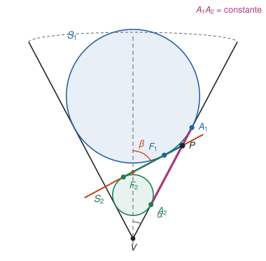
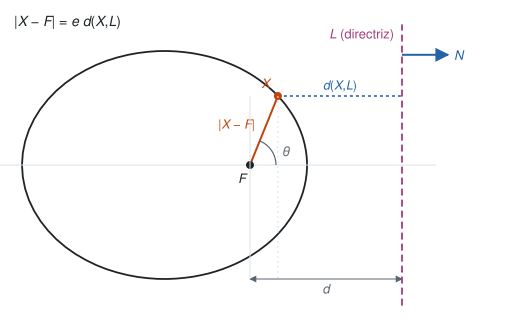
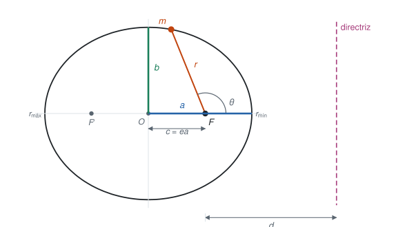
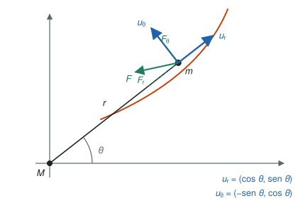
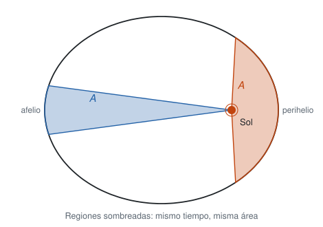

Esta sección sigue el §21 del Simmons y la sección 13.18 del Apostol (*Calculus*, vol. 1). El plan tiene dos partes. Primero se construye la geometría: la elipse como sección de un cono, con las esferas de Dandelin, y su ecuación en coordenadas polares. Después se llega a la misma ecuación desde la física, resolviendo una ecuación diferencial: la ley de gravitación de Newton y la conservación del momento angular dan la órbita, y de ella salen las tres leyes de Kepler.

Convenciones: un punto sobre una variable indica derivada respecto al tiempo, $\dot r=dr/dt$, y una prima indica derivada respecto al ángulo, $z'=dz/d\theta$. Cuando haga falta se escribe $dt$ o $d\theta$ de forma explícita.

## De esfera a planeta

Las cuentas de esta sección son la última etapa de una historia larga: la Tierra pasó de ser una esfera en el centro del cielo a ser un planeta más, y las cónicas de Apolonio resultaron ser las órbitas que dibujan esos planetas. El siguiente panel recorre siete autores, de Aristarco a Newton, y para cada uno responde tres preguntas: qué aportó sobre la Tierra redonda, sobre su rotación y sobre su condición de planeta.

```{=html}
<iframe src="linea-tiempo.html" width="100%" height="830" style="border:1px solid #dfe3e2; border-radius:6px;" title="Línea de tiempo: de esfera a planeta"></iframe>
```

## Las cónicas y las esferas de Dandelin

Sea $A$ una recta fija y $G$ una recta móvil que la corta en un punto $V$ y que forma con $A$ un ángulo constante $\alpha\in(0,\pi/2)$. La superficie que barre $G$ al girar alrededor de $A$ es un **cono** (doble): $G$ es la generatriz, $A$ el eje y $V$ el vértice. Las curvas que se obtienen al cortar el cono con un plano que no pasa por $V$ se llaman **cónicas**:

1. si el plano es paralelo a una generatriz, la curva es una **parábola**;
2. si no es paralelo a ninguna y corta una sola hoja del cono, es una **elipse**, y es un **círculo** cuando el plano es ortogonal al eje;
3. si corta las dos hojas, es una **hipérbola**.

La idea que sigue es de Dandelin (1822). Tomemos dos esferas $S_1$ y $S_2$ tangentes al cono y al plano de corte, una a cada lado del plano, y llamemos $F_1$ y $F_2$ a los puntos donde cada esfera toca el plano. Sea $P$ un punto de la elipse. La generatriz que pasa por $P$ y por el vértice corta a las circunferencias de tangencia de $S_1$ y $S_2$ con el cono en dos puntos $A_1$ y $A_2$.

{#fig-dandelin width=62%}

Los segmentos $PF_1$ y $PA_1$ son dos tangentes a la esfera $S_1$ desde un mismo punto exterior $P$, así que $|PF_1|=|PA_1|$. Lo mismo ocurre con $S_2$: $|PF_2|=|PA_2|$. Entonces

$$|PF_1|+|PF_2| = |PA_1|+|PA_2| = |A_1A_2|$$

y $|A_1A_2|$ no depende de $P$: es la distancia, medida sobre una generatriz, entre las dos circunferencias de tangencia, y por la simetría de revolución es la misma para todas las generatrices. La suma de las distancias a $F_1$ y $F_2$ es constante, que es precisamente la definición escolar de la elipse, con focos $F_1$ y $F_2$.

::: {.callout-note title="Simulador: cónicas y esferas de Dandelin"}
Mueva el deslizador de la excentricidad $e$ y vea cómo el plano rueda sobre la esfera inscrita en el cono. Con $e=0$ el plano es ortogonal al eje (círculo), con $0<e<1$ se tiene una elipse, con $e=1$ el plano es paralelo a una generatriz (parábola) y con $e>1$ corta las dos hojas (hipérbola). El panel muestra $PF_1+PF_2$ en la elipse y $|PF_1-PF_2|$ en la hipérbola, y también la directriz, que se define en la siguiente sección. Arrastre la imagen para girarla.

```{=html}
<iframe src="conicas-dandelin.html" width="100%" height="1010" style="border:1px solid #dfe3e2; border-radius:6px;" title="Simulador: cónicas y esferas de Dandelin"></iframe>
```
:::

## La directriz y la forma polar

Hay otra definición de las cónicas, que sirve también para la parábola y la hipérbola. Sea $L$ una recta, $F$ un punto fuera de $L$ y $e>0$ un número. El conjunto de todos los puntos $X$ que cumplen

$$|X-F| = e\,d(X,L)$$

es una cónica de **excentricidad** $e$: una elipse si $e<1$, una parábola si $e=1$ y una hipérbola si $e>1$. El punto $F$ es un foco y $L$ la **directriz**.

### La directriz en el cono

En la representación de Dandelin, $L$ es la intersección del plano de corte $\Pi$ con el plano $\Pi_1$ de la circunferencia de tangencia de $S_1$ con el cono, y $F=F_1$. Veamos que se cumple la relación y de paso quién es $e$. Sea $\beta$ el ángulo entre el plano $\Pi$ y el eje del cono. Para un punto $P$ de la curva:

1. $P$ y $A_1$ están en la misma generatriz, que forma el ángulo $\alpha$ con el eje, y $\Pi_1$ es ortogonal al eje y contiene a $A_1$. Entonces la distancia de $P$ al plano $\Pi_1$ vale $|PA_1|\cos\alpha$.
2. Como $P$ está en $\Pi$, esa misma distancia es $d(P,L)$ por el seno del ángulo diedro entre $\Pi$ y $\Pi_1$, que es $90^\circ-\beta$. Es decir, vale $d(P,L)\cos\beta$.

Igualando, y usando que $|PF_1|=|PA_1|$,

$$|PF_1| = \frac{\cos\beta}{\cos\alpha}\,d(P,L), \qquad e=\frac{\cos\beta}{\cos\alpha}$$

Con $\beta=90^\circ$ se tiene $e=0$ (círculo), con $\beta>\alpha$ se tiene $e<1$ (elipse), con $\beta=\alpha$ se tiene $e=1$ (parábola) y con $\beta<\alpha$ se tiene $e>1$ (hipérbola). El simulador de arriba calcula $\cos\beta/\cos\alpha$ y el cociente $|PF_1|/d(P,L)$, y los dos coinciden con $e$.

### La ecuación polar

Pongamos $F$ en el origen y sea $N=(1,0)$ el vector unitario normal a $L$, de modo que $L=\{X:\ X\cdot N=d\}$ con $d>0$. Entonces $d(X,L)=|d-X\cdot N|$ y la condición es $|X|=e\,|d-X\cdot N|$.

{#fig-directriz width=70%}

En coordenadas polares, $X=(r\cos\theta,\ r\sin\theta)$ y la relación queda $r=e\,|d-r\cos\theta|$. Si $X$ está del lado de $F$ respecto de $L$, el valor absoluto se quita sin cambiar el signo:

$$r=e\,(d-r\cos\theta)\quad\Longrightarrow\quad r\,(1+e\cos\theta)=ed\quad\Longrightarrow\quad r=\frac{ed}{1+e\cos\theta}$$

Si $X$ está del otro lado de $L$ (la otra rama de la hipérbola), $r=e\,(r\cos\theta-d)$ y se obtiene $r=ed/(e\cos\theta-1)$.

### La elipse en coordenadas cartesianas

Supongamos $e<1$. Con $r=ed-ex$ y $r^2=x^2+y^2$,

$$x^2+y^2=(ed-ex)^2 \quad\Longrightarrow\quad (1-e^2)\,x^2+2e^2d\,x+y^2=e^2d^2$$

Dividimos por $1-e^2$ y completamos el cuadrado en $x$:

$$\left(x+\frac{e^2d}{1-e^2}\right)^2+\frac{y^2}{1-e^2}=\frac{e^2d^2}{(1-e^2)^2}$$

Con $a=\dfrac{ed}{1-e^2}$ (es decir, $d=\dfrac{a(1-e^2)}{e}$), el centro queda en $x=-ea$ y la ecuación se reduce a

$$\frac{(x+ea)^2}{a^2}+\frac{y^2}{a^2(1-e^2)}=1$$

Es una elipse canónica de semieje mayor $a$ y semieje menor $b=a\sqrt{1-e^2}$, trasladada $-ea$ en $x$. Como $a^2-b^2=e^2a^2$, la distancia focal es $c=ea$ y $e=c/a$. La elipse pasa por $(-ea\pm a,\ 0)$ y por $(-ea,\ \pm b)$. El foco $F$ en el origen queda a la distancia $c$ del centro, y el otro foco simétrico respecto del centro.

{#fig-elipse width=75%}

::: {.callout-note title="Haciendo las cuentas con Maxima"}
```maxima
kill(all);

/* La relacion x^2+y^2 = (e*d - e*x)^2 equivale a la elipse canonica
   con a = e*d/(1-e^2): comparamos los dos lados multiplicados por (1-e^2) */
a: e*d/(1 - e^2);
izq: x^2 + y^2 - (e*d - e*x)^2;
der: (1 - e^2)*(((x + e*a)^2 + y^2/(1 - e^2)) - a^2);
ratsimp(izq - der);                   /* debe dar 0 */

/* Semieje menor y distancia focal */
b2: a^2*(1 - e^2);
ratsimp(a^2 - b2 - (e*a)^2);          /* debe dar 0: a^2 - b^2 = c^2 con c = e*a */
```
:::

## Velocidad y aceleración en coordenadas polares

Consideremos un cuerpo de masa $m$ que se mueve en un plano, con el Sol de masa $M$ en el origen. En cada punto de la trayectoria tomamos la base ortonormal

$$u_r=(\cos\theta,\ \sin\theta), \qquad u_\theta=(-\sin\theta,\ \cos\theta)$$

{#fig-polar width=60%}

Derivando respecto del ángulo, $u_r'=u_\theta$ y $u_\theta'=-u_r$. Con la regla de la cadena, $\dot u_r=\dfrac{d\theta}{dt}\dfrac{du_r}{d\theta}=\dot\theta\,u_\theta$ y $\dot u_\theta=-\dot\theta\,u_r$.

El vector de posición es $r\,u_r$, y su velocidad es

$$v=\frac{d}{dt}\left(r\,u_r\right)=\dot r\,u_r+r\dot\theta\,u_\theta$$

Derivando otra vez,

$$a=\ddot r\,u_r+\dot r\dot\theta\,u_\theta+\left(\dot r\dot\theta+r\ddot\theta\right)u_\theta-r\dot\theta^2\,u_r=\left(\ddot r-r\dot\theta^2\right)u_r+\left(r\ddot\theta+2\dot r\dot\theta\right)u_\theta$$

Si la fuerza es $F=F_r\,u_r+F_\theta\,u_\theta$, la segunda ley de Newton $F=ma$ da

$$F_r=m\left(\ddot r-r\dot\theta^2\right), \qquad F_\theta=m\left(r\ddot\theta+2\dot r\dot\theta\right)$$

## La segunda ley de Kepler

Estudiemos el caso de una fuerza central, la que apunta siempre hacia el Sol. Entonces $F_\theta=0$, es decir,

$$r\ddot\theta+2\dot r\dot\theta=0$$

Multiplicando por $r$ se reconoce una derivada exacta:

$$r^2\ddot\theta+2r\dot r\dot\theta=\frac{d}{dt}\left(r^2\dot\theta\right)=0 \quad\Longrightarrow\quad r^2\dot\theta=h$$

con $h$ constante (el momento angular por unidad de masa). Recordemos que el área barrida por el radio vector entre los ángulos $\theta_1$ y $\theta_2$ es $\tfrac12\int_{\theta_1}^{\theta_2} r^2\,d\theta$. Como $d\theta=\dot\theta\,dt$, entre los tiempos $t_1$ y $t_2$ es

$$A(t_1,t_2)=\frac12\int_{t_1}^{t_2} r^2\dot\theta\,dt=\frac12\int_{t_1}^{t_2} h\,dt=\frac12\,h\,(t_2-t_1)$$

::: {.callout-important title="Segunda ley de Kepler"}
El radio vector del Sol a un planeta barre áreas iguales en intervalos de tiempo iguales.
:::

{#fig-areas width=70%}

Note que solo se usó que la fuerza es central: la segunda ley vale para cualquier fuerza central, no solo para la gravedad.

## La primera ley de Kepler

Ahora usamos la ley de gravitación universal de Newton, $F=-\dfrac{GmM}{r^2}\,u_r$, con $G$ la constante gravitacional. La componente radial de $F=ma$ es

$$\ddot r-r\dot\theta^2=-\frac{k}{r^2}, \qquad k=GM \tag{*}$$

De $r^2\dot\theta=h$ se tiene $\dot\theta=h/r^2$, y entonces

$$\ddot r-\frac{h^2}{r^3}=-\frac{k}{r^2}$$

Es una ecuación de segundo orden no lineal, y ni la reducción de orden ni una solución por tanteo funcionan bien. La idea es cambiar de variables: tomar $\theta$ como variable independiente y $z=1/r$ como incógnita. Como $\dot\theta=h/r^2=hz^2$,

$$\dot r=\frac{d}{dt}\left(\frac1z\right)=-\frac{\dot z}{z^2}=-\frac1{z^2}\,\frac{dz}{d\theta}\,\frac{d\theta}{dt}=-\frac{1}{z^2}\,z'\,hz^2=-h\,z'$$

$$\ddot r=\frac{d}{dt}\left(-h\,z'\right)=-h\,z''\,\frac{d\theta}{dt}=-h^2z^2z''$$

Sustituyendo en $(\ast)$, con $r\dot\theta^2=h^2z^3$ y $k/r^2=kz^2$:

$$-h^2z^2z''-h^2z^3=-kz^2 \quad\Longrightarrow\quad z''+z=\frac{k}{h^2}$$

Es una ecuación lineal con coeficientes constantes, con solución general

$$z(\theta)=B\cos\theta+A\sin\theta+\frac{k}{h^2}$$

Elijamos el eje polar de modo que $\theta=0$ sea el punto de mayor $z$, es decir, el de menor $r$ (el perihelio). Allí $z'(0)=0$ y $z''(0)<0$, lo que da $A=0$ y $B>0$. Entonces

$$\frac1r=B\cos\theta+\frac{k}{h^2} \quad\Longrightarrow\quad r=\frac{h^2/k}{1+\dfrac{Bh^2}{k}\cos\theta}$$

Es exactamente la ecuación polar de una cónica, $r=ed/(1+e\cos\theta)$, con

$$ed=\frac{h^2}{k}, \qquad e=\frac{Bh^2}{k}, \qquad d=\frac1B$$

El Sol está en el foco, y la directriz queda a la distancia $d=1/B$ del Sol. Como los planetas siguen órbitas acotadas, $e<1$, es decir $0<B<k/h^2$.

::: {.callout-important title="Primera ley de Kepler"}
Los planetas se mueven en elipses con el Sol en uno de los focos.
:::

::: {.callout-note title="Haciendo las cuentas con Maxima"}
```maxima
kill(all);

/* La ecuacion lineal z'' + z = k/h^2 */
ode2('diff(z, th, 2) + z = k/h^2, z, th);   /* z = %k1*sin(th) + %k2*cos(th) + k/h^2 */

/* Verificamos que r = (h^2/k)/(1+e*cos(th)) cumple r'' - r*(theta')^2 = -k/r^2,
   donde theta' = h/r^2 y la derivada en t es (d/dtheta)*theta' */
p: h^2/k;
r: p/(1 + e*cos(th));
thd: h/r^2;
rd: diff(r, th)*thd;
rdd: diff(rd, th)*thd;
chequeo: rdd - r*thd^2 + k/r^2;
ratsimp(ratsubst(1 - cos(th)^2, sin(th)^2, ratsimp(chequeo)));   /* debe dar 0 */
```
:::

## Análisis de energía

La energía cinética es

$$E_C=\frac12 mv^2=\frac12 m\left(r^2\dot\theta^2+\dot r^2\right)$$

y la energía potencial gravitacional, tomando cero en el infinito, es

$$E_P=-\int_r^\infty \frac{km}{\rho^2}\,d\rho=-\frac{km}{r}$$

La energía total es $E=E_C+E_P$ y se conserva. Calculémosla en el perihelio, $\theta=0$. Allí $\dot r=-hz'(0)=0$, el radio es $r_{\min}=1/z_0$ y, por la ecuación de la órbita,

$$z_0=\frac{1+e}{h^2/k}=(1+e)\,\frac{k}{h^2}$$

Como $\dot\theta=hz^2$, se tiene $r^2\dot\theta^2=h^2z_0^2$ y

$$E=\frac12 m h^2z_0^2-km\,z_0=\frac{mk^2}{h^2}\left[\frac{(1+e)^2}{2}-(1+e)\right]=\frac{mk^2}{2h^2}\left(e^2-1\right)$$

Despejando la excentricidad,

$$e=\sqrt{1+\frac{2Eh^2}{mk^2}}$$

::: {.callout-important title="La energía decide el tipo de órbita"}
Según el signo de $E$, la órbita es una **elipse** ($E<0$, $e<1$), una **parábola** ($E=0$, $e=1$) o una **hipérbola** ($E>0$, $e>1$).
:::

Los planetas del Sistema Solar tienen energía negativa y se mueven en elipses, y los cuerpos que pasan por el sistema a gran velocidad tienen energía positiva y recorren hipérbolas. Que $E$ sea negativa no contradice nada: la energía cinética es siempre positiva, pero la potencial es negativa porque se tomó el cero en el infinito. Que $E<0$ significa que el cuerpo está ligado al Sol: no tiene energía suficiente para llegar al infinito. Una Tierra a la que se le diera un empujón que subiera su energía por encima de cero entraría en una hipérbola y dejaría el Sistema Solar para siempre.

## La tercera ley de Kepler

Restrinjamos la atención a la órbita elíptica. Los valores extremos de $r$ se alcanzan en $\theta=0$ y $\theta=\pi$:

$$r_{\min}=\frac{h^2}{k(1+e)}, \qquad r_{\max}=\frac{h^2}{k(1-e)}$$

En astronomía, el semieje mayor $a$ se llama la distancia media, porque es la mitad de la suma de estos dos valores:

$$a=\frac12\left(r_{\min}+r_{\max}\right)=\frac{h^2}{2k}\cdot\frac{(1-e)+(1+e)}{1-e^2}=\frac{h^2}{k\,(1-e^2)}$$

(geométricamente, $r_{\min}=a-c=a(1-e)$ y $r_{\max}=a+c=a(1+e)$, como en la @fig-elipse). Como $b^2=a^2(1-e^2)$, se tiene $1-e^2=b^2/a^2$ y la igualdad anterior queda $a=h^2a^2/(kb^2)$, es decir,

$$b^2=\frac{h^2}{k}\,a$$

Sea $T$ el periodo del planeta. El área de la elipse es $\pi ab$, y por la segunda ley es $\tfrac12 hT$ (la integral de $0$ a $T$ de $\tfrac12 h\,dt$). Entonces $\pi ab=\tfrac12 hT$ y

$$T^2=\frac{4\pi^2a^2b^2}{h^2}=\frac{4\pi^2a^2}{h^2}\cdot\frac{h^2}{k}\,a=\frac{4\pi^2}{k}\,a^3$$

::: {.callout-important title="Tercera ley de Kepler"}
El cuadrado del periodo de un planeta es proporcional al cubo de su distancia media al Sol: $T^2=\dfrac{4\pi^2}{k}\,a^3$.
:::

La constante $k=GM$ depende de la masa central y no de $m$, así que es la misma para todos los planetas. Midiendo $T$ en años y $a$ en unidades astronómicas (la distancia media de la Tierra al Sol), $k=4\pi^2$ y la ley queda $T^2=a^3$.

## Problema: la energía orbital

::: {.callout-tip title="Ejercicio (Simmons, §21, problema 4)"}
Demuestre que la rapidez $v$ de un planeta en cualquier punto de su órbita es

$$v^2=k\left(\frac2r-\frac1a\right)$$
:::

::: {.callout-tip title="Solución" collapse="true"}
Escribimos $p=h^2/k$, de modo que la órbita es $r=p/(1+e\cos\theta)$. Partimos de $v^2=r^2\dot\theta^2+\dot r^2$.

Del primer término, como $\dot\theta=h/r^2$, se tiene $r^2\dot\theta^2=h^2/r^2$.

Para el segundo, $\dot r=\dfrac{dr}{d\theta}\,\dot\theta=\dfrac{h}{r^2}\,\dfrac{dr}{d\theta}$, y derivando la órbita,

$$\frac{dr}{d\theta}=\frac{p\,e\sin\theta}{(1+e\cos\theta)^2}=\frac{r^2}{p}\,e\sin\theta \quad\Longrightarrow\quad \dot r=\frac hp\,e\sin\theta$$

De $r(1+e\cos\theta)=p$ se despeja $\cos\theta=(p/r-1)/e$, así que $e^2\sin^2\theta=e^2-(p/r-1)^2$ y

$$\dot r^2=\frac{h^2}{p^2}\left[e^2-\left(\frac pr-1\right)^2\right]=\frac{h^2}{p^2}\left(e^2-1+\frac{2p}{r}-\frac{p^2}{r^2}\right)$$

Sumando los dos términos, el $h^2/r^2$ se cancela con el que sale de $-h^2p^2/(p^2r^2)$:

$$v^2=\frac{h^2}{p^2}\left(e^2-1\right)+\frac{2h^2}{p\,r}$$

Ahora usamos $p=h^2/k$, de donde $h^2/p^2=k^2/h^2$ y $h^2/p=k$. Además, de $a=\dfrac{h^2}{k(1-e^2)}$ se tiene $1-e^2=\dfrac{h^2}{ka}$. Entonces

$$v^2=\frac{k^2}{h^2}\left(e^2-1\right)+\frac{2k}{r}=-\frac{k^2}{h^2}\cdot\frac{h^2}{ka}+\frac{2k}{r}=k\left(\frac2r-\frac1a\right)\qquad\blacksquare$$
:::

Esta fórmula es la energía orbital escrita en otra forma. Multiplicando por $m/2$ y pasando $km/r$ al lado izquierdo queda $\tfrac12 mv^2-\dfrac{km}{r}=-\dfrac{km}{2a}$, de modo que en una órbita elíptica la energía total depende solo del semieje mayor: $E=-\dfrac{km}{2a}$. Dos casos límite: en una órbita circular, $r=a$ y $v^2=k/a$; y la rapidez de escape, que corresponde a $a\to\infty$ ($E=0$), es $v^2=2k/r$.

::: {.callout-note title="Haciendo las cuentas con Maxima"}
```maxima
kill(all);

p: h^2/k;
r: p/(1 + e*cos(th));
thd: h/r^2;
rd: diff(r, th)*thd;
v2: r^2*thd^2 + rd^2;

/* Rapidez al cuadrado contra k*(2/r - 1/a), con a = p/(1-e^2) */
a: p/(1 - e^2);
chequeo: v2 - k*(2/r - 1/a);
ratsimp(ratsubst(1 - cos(th)^2, sin(th)^2, ratsimp(chequeo)));   /* debe dar 0 */

/* La energia total es una constante, E = m*k^2*(e^2-1)/(2*h^2) = -k*m/(2*a) */
E: m*v2/2 - k*m/r;
ratsimp(ratsubst(1 - cos(th)^2, sin(th)^2, ratsimp(E - m*k^2*(e^2 - 1)/(2*h^2))));   /* 0 */
ratsimp(E + k*m/(2*a));                                                               /* 0 */
```
:::

## Problema: la explosión de la Tierra

::: {.callout-tip title="Ejercicio (Simmons, §21, problema 5)"}
Suponga que la Tierra explota en fragmentos que salen con la misma rapidez en direcciones distintas, cada uno hacia una órbita propia. Use la tercera ley de Kepler y el resultado del problema anterior para demostrar que todos los fragmentos que no caen al Sol ni escapan del Sistema Solar se reúnen más tarde en el mismo punto donde empezaron a separarse.
:::

::: {.callout-tip title="Solución" collapse="true"}
Sea $r$ la distancia al Sol del punto de la explosión y $v$ la rapidez común de los fragmentos justo después. Por el problema anterior, cada fragmento cumple $v^2=k\,(2/r-1/a)$ con su propio semieje mayor $a$. Pero $r$ y $v$ son iguales para todos, así que despejando

$$\frac1a=\frac2r-\frac{v^2}{k} \quad\Longrightarrow\quad a=\frac{kr}{2k-v^2r}$$

es el **mismo $a$ para todos**, sin importar la dirección. Esto tiene sentido solo si $a>0$, es decir $v^2<2k/r$, la condición de energía negativa. Los fragmentos con $v^2\ge 2k/r$ tienen $E\ge0$, siguen una parábola o una hipérbola y se pierden.

Por la tercera ley,

$$T^2=\frac{4\pi^2}{k}\,a^3=\frac{4\pi^2k^2\,r^3}{(2k-v^2r)^3}$$

que depende de $r$ y de $v$ y no de la dirección: **todos los fragmentos tienen el mismo periodo $T$**. Cada uno parte del mismo punto con una órbita que se repite cada $T$, así que al cabo de un tiempo $T$ todos están de nuevo en el punto de partida, y se reúnen allí. Los que no vuelven son los que caen al Sol (los que salen casi en dirección radial y tienen su perihelio dentro del Sol) y los que escapan.

Para la Tierra, $r=1$ UA y $v=v_{\rm circ}=2\pi$ UA/año $\approx 29{,}8$ km/s dan $a=1$ y $T=1$ año: los fragmentos se reúnen un año después. La rapidez de escape es $\sqrt2\,v_{\rm circ}\approx 42{,}1$ km/s. Y si salen con la rapidez de la Tierra, un fragmento que sale con un ángulo $\varphi$ medido desde la dirección tangencial tiene $e=|\sin\varphi|$ y perihelio $1-|\sin\varphi|$ UA. Como el radio del Sol es $0{,}00465$ UA, el fragmento cae en el Sol si $|\sin\varphi|>0{,}99535$, es decir, si sale a menos de unos $5{,}5^\circ$ de la dirección radial.
:::

La demostración depende de que la rapidez sea exactamente la misma. Si las rapideces difieren, los semiejes difieren y también los periodos: como $T\propto a^{3/2}$ se tiene $dT/T=\tfrac32\,da/a$, y partiendo de una órbita circular ($r=a$), de $1/a=2/r-v^2/k$ sale $da/a=2\,dv/v$, así que

$$\frac{dT}{T}=3\,\frac{dv}{v}$$

Una diferencia de $1\,\%$ en la rapidez ($0{,}3$ km/s, alrededor de $1{,}031$ años de periodo en vez de $1$) separa el regreso de ese fragmento unos $11$ días, y a un año de la explosión estaría a unos $0{,}19$ UA, casi $30$ millones de kilómetros, del punto de partida.

::: {.callout-note title="Haciendo las cuentas con Maxima"}
```maxima
kill(all);

/* Unidades: UA y años, k = 4*pi^2. Explosion a r = 1 UA */
k: 4*%pi^2;
r0: 1;
semieje(v) := k*r0/(2*k - v^2*r0);
periodo(v) := sqrt(4*%pi^2/k*semieje(v)^3);

periodo(2*%pi);                       /* 1: la rapidez circular da T = 1 ano */
float(periodo(1.01*2*%pi));           /* aprox. 1.0309: 1% mas de rapidez, 3% mas de periodo */
float(sqrt(2*k/r0));                  /* rapidez de escape en UA/ano, aprox. 8.886 (42.1 km/s) */
```
:::

::: {.callout-note title="Simulador: la explosión de la Tierra"}
Los fragmentos salen del mismo punto, a 1 UA del Sol, con la misma rapidez y en direcciones repartidas en un abanico. Cada uno recorre su órbita kepleriana, calculada con la ecuación de Kepler, y el panel marca cuándo vuelven a reunirse. Algunas cosas para probar:

1. Con la rapidez de la Tierra (botón "Igual a la Tierra") todos los fragmentos regresan al punto de la explosión en $t=T=1$ año. La curva de abajo, que mide qué tan dispersos están, vuelve a cero en $t=1$, $2$ y $3$ años.
2. Con rapidez mayor (33 o 38 km/s) todos los fragmentos siguen teniendo el mismo $a$ y el mismo $T$, y se reúnen al cabo de ese nuevo periodo. Con 44 km/s, por encima del escape, ya no regresa ninguno.
3. Active la dispersión de rapideces: aunque sea de un $1\,\%$ el grupo deja de reunirse. Reduzca el abanico a unos grados alrededor de la dirección tangencial y vea cómo cambia la forma del grupo.

```{=html}
<iframe src="explosion.html" width="100%" height="1160" style="border:1px solid #dfe3e2; border-radius:6px;" title="Simulador: la explosión de la Tierra"></iframe>
```
:::
